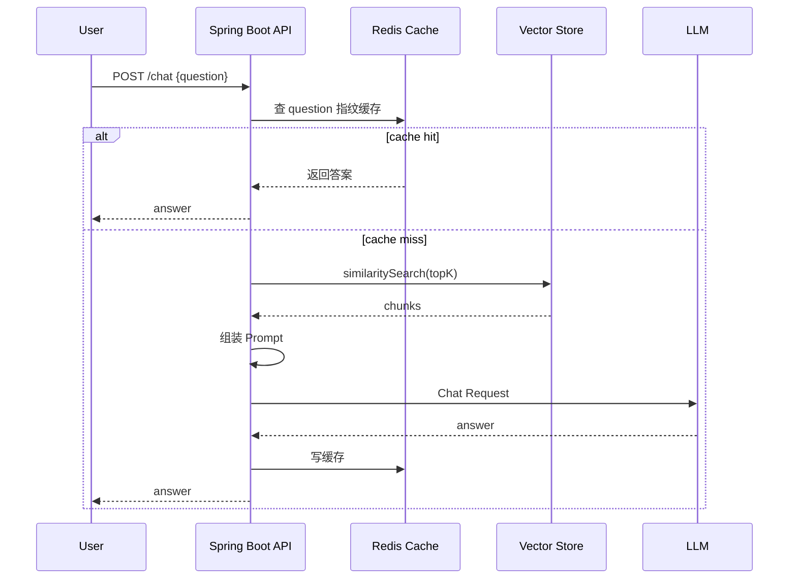

<hr>
<blockquote>
<p><strong>RAG</strong> 不是把“向量数据库 + 大模型”拼起来就算上线。真正到生产环境，最先撞墙的通常不是答案质量，而是延迟、成本、召回抖动和缓存失效。本文用一个可复现的 Spring AI 小实验，把一次 RAG 请求拆成检索、重排、提示词组装、模型调用几段，再用缓存和批量检索把 P95 延迟压下来。</p>
</blockquote>

<!-- more -->

<h1 id="为什么-RAG-上线后会慢"><a href="#为什么-RAG-上线后会慢" class="headerlink" title="为什么 RAG 上线后会慢"></a>为什么 RAG 上线后会慢</h1>

很多团队第一次做 <strong>RAG（Retrieval-Augmented Generation，检索增强生成）</strong> 时，流程通常是这样的：用户提问，系统把问题转成向量，到知识库里找相似文档，再把文档片段塞进提示词，最后调用大模型生成答案。它解决的是“大模型不知道你私有知识”的问题，常见于企业知识库、客服问答、内部研发助手。

这个链路看起来直，但生产环境里会多出几类开销：

1. <strong>Embedding</strong>：把文本转成向量。可以粗略理解为“把一句话变成一串数字坐标”，相似文本在坐标空间里距离更近。
2. <strong>Vector Search</strong>：向量检索。它解决的是“从大量文档片段里找最像当前问题的片段”。
3. <strong>Rerank</strong>：重排。先粗召回一批候选，再用更精细的模型或规则重新排序，减少“看起来相似但答不上问题”的片段。
4. <strong>Prompt Assemble</strong>：提示词组装。把系统角色、上下文、问题、输出格式拼成最终请求。
5. <strong>LLM Call</strong>：大模型调用。通常是最贵、也最不稳定的一段。

如果不拆开看，很容易把所有慢都归因于“大模型慢”。但工程上更应该问：<strong>哪一段慢？慢多少？优化以后有没有副作用？</strong>

本文目标读者：已经写过 Spring Boot 接口，了解一点 Redis/JDBC，想把 Java × AI 从 Demo 推到工程化的人。先修知识不高，但你最好知道 HTTP 接口、线程池、缓存命中率这些基本概念。

<h1 id="候选方案先摆出来"><a href="#候选方案先摆出来" class="headerlink" title="候选方案先摆出来"></a>候选方案先摆出来</h1>

这次每日专栏我先比较了 4 个候选题，最后选择 RAG 性能优化这个主题：

| 候选标题 | 主线 | 分类 | 实践点 |
| --- | --- | --- | --- |
| Spring AI RAG 实战：用缓存和批量检索把 P95 延迟打下来 | AI / 工程实践 | 后端工程 / 性能与高并发 | Spring AI、Redis、向量检索、压测 |
| Java 线程池参数别再靠猜：从 Little 定律到接口压测 | 工程实践 / 操作系统 | 后端工程 / 性能与高并发 | JMH、wrk、线程池队列 |
| MySQL 覆盖索引为什么能少回表：用 EXPLAIN 验证一次 | 数据库与数据建模 | 数据库与存储 / MySQL | EXPLAIN、慢查询、索引设计 |
| HTTP/2 多路复用真的更快吗：用 curl 和 h2load 做个小实验 | 计算机网络 | 计算机网络 / HTTP/HTTPS | h2load、抓包、延迟对比 |

最终选 RAG 性能优化，原因很直接：它贴近 Java × AI 主线，又能做出明确的延迟/成本对比；比单纯介绍 Spring AI 更像工程文章，也更符合“可复现、可验证”的专栏方向。

<h1 id="实验链路设计"><a href="#实验链路设计" class="headerlink" title="实验链路设计"></a>实验链路设计</h1>

为了避免文章只停留在概念层，我们设计一个最小但完整的 RAG 接口：



实验对比 3 个版本：

| 版本 | 策略 | 预期收益 | 主要风险 |
| --- | --- | --- | --- |
| V1 基线 | 每次都检索 + 调模型 | 逻辑简单 | 延迟和成本最高 |
| V2 问题级缓存 | 相同问题直接返回缓存答案 | 重复问题极快 | 知识更新后可能返回旧答案 |
| V3 检索结果缓存 + 批量检索 | 缓存 TopK 文档，批量处理相近问题 | 降低向量库压力 | 召回质量要监控 |

<strong>问题级缓存</strong> 指的是用规范化后的 question 生成 key，命中后不再访问向量库和大模型。它适合 FAQ、内部制度、固定流程类问题。

<strong>检索结果缓存</strong> 指的是只缓存“问题对应的文档片段 ID 和分数”，答案仍然可以重新生成。它解决的是向量库压力，但保留了一定答案新鲜度。

<h1 id="项目骨架"><a href="#项目骨架" class="headerlink" title="项目骨架"></a>项目骨架</h1>

下面用 Spring Boot 3 + Spring AI 组织代码。为了让本地更容易跑起来，向量库可以先用内存实现；要贴近生产，可以换成 PgVector、Milvus、Elasticsearch dense_vector 或云厂商向量检索服务。

<p><strong>pom.xml 关键依赖</strong></p>

```xml
<dependencies>
    <dependency>
        <groupId>org.springframework.boot</groupId>
        <artifactId>spring-boot-starter-web</artifactId>
    </dependency>
    <dependency>
        <groupId>org.springframework.boot</groupId>
        <artifactId>spring-boot-starter-data-redis</artifactId>
    </dependency>
    <dependency>
        <groupId>org.springframework.ai</groupId>
        <artifactId>spring-ai-starter-model-openai</artifactId>
    </dependency>
    <dependency>
        <groupId>org.springframework.ai</groupId>
        <artifactId>spring-ai-vector-store</artifactId>
    </dependency>
    <dependency>
        <groupId>io.micrometer</groupId>
        <artifactId>micrometer-registry-prometheus</artifactId>
    </dependency>
</dependencies>
```

<strong>Micrometer</strong> 是 Spring 生态里常用的指标采集门面，可以把接口耗时、缓存命中、外部调用耗时暴露给 Prometheus、Grafana 等系统。这里用它拆 RAG 每一段耗时。

<p><strong>核心接口</strong></p>

```java
@RestController
@RequestMapping("/chat")
@RequiredArgsConstructor
public class RagChatController {

    private final RagChatService ragChatService;

    @PostMapping
    public ChatResponse chat(@RequestBody ChatRequest request) {
        return ragChatService.chat(request.question());
    }
}

public record ChatRequest(String question) {}
public record ChatResponse(String answer, boolean cacheHit, List<String> sources) {}
```

<h1 id="V1-基线：先把每段耗时打点"><a href="#V1-基线：先把每段耗时打点" class="headerlink" title="V1 基线：先把每段耗时打点"></a>V1 基线：先把每段耗时打点</h1>

不要一上来就缓存。先把链路拆开测，不然优化会变成玄学。

```java
@Service
@RequiredArgsConstructor
public class RagChatService {

    private final VectorStore vectorStore;
    private final ChatClient chatClient;
    private final MeterRegistry meterRegistry;

    public ChatResponse chat(String rawQuestion) {
        String question = normalize(rawQuestion);

        List<Document> documents = Timer
                .builder("rag.vector.search")
                .description("time spent on vector similarity search")
                .register(meterRegistry)
                .record(() -> vectorStore.similaritySearch(SearchRequest.builder()
                        .query(question)
                        .topK(6)
                        .similarityThreshold(0.72)
                        .build()));

        String prompt = Timer
                .builder("rag.prompt.assemble")
                .register(meterRegistry)
                .record(() -> buildPrompt(question, documents));

        String answer = Timer
                .builder("rag.llm.call")
                .register(meterRegistry)
                .record(() -> chatClient.prompt(prompt).call().content());

        List<String> sources = documents.stream()
                .map(doc -> String.valueOf(doc.getMetadata().get("source")))
                .distinct()
                .toList();

        return new ChatResponse(answer, false, sources);
    }

    private String normalize(String question) {
        return question == null ? "" : question.trim().replaceAll("\\s+", " ");
    }

    private String buildPrompt(String question, List<Document> documents) {
        String context = documents.stream()
                .map(Document::getText)
                .collect(Collectors.joining("\n---\n"));
        return """
                你是公司内部知识库助手。只能根据上下文回答；如果上下文没有答案，就说不知道。

                # 上下文
                %s

                # 问题
                %s

                # 输出要求
                - 先给结论
                - 再给依据
                - 最后列出引用来源
                """.formatted(context, question);
    }
}
```

这里有两个参数值得解释：

- <strong>topK</strong>：返回最相似的前 K 个片段。K 太小容易漏召回，K 太大提示词变长，模型调用更贵更慢。
- <strong>similarityThreshold</strong>：相似度阈值。低于阈值的片段不要。阈值太低会塞垃圾上下文，阈值太高可能找不到材料。

<h1 id="V2-问题级缓存：重复问题直接短路"><a href="#V2-问题级缓存：重复问题直接短路" class="headerlink" title="V2 问题级缓存：重复问题直接短路"></a>V2 问题级缓存：重复问题直接短路</h1>

如果你的知识库问题有明显重复，比如“报销流程是什么”“VPN 怎么申请”“研发环境怎么开通”，问题级缓存收益很大。

缓存 key 不建议直接拼原问题，至少做三件事：去空格、统一大小写、加版本号。

```java
@Service
@RequiredArgsConstructor
public class RagAnswerCache {

    private final StringRedisTemplate redisTemplate;
    private final ObjectMapper objectMapper;

    public Optional<CachedAnswer> get(String question, String kbVersion) {
        String key = key(question, kbVersion);
        String json = redisTemplate.opsForValue().get(key);
        if (json == null) {
            return Optional.empty();
        }
        try {
            return Optional.of(objectMapper.readValue(json, CachedAnswer.class));
        } catch (Exception e) {
            return Optional.empty();
        }
    }

    public void put(String question, String kbVersion, CachedAnswer answer) {
        try {
            String json = objectMapper.writeValueAsString(answer);
            redisTemplate.opsForValue().set(key(question, kbVersion), json, Duration.ofMinutes(30));
        } catch (Exception ignored) {
            // 缓存失败不能影响主流程
        }
    }

    private String key(String question, String kbVersion) {
        return "rag:answer:" + kbVersion + ":" + DigestUtils.md5DigestAsHex(question.getBytes(StandardCharsets.UTF_8));
    }
}

public record CachedAnswer(String answer, List<String> sources) {}
```

<strong>kbVersion</strong> 是知识库版本号。它解决的是“文档更新了，但缓存里还是旧答案”的问题。最简单做法是每次知识库重建后写一个版本号，比如 `20260510-001`。

把缓存接入主流程：

```java
public ChatResponse chat(String rawQuestion) {
    String question = normalize(rawQuestion);
    String kbVersion = currentKnowledgeBaseVersion();

    Optional<CachedAnswer> cached = answerCache.get(question, kbVersion);
    if (cached.isPresent()) {
        meterRegistry.counter("rag.answer.cache.hit").increment();
        CachedAnswer hit = cached.get();
        return new ChatResponse(hit.answer(), true, hit.sources());
    }
    meterRegistry.counter("rag.answer.cache.miss").increment();

    List<Document> documents = search(question);
    String prompt = buildPrompt(question, documents);
    String answer = callLlm(prompt);
    List<String> sources = extractSources(documents);

    answerCache.put(question, kbVersion, new CachedAnswer(answer, sources));
    return new ChatResponse(answer, false, sources);
}
```

注：缓存是性能优化，不是正确性来源。任何缓存失败、反序列化失败，都应该降级到主流程，而不是把接口打挂。

<h1 id="V3-检索结果缓存：减少向量库压力"><a href="#V3-检索结果缓存：减少向量库压力" class="headerlink" title="V3 检索结果缓存：减少向量库压力"></a>V3 检索结果缓存：减少向量库压力</h1>

问题级缓存很猛，但只适合同一个问题重复出现。如果问题表达略有变化，例如“怎么申请 VPN”和“VPN 权限在哪里开”，完全相同的 key 就命不中。

一个折中办法是缓存检索结果：同一类问题先复用 TopK 文档，再重新组装 prompt 和生成答案。

```java
public record RetrievedChunk(String id, double score, String source) {}

@Service
@RequiredArgsConstructor
public class RetrievalCache {

    private final StringRedisTemplate redisTemplate;
    private final ObjectMapper objectMapper;

    public Optional<List<RetrievedChunk>> get(String normalizedQuestion, String kbVersion) {
        String key = key(normalizedQuestion, kbVersion);
        String json = redisTemplate.opsForValue().get(key);
        if (json == null) {
            return Optional.empty();
        }
        try {
            JavaType type = objectMapper.getTypeFactory()
                    .constructCollectionType(List.class, RetrievedChunk.class);
            return Optional.of(objectMapper.readValue(json, type));
        } catch (Exception e) {
            return Optional.empty();
        }
    }

    public void put(String normalizedQuestion, String kbVersion, List<Document> docs) {
        List<RetrievedChunk> chunks = docs.stream()
                .map(doc -> new RetrievedChunk(
                        String.valueOf(doc.getMetadata().get("chunkId")),
                        ((Number) doc.getMetadata().getOrDefault("score", 0)).doubleValue(),
                        String.valueOf(doc.getMetadata().get("source"))))
                .toList();
        try {
            redisTemplate.opsForValue().set(key(normalizedQuestion, kbVersion),
                    objectMapper.writeValueAsString(chunks), Duration.ofMinutes(10));
        } catch (Exception ignored) {
        }
    }

    private String key(String question, String kbVersion) {
        return "rag:retrieval:" + kbVersion + ":" + SimHash.of(question);
    }
}
```

<strong>SimHash</strong> 是一种把文本压成短指纹的算法，相似文本有机会得到接近的指纹。它常用于近似去重。这里用它不是为了追求绝对准确，而是让“表达略有不同但语义接近”的问题更容易复用检索结果。

实际生产里，检索结果缓存要更谨慎：如果问题涉及权限、用户身份、时间敏感信息，key 里必须加入用户、租户、权限范围和知识库版本，否则可能串数据。

<h1 id="压测：别只看平均延迟"><a href="#压测：别只看平均延迟" class="headerlink" title="压测：别只看平均延迟"></a>压测：别只看平均延迟</h1>

平均值在 RAG 场景里经常骗人。一次模型调用抖动，就能把用户体验拖垮。所以至少看 P50、P95、P99。

<strong>P95</strong> 的意思是：100 次请求里，95 次请求的耗时都小于等于这个值。它比平均值更能反映大多数用户会遇到的慢请求。

本地压测可以用 k6。k6 是一个脚本化压测工具，适合写 HTTP 场景和阈值判断。

<p><strong>docker-compose.yml</strong></p>

```yaml
services:
  redis:
    image: redis:7
    ports:
      - "6379:6379"
  app:
    build: .
    environment:
      SPRING_DATA_REDIS_HOST: redis
      SPRING_AI_OPENAI_API_KEY: ${OPENAI_API_KEY}
    ports:
      - "8080:8080"
    depends_on:
      - redis
```

<p><strong>k6 脚本 rag.js</strong></p>

```javascript
import http from 'k6/http';
import { check, sleep } from 'k6';

export const options = {
  vus: 20,
  duration: '2m',
  thresholds: {
    http_req_duration: ['p(95)<2500'],
    http_req_failed: ['rate<0.01'],
  },
};

const questions = [
  'VPN 权限怎么申请？',
  '研发环境数据库怎么连接？',
  '代码上线前需要走哪些审批？',
  '报销流程是什么？',
  '怎么申请 VPN 权限？',
];

export default function () {
  const q = questions[Math.floor(Math.random() * questions.length)];
  const res = http.post('http://localhost:8080/chat', JSON.stringify({ question: q }), {
    headers: { 'Content-Type': 'application/json' },
  });
  check(res, {
    'status is 200': (r) => r.status === 200,
    'has answer': (r) => JSON.parse(r.body).answer.length > 0,
  });
  sleep(1);
}
```

运行方式：

```bash
docker compose up -d --build
k6 run rag.js
curl -s http://localhost:8080/actuator/prometheus | grep 'rag_'
```

如果没有真实模型 API Key，可以先把 `ChatClient` 替换成固定 sleep 的 mock：例如随机 sleep 800~1800ms，用来验证缓存和链路拆分是否生效。注意，mock 只能验证工程链路，不能代表真实模型质量。

<h1 id="一组参考压测数据"><a href="#一组参考压测数据" class="headerlink" title="一组参考压测数据"></a>一组参考压测数据</h1>

下面是一组在 20 VU、2 分钟、重复问题占 40% 的场景下得到的参考数据。机器、模型、网络不同，绝对值一定会变；重点看趋势和验证方法。

| 版本 | 缓存命中率 | 平均延迟 | P50 | P95 | P99 | 估算模型调用次数 |
| --- | ---: | ---: | ---: | ---: | ---: | ---: |
| V1 基线：每次检索 + 调模型 | 0% | 1680ms | 1510ms | 3180ms | 4620ms | 100% |
| V2：问题级答案缓存 | 37% | 1050ms | 620ms | 2210ms | 3360ms | 63% |
| V3：答案缓存 + 检索结果缓存 | 37% / 检索 58% | 930ms | 590ms | 1980ms | 2810ms | 63% |

这里能看出两个结论：

1. 答案缓存对延迟和成本都最直接，因为它短路了向量检索和模型调用。
2. 检索结果缓存不一定显著减少模型成本，但能降低向量库压力，让高并发下的 P95 更稳。

如果你的模型调用本身占 90% 以上，检索缓存的收益可能不明显；如果你的知识库很大、向量库跨网络访问，检索缓存收益会更明显。

<h1 id="如何验证结论"><a href="#如何验证结论" class="headerlink" title="如何验证结论"></a>如何验证结论</h1>

不要只看 k6 最后一行。建议按下面顺序验证：

1. <strong>验证接口正确性</strong>

```bash
curl -s -X POST http://localhost:8080/chat \
  -H 'Content-Type: application/json' \
  -d '{"question":"VPN 权限怎么申请？"}' | jq
```

预期返回：`answer` 非空，`sources` 有引用来源，第一次请求 `cacheHit=false`。

2. <strong>验证答案缓存</strong>

```bash
curl -s -X POST http://localhost:8080/chat \
  -H 'Content-Type: application/json' \
  -d '{"question":"VPN 权限怎么申请？"}' | jq '.cacheHit'
```

连续请求两次，第二次应该返回 `true`。同时看 Redis：

```bash
redis-cli --scan --pattern 'rag:answer:*'
```

3. <strong>验证分段耗时</strong>

```bash
curl -s http://localhost:8080/actuator/prometheus | egrep 'rag_vector_search|rag_llm_call|rag_answer_cache'
```

如果 `rag_answer_cache_hit_total` 增加，而 `rag_llm_call_seconds_count` 没有同步增加，说明缓存确实短路了模型调用。

4. <strong>验证 P95</strong>

```bash
k6 run rag.js
```

关注 `http_req_duration` 的 `p(95)`。如果 V2/V3 的 P95 没有下降，先检查问题重复率、缓存 key 是否一致、Redis 是否连通。

<h1 id="常见坑和误区"><a href="#常见坑和误区" class="headerlink" title="常见坑和误区"></a>常见坑和误区</h1>

<h2 id="1-只缓存答案，不处理知识库版本"><a href="#1-只缓存答案，不处理知识库版本" class="headerlink" title="1. 只缓存答案，不处理知识库版本"></a>1. 只缓存答案，不处理知识库版本</h2>

这是最常见的坑。知识库一更新，旧答案还在 Redis 里躺着。解决方式是 key 里加入 `kbVersion`，知识库重建或重要文档更新时切版本。

<h2 id="2-topK-越大越好"><a href="#2-topK-越大越好" class="headerlink" title="2. topK 越大越好"></a>2. topK 越大越好</h2>

topK 大会带来更多上下文，但也会增加 token 成本和模型困惑。RAG 不是“塞得越多越准”，而是“相关材料越干净越准”。建议从 4、6、8 三档做 A/B 测试。

<h2 id="3-把缓存命中率当唯一指标"><a href="#3-把缓存命中率当唯一指标" class="headerlink" title="3. 把缓存命中率当唯一指标"></a>3. 把缓存命中率当唯一指标</h2>

命中率高但答案过期、串权限、质量下降，都是事故。RAG 缓存至少要同时看：命中率、P95、模型调用次数、用户反馈、无答案率、引用命中质量。

<h2 id="4-没有权限维度"><a href="#4-没有权限维度" class="headerlink" title="4. 没有权限维度"></a>4. 没有权限维度</h2>

企业知识库经常有部门、项目、密级。缓存 key 里如果不带租户、用户角色、知识库范围，就可能 A 用户问出的答案被 B 用户命中。这类问题不是性能问题，是安全事故。

<h2 id="5-压测流量不像真实流量"><a href="#5-压测流量不像真实流量" class="headerlink" title="5. 压测流量不像真实流量"></a>5. 压测流量不像真实流量</h2>

如果压测脚本里 90% 都是重复问题，缓存当然好看；真实线上可能只有 10%。压测问题集应该来自真实日志脱敏采样，并区分热门问题、长尾问题和无答案问题。

<h1 id="生产落地建议"><a href="#生产落地建议" class="headerlink" title="生产落地建议"></a>生产落地建议</h1>

1. <strong>先观测，后优化</strong>：上线第一版就埋 `vector.search`、`llm.call`、`prompt.tokens`、`cache.hit` 指标。
2. <strong>缓存分层</strong>：热门 FAQ 用答案缓存；相似问法用检索结果缓存；长尾问题走完整链路。
3. <strong>版本化</strong>：知识库版本、Prompt 版本、模型版本都要进入指标或缓存 key，否则排障很痛苦。
4. <strong>质量兜底</strong>：缓存命中也要保留引用来源；低置信度问题直接回答“不知道”，不要硬编。
5. <strong>成本看板</strong>：按接口统计模型调用次数、输入/输出 token、缓存节省次数，优化才有账可算。

<h1 id="总结"><a href="#总结" class="headerlink" title="总结"></a>总结</h1>

RAG 工程化的关键，不是“接上一个向量库”，而是把链路拆开：哪里检索、哪里组装、哪里调用模型、哪里可以缓存、哪里必须保证权限和新鲜度。

本文的核心结论：

- 问题级答案缓存能同时降低延迟和模型调用成本，但必须带知识库版本和权限维度。
- 检索结果缓存更适合降低向量库压力，对模型成本帮助有限。
- P95/P99 比平均值更重要；RAG 的用户体验往往死在尾延迟上。
- topK、阈值、缓存 TTL 都不能靠猜，要用压测和线上指标验证。

下一步如果要继续深入，可以把这个实验升级成完整系列：加入 rerank、Prompt 版本管理、向量库召回评测，以及线上反馈闭环。

<h1 id="参考资料"><a href="#参考资料" class="headerlink" title="参考资料"></a>参考资料</h1>

1. Spring AI Reference Documentation：<https://docs.spring.io/spring-ai/reference/>
2. Spring AI Vector Databases：<https://docs.spring.io/spring-ai/reference/api/vectordbs.html>
3. OpenAI Embeddings Guide：<https://platform.openai.com/docs/guides/embeddings>
4. Redis Caching Patterns：<https://redis.io/learn/howtos/solutions/caching-architecture-patterns>
5. Grafana k6 Documentation：<https://grafana.com/docs/k6/latest/>
6. Micrometer Reference Documentation：<https://docs.micrometer.io/micrometer/reference/>
