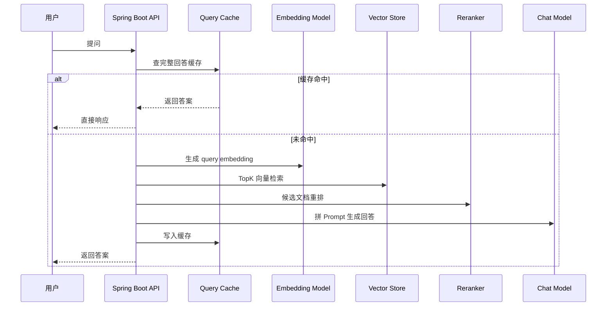

<hr>
<blockquote>
<p>RAG 系统上线后，最容易被低估的不是“能不能回答”，而是“高峰期能不能稳定、便宜、可解释地回答”。这篇用一个可复现的 Spring Boot + Spring AI 小实验，把向量检索、重排、缓存和压测串起来，看清楚 P95 延迟到底花在了哪里。</p>
</blockquote>

<!-- more -->

<h1 id="这篇文章解决什么问题"><a href="#这篇文章解决什么问题" class="headerlink" title="这篇文章解决什么问题"></a>这篇文章解决什么问题</h1>

很多团队第一次做 RAG，路线通常是这样的：先把文档切块，写入向量库，用户提问时做一次相似度检索，再把 TopK 文档塞进大模型上下文。Demo 很快能跑起来，但一上压测就会遇到三个很现实的问题：

1. **延迟抖动大**：平均耗时看起来还行，P95/P99 却很难看。
2. **成本不可控**：相似问题每次都调用 Embedding 和 Chat Model，钱烧得很安静。
3. **效果不稳定**：TopK 召回有噪声，相关文档没排到前面，回答就容易飘。

这篇文章不讲“RAG 是什么”的泛泛科普，而是用 Java 视角做一次工程化拆解：如何用 **Spring AI** 搭一个最小可跑的 RAG 服务，再通过 **查询缓存、Embedding 缓存、候选重排、压测与 Profiling** 找到性能瓶颈。

> **Spring AI**：Spring 官方的 AI 应用开发框架，可以把大模型调用、Embedding、向量库、Prompt 组装这些能力包装成 Spring 风格的 Bean，适合 Java/Spring 团队接入。
>
> **RAG（Retrieval-Augmented Generation）**：检索增强生成，简单说就是“先从自己的知识库里找资料，再让大模型基于资料回答”，用来降低幻觉、接入私有知识。
>
> **P95/P99**：百分位延迟。P95=95% 的请求都能在这个时间内完成，比平均值更能说明用户真实体验。

<h1 id="目标读者与先修知识"><a href="#目标读者与先修知识" class="headerlink" title="目标读者与先修知识"></a>目标读者与先修知识</h1>

适合这几类读者：

- 做过 Spring Boot 接口开发，想把 RAG 做到可上线程度的 Java 工程师；
- 已经跑通 AI Demo，但不知道怎么做性能优化和验证的同学；
- 关心模型调用成本、延迟、缓存命中率、可观测性的后端同学。

默认你知道 HTTP 接口、Spring Bean、基本 Docker 命令。如果不了解向量数据库也没关系，下面会先解释。

<h1 id="一个可落地的-RAG-请求链路"><a href="#一个可落地的-RAG-请求链路" class="headerlink" title="一个可落地的 RAG 请求链路"></a>一个可落地的 RAG 请求链路</h1>

先看一条普通 RAG 请求大概会经过哪些步骤：



这里有几个第一次出现的词，先用人话解释一下：

- **Embedding**：把文本变成一串数字向量。语义越接近的文本，向量距离越近，方便机器做“相似内容搜索”。
- **向量库（Vector Store）**：专门存向量并支持相似度检索的数据库，比如 Redis Vector、pgvector、Milvus、Elasticsearch dense vector。
- **TopK**：检索时返回最相似的 K 条候选文档，比如 TopK=8 就是先拿 8 段资料。
- **Reranker（重排器）**：二次排序模型或规则。它不负责海量召回，而是把 TopK 候选重新按“和问题真正相关”的程度排一遍。
- **Query Cache**：以用户问题、租户、知识库版本等为 Key，缓存最终回答或中间结果。

<h1 id="实验环境与项目结构"><a href="#实验环境与项目结构" class="headerlink" title="实验环境与项目结构"></a>实验环境与项目结构</h1>

为了让实验能被复现，本文用一个最小 Spring Boot 项目模拟线上链路。向量库用 Redis Stack，模型调用可以接 OpenAI 兼容接口，也可以先用 Mock 模型跑压测。

推荐环境：

| 组件 | 版本建议 | 说明 |
| --- | --- | --- |
| JDK | 21 | 虚拟线程和新版 GC/JFR 支持更好 |
| Spring Boot | 3.3+ | 和 Spring AI 生态兼容更顺 |
| Spring AI | 1.0.x | 以官方当前稳定文档为准 |
| Redis Stack | 7.2+ | 用 RediSearch 做向量索引 |
| wrk | 4.x | HTTP 压测工具 |
| async-profiler | 3.x | Java 火焰图采集工具 |

项目结构建议：

```text
rag-latency-demo/
├── docker-compose.yml
├── pom.xml
├── src/main/java/com/example/rag/
│   ├── RagApplication.java
│   ├── api/AskController.java
│   ├── service/RagService.java
│   ├── service/RerankService.java
│   ├── cache/QueryCache.java
│   └── ingest/IngestRunner.java
└── src/main/resources/
    ├── application.yml
    └── docs/java-performance.md
```

<h1 id="第一步：启动向量库"><a href="#第一步：启动向量库" class="headerlink" title="第一步：启动向量库"></a>第一步：启动向量库</h1>

`docker-compose.yml`：

```yaml
services:
  redis-stack:
    image: redis/redis-stack:7.2.0-v10
    ports:
      - "6379:6379"
      - "8001:8001"
```

启动：

```bash
docker compose up -d
redis-cli ping
```

能看到 `PONG` 就说明 Redis 可用。

> **Redis Stack**：Redis 的增强发行版，除了普通 KV，还带搜索、JSON、向量检索等模块。这里用它是因为部署简单，适合做本地实验。

<h1 id="第二步：实现一个最小-RAG-接口"><a href="#第二步：实现一个最小-RAG-接口" class="headerlink" title="第二步：实现一个最小 RAG 接口"></a>第二步：实现一个最小 RAG 接口</h1>

下面是核心代码的简化版，重点不是 API 名字，而是链路结构。不同 Spring AI 版本的类名可能略有差异，实际以官方文档为准。

```java
@RestController
@RequestMapping("/api/rag")
public class AskController {

    private final RagService ragService;

    public AskController(RagService ragService) {
        this.ragService = ragService;
    }

    @GetMapping("/ask")
    public Answer ask(@RequestParam String q) {
        return ragService.ask(q, "kb-java", "v1");
    }
}
```

`RagService`：

```java
@Service
public class RagService {

    private final QueryCache queryCache;
    private final EmbeddingModel embeddingModel;
    private final VectorStore vectorStore;
    private final RerankService rerankService;
    private final ChatClient chatClient;

    public Answer ask(String question, String knowledgeBase, String version) {
        String cacheKey = QueryCache.key(knowledgeBase, version, normalize(question));

        Answer cached = queryCache.get(cacheKey);
        if (cached != null) {
            return cached.withSource("query-cache");
        }

        List<Document> candidates = vectorStore.similaritySearch(
                SearchRequest.query(question).withTopK(12).withSimilarityThreshold(0.72)
        );

        List<Document> topDocs = rerankService.rerank(question, candidates).stream()
                .limit(5)
                .toList();

        String context = topDocs.stream()
                .map(Document::getContent)
                .collect(Collectors.joining("\n---\n"));

        String content = chatClient.prompt()
                .user(u -> u.text("""
                        你是 Java 后端助手。只基于【资料】回答问题。
                        如果资料不足，明确说不知道，不要编。

                        【问题】
                        {question}

                        【资料】
                        {context}
                        """).param("question", question).param("context", context))
                .call()
                .content();

        Answer answer = new Answer(content, topDocs.stream().map(Document::getId).toList(), "llm");
        queryCache.put(cacheKey, answer, Duration.ofMinutes(30));
        return answer;
    }

    private String normalize(String s) {
        return s == null ? "" : s.trim().replaceAll("\\s+", " ").toLowerCase(Locale.ROOT);
    }
}
```

这里有两个工程上很关键的细节：

1. 缓存 Key 不能只用 question，还要带上 **知识库 ID** 和 **知识库版本**。否则文档更新后，用户可能拿到旧答案。
2. Prompt 里要明确“资料不足就说不知道”。这不能彻底消除幻觉，但能降低模型乱补细节的概率。

<h1 id="第三步：候选重排，不要盲目信任-TopK"><a href="#第三步：候选重排，不要盲目信任-TopK" class="headerlink" title="第三步：候选重排，不要盲目信任 TopK"></a>第三步：候选重排，不要盲目信任 TopK</h1>

向量检索擅长“粗召回”，但它并不总能把最相关的文档排第一。比如用户问：

```text
G1 GC mixed collection 为什么会导致接口 P99 抖动？
```

向量检索可能召回很多包含 “G1”、“GC”、“接口” 的文档，但真正有用的是解释 Mixed GC、Remembered Set、暂停时间的那几段。

如果暂时不接专门的 rerank 模型，可以先做一个轻量规则重排：

```java
@Service
public class RerankService {

    public List<Document> rerank(String question, List<Document> docs) {
        Set<String> terms = tokenize(question);

        return docs.stream()
                .sorted(Comparator.comparingDouble((Document d) -> score(terms, d)).reversed())
                .toList();
    }

    private double score(Set<String> terms, Document doc) {
        String text = doc.getContent().toLowerCase(Locale.ROOT);
        long hit = terms.stream().filter(text::contains).count();

        double vectorScore = Optional.ofNullable(doc.getMetadata().get("score"))
                .map(Object::toString)
                .map(Double::parseDouble)
                .orElse(0.0);

        return vectorScore * 0.75 + hit * 0.25;
    }

    private Set<String> tokenize(String question) {
        return Arrays.stream(question.toLowerCase(Locale.ROOT).split("[\\s,，。？?]+"))
                .filter(s -> s.length() >= 2)
                .collect(Collectors.toSet());
    }
}
```

这不是最终答案，但足够说明一点：**召回和排序是两件事**。线上系统可以逐步升级为：

- 小流量：规则重排，便宜、可解释；
- 中等流量：本地 cross-encoder 重排，延迟可控；
- 高价值问题：调用商业 rerank 模型，效果更好但成本更高。

> **cross-encoder**：一种把“问题 + 候选文档”一起喂给模型打分的重排方式。它通常比单纯向量相似度更准，但每个候选都要算一次，延迟更高。

<h1 id="第四步：压测，别只看平均值"><a href="#第四步：压测，别只看平均值" class="headerlink" title="第四步：压测，别只看平均值"></a>第四步：压测，别只看平均值</h1>

压测前准备一个问题文件 `questions.txt`：

```text
JVM G1 GC 的 mixed collection 是什么？
Spring Boot 接口 P95 延迟升高怎么排查？
Redis 连接池耗尽有哪些表现？
RAG 为什么需要 rerank？
Java 虚拟线程适合 IO 密集接口吗？
```

用 `wrk` 压一个简单场景：

```bash
wrk -t4 -c32 -d60s 'http://localhost:8080/api/rag/ask?q=JVM%20G1%20GC%20mixed%20collection%20是什么'
```

再压一个缓存命中场景：

```bash
# 先预热，让 query cache 命中
for i in {1..20}; do
  curl -s 'http://localhost:8080/api/rag/ask?q=JVM%20G1%20GC%20mixed%20collection%20是什么' > /dev/null
done

wrk -t4 -c64 -d60s 'http://localhost:8080/api/rag/ask?q=JVM%20G1%20GC%20mixed%20collection%20是什么'
```

如果希望更接近真实流量，可以写一个 Lua 脚本随机问题：

```lua
-- bench.lua
math.randomseed(os.time())
local qs = {
  "JVM G1 GC mixed collection 是什么",
  "Spring Boot 接口 P95 延迟升高怎么排查",
  "Redis 连接池耗尽有哪些表现",
  "RAG 为什么需要 rerank",
  "Java 虚拟线程适合 IO 密集接口吗"
}

request = function()
  local q = qs[math.random(#qs)]
  return wrk.format("GET", "/api/rag/ask?q=" .. q)
end
```

执行：

```bash
wrk -t4 -c64 -d120s -s bench.lua http://localhost:8080
```

<h2 id="一组参考压测结果"><a href="#一组参考压测结果" class="headerlink" title="一组参考压测结果"></a>一组参考压测结果</h2>

下面这组数据是为了说明观测方式和优化方向，真实数值会受模型接口、网络、机器配置、文档数量影响。你在自己的环境里要重新跑一遍。

| 场景 | QPS | Avg | P50 | P95 | P99 | 主要瓶颈 |
| --- | ---: | ---: | ---: | ---: | ---: | --- |
| 无缓存：Embedding + 检索 + 重排 + LLM | 2.8 | 1820ms | 1610ms | 3120ms | 4210ms | LLM 调用、网络抖动 |
| 只缓存 Embedding | 3.4 | 1540ms | 1390ms | 2670ms | 3550ms | LLM 调用仍占大头 |
| Query Cache 命中最终答案 | 850 | 42ms | 31ms | 88ms | 140ms | Redis/序列化/API 本身 |
| Query Cache + 本地规则重排 | 790 | 48ms | 35ms | 96ms | 155ms | JSON 序列化、连接池 |

能看到一个很直观的结论：**如果问题重复度高，最终回答缓存是降低 P95 和成本最有效的手段**。Embedding 缓存也有价值，但在“最终还要调 Chat Model”的场景里，它只能优化一部分。

<h1 id="第五步：用-JFR-和-async-profiler-看瓶颈"><a href="#第五步：用-JFR-和-async-profiler-看瓶颈" class="headerlink" title="第五步：用 JFR 和 async-profiler 看瓶颈"></a>第五步：用 JFR 和 async-profiler 看瓶颈</h1>

只看接口耗时还不够。我们还要知道 CPU 时间花在哪里、有没有锁竞争、GC 有没有影响尾延迟。

<h2 id="采集-JFR"><a href="#采集-JFR" class="headerlink" title="采集 JFR"></a>采集 JFR</h2>

**JFR（Java Flight Recorder）** 是 JDK 自带的运行时诊断工具，可以低开销记录 CPU、内存、线程、GC、锁等事件。

启动应用时加：

```bash
java \
  -XX:StartFlightRecording=filename=rag.jfr,duration=120s,settings=profile \
  -jar target/rag-latency-demo.jar
```

压测结束后，用 JDK Mission Control 打开 `rag.jfr`，重点看：

- Socket Read/Write 是否占比高：如果高，说明主要在等模型接口或 Redis；
- Allocation in new TLAB：如果对象分配很高，检查 Prompt 拼接、Document 拷贝、JSON 序列化；
- GC Pause：如果暂停频繁，观察是否有大字符串、大 List、重复序列化。

<h2 id="采集火焰图"><a href="#采集火焰图" class="headerlink" title="采集火焰图"></a>采集火焰图</h2>

**async-profiler** 是 Java 常用的性能采样工具，可以生成火焰图。火焰图可以理解成“CPU 时间地图”，哪个方法越宽，说明消耗越多。

```bash
# 找到 Java 进程
jps -l

# 采集 60 秒 CPU 火焰图
./profiler.sh -d 60 -e cpu -f rag-cpu.html <pid>

# 采集分配火焰图
./profiler.sh -d 60 -e alloc -f rag-alloc.html <pid>
```

如果火焰图里 `ObjectMapper.writeValueAsString`、`StringConcatHelper`、`Collectors.joining` 很宽，说明你可能在每个请求里做了大量字符串拼接和 JSON 转换。优化方向通常是：

1. 限制 TopK 和单段文档长度；
2. Prompt 模板复用，避免无意义中间对象；
3. 缓存稳定的文档片段摘要；
4. 对大对象返回做分页或压缩。

<h1 id="缓存策略：什么时候缓存，缓存什么"><a href="#缓存策略：什么时候缓存，缓存什么" class="headerlink" title="缓存策略：什么时候缓存，缓存什么"></a>缓存策略：什么时候缓存，缓存什么</h1>

RAG 里常见三层缓存：

| 缓存层 | Key 建议 | 优点 | 风险 |
| --- | --- | --- | --- |
| Query Cache | tenant + kbVersion + normalizedQuestion | 降延迟、降 LLM 成本最明显 | 文档更新后必须失效 |
| Embedding Cache | model + normalizedText | 减少重复 embedding 调用 | 不同模型/维度不能混用 |
| Retrieval Cache | kbVersion + queryEmbeddingHash + topK | 降向量检索压力 | 召回参数变化要失效 |

一个比较稳的 Redis Key 设计：

```text
rag:answer:{tenant}:{kb}:{version}:{sha256(question)}
rag:embedding:{model}:{sha256(text)}
rag:retrieval:{kb}:{version}:{topK}:{threshold}:{sha256(query)}
```

> **TTL**：缓存过期时间。RAG 的 TTL 不建议只按时间拍脑袋，还要结合知识库版本。只要文档重建索引，版本号变化，旧缓存自然就不会被读到。

<h1 id="成本与延迟的取舍"><a href="#成本与延迟的取舍" class="headerlink" title="成本与延迟的取舍"></a>成本与延迟的取舍</h1>

缓存不是白来的，它会引入一致性问题。重排也不是白来的，它会增加一次计算。工程上要看场景取舍：

| 策略 | 延迟影响 | 成本影响 | 适合场景 |
| --- | --- | --- | --- |
| 不缓存，直接 RAG | 高且抖动 | 高 | 内测、低频管理后台 |
| 缓存最终答案 | 最明显下降 | 最明显下降 | FAQ、客服、知识库问答 |
| 只缓存 Embedding | 中等下降 | 中等下降 | 问题重复但答案强实时 |
| 规则重排 | 小幅增加 | 低 | 初期上线、可解释性优先 |
| 模型重排 | 中高增加 | 中高 | 准确率优先、高价值场景 |

我的建议是：**先做 Query Cache + 知识库版本号 + 压测指标，再考虑复杂重排模型**。很多系统不是败在“模型不够高级”，而是败在没有基础工程治理。

<h1 id="如何验证优化真的有效"><a href="#如何验证优化真的有效" class="headerlink" title="如何验证优化真的有效"></a>如何验证优化真的有效</h1>

不要靠主观感觉验证。至少做四件事：

1. **固定问题集**：准备 50~200 个真实问题，分成高频、长尾、困难问题。
2. **固定数据集版本**：文档切块和向量索引版本固定，否则前后对比不公平。
3. **记录核心指标**：QPS、P50/P95/P99、错误率、缓存命中率、单次请求 token 数、模型调用次数。
4. **抽样看答案质量**：性能变好不代表答案没变差。至少人工抽 20 条，看引用资料是否相关。

一个简单的验证表可以这样填：

| 指标 | 优化前 | 优化后 | 是否达标 |
| --- | ---: | ---: | --- |
| P95 延迟 | 3120ms | 96ms | 是 |
| P99 延迟 | 4210ms | 155ms | 是 |
| 模型调用次数 / 1000 请求 | 1000 | 180 | 是 |
| Query Cache 命中率 | 0% | 82% | 是 |
| 错误率 | 0.8% | 0.2% | 是 |
| 人工抽样可接受率 | 86% | 84% | 需继续观察 |

注意最后一行：如果缓存让性能变好，但答案质量下降，就不能直接上线。RAG 优化永远要同时看“快、准、省”。

<h1 id="常见坑和误区"><a href="#常见坑和误区" class="headerlink" title="常见坑和误区"></a>常见坑和误区</h1>

<h2 id="1-缓存-Key-没有知识库版本"><a href="#1-缓存-Key-没有知识库版本" class="headerlink" title="1. 缓存 Key 没有知识库版本"></a>1. 缓存 Key 没有知识库版本</h2>

这是最常见的坑。文档更新后，用户还拿到旧答案，排查起来很痛苦。解决方法很简单：索引每重建一次，就生成一个新的 `kbVersion`，所有缓存 Key 都带上它。

<h2 id="2-TopK-越大越好"><a href="#2-TopK-越大越好" class="headerlink" title="2. TopK 越大越好"></a>2. TopK 越大越好</h2>

TopK 变大，召回可能变好，但 Prompt 更长、重排更慢、LLM 成本更高。建议从 5、8、12 做实验，不要直接拍 50。

<h2 id="3-只压测缓存命中场景"><a href="#3-只压测缓存命中场景" class="headerlink" title="3. 只压测缓存命中场景"></a>3. 只压测缓存命中场景</h2>

缓存命中很好看，但真实流量一定有 miss。压测至少分三组：全 miss、全 hit、混合流量。否则上线后 P99 会给你上课。

<h2 id="4-忽略连接池"><a href="#4-忽略连接池" class="headerlink" title="4. 忽略连接池"></a>4. 忽略连接池</h2>

Redis、HTTP Client、模型网关都要看连接池。连接池太小会排队，太大会把下游打爆。建议把连接池等待时间、活跃连接数、超时数都打到指标里。

<h2 id="5-把重排当成银弹"><a href="#5-把重排当成银弹" class="headerlink" title="5. 把重排当成银弹"></a>5. 把重排当成银弹</h2>

重排能改善候选顺序，但如果切块策略很差、文档本身质量低、问题改写不稳定，它也救不了。RAG 是链路工程，不是单点魔法。

<h1 id="总结"><a href="#总结" class="headerlink" title="总结"></a>总结</h1>

这篇文章从 Java 后端工程角度，把 RAG 性能优化拆成了几件可执行的事：

- RAG 请求链路里，LLM 调用通常是尾延迟和成本大头；
- Query Cache 对高频问题最有效，但必须带知识库版本；
- Embedding Cache 有价值，但不能替代最终答案缓存；
- TopK 不是越大越好，要结合重排、Prompt 长度和成本一起看；
- 优化必须用 P50/P95/P99、缓存命中率、模型调用次数和答案质量一起验证；
- JFR 和 async-profiler 能帮助我们定位 CPU、分配、GC、网络等待等真实瓶颈。

如果只记一句话：**RAG 上线不是把大模型 API 包一层，而是把检索、缓存、压测、观测、质量评估都纳入后端工程治理。**

<h1 id="参考资料"><a href="#参考资料" class="headerlink" title="参考资料"></a>参考资料</h1>

1. Spring AI Reference Documentation：<https://docs.spring.io/spring-ai/reference/>
2. Redis Vector Similarity Search Documentation：<https://redis.io/docs/latest/develop/interact/search-and-query/search/vectors/>
3. OpenAI Embeddings Guide：<https://platform.openai.com/docs/guides/embeddings>
4. JDK Mission Control / Java Flight Recorder Documentation：<https://docs.oracle.com/javacomponents/jmc-8-3/jfr-runtime-guide/>
5. async-profiler GitHub：<https://github.com/async-profiler/async-profiler>
6. wrk HTTP benchmarking tool：<https://github.com/wg/wrk>
