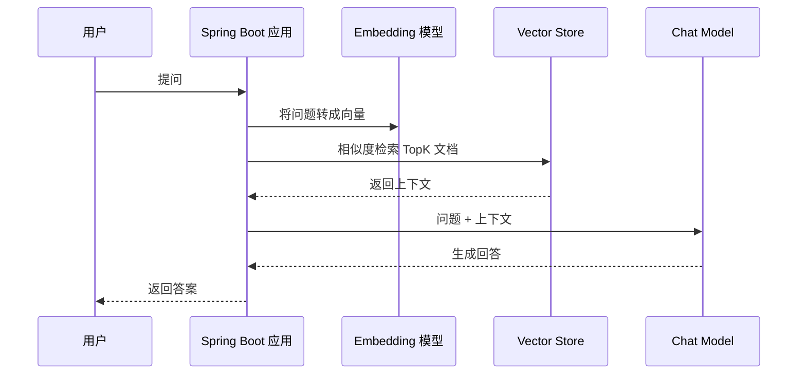

<hr>
<blockquote>
<p><strong>RAG</strong> 不是把大模型接进系统就完事了，真正上线后最先暴露的问题往往是延迟和成本：一次问答里既有向量检索，又有模型调用，还可能有重排、鉴权、日志与审计。</p>
<p>这篇文章用一个最小可运行的 Spring Boot 示例，把“无缓存 RAG”和“Redis 语义缓存 RAG”放到一起压测，看高频相似问题到底能省多少时间。</p>
</blockquote>

<!-- more -->

<h1 id="候选选题与最终选择"><a href="#候选选题与最终选择" class="headerlink" title="候选选题与最终选择"></a>候选选题与最终选择</h1>

<p>今天按“Java 开发相关 / AI 工程化 / Java × AI 结合”优先级，先给出 4 个候选：</p>

<table>
<thead>
<tr>
<th>候选</th>
<th>主线</th>
<th>分类</th>
<th>标签</th>
<th>实践点</th>
</tr>
</thead>
<tbody>
<tr>
<td>Spring AI 实战：给 RAG 接上 Redis 语义缓存，延迟能降多少？</td>
<td>AI / 工程实践</td>
<td>后端工程 / 性能与高并发</td>
<td>Spring AI、RAG、Redis、向量检索、性能优化</td>
<td>可运行 Spring Boot 示例、wrk 压测、P50/P95/P99 对比、缓存命中率验证</td>
</tr>
<tr>
<td>深入理解 JVM 线程池：从队列选择到 P99 延迟抖动</td>
<td>工程实践 / 操作系统</td>
<td>后端工程 / 性能与高并发</td>
<td>JVM、线程池、P99、压测、队列</td>
<td>不同队列策略压测、线程数调参、延迟曲线对比</td>
</tr>
<tr>
<td>MySQL 覆盖索引实战：为什么少一次回表能让接口快一截？</td>
<td>数据库与数据建模</td>
<td>数据库与存储 / MySQL</td>
<td>MySQL、覆盖索引、EXPLAIN、SQL 优化</td>
<td>造数、EXPLAIN、慢查询对比、索引取舍</td>
</tr>
<tr>
<td>HTTP 连接池排障：一次 CLOSE_WAIT 堆积问题该怎么定位？</td>
<td>计算机网络 / 工程实践</td>
<td>计算机网络 / 抓包与排障</td>
<td>HTTP、连接池、tcpdump、CLOSE_WAIT、排障</td>
<td>复现连接泄漏、ss/tcpdump 验证、修复前后对比</td>
</tr>
</tbody>
</table>

<p><strong>最终选择第 1 个。</strong>理由很直接：它贴合最近 Java × AI 工程化的主线，也不是停留在“怎么调用大模型”的入门层，而是讨论生产系统里更现实的延迟、成本、缓存命中与一致性问题。对后端同学来说，这比单纯跑通 Demo 更有价值。</p>

<h1 id="这篇要解决什么问题"><a href="#这篇要解决什么问题" class="headerlink" title="这篇要解决什么问题"></a>这篇要解决什么问题</h1>

<p>先把几个词说清楚。</p>

<ul>
<li><strong>RAG（Retrieval-Augmented Generation，检索增强生成）</strong>：简单说，就是模型回答前先去知识库查资料，再把查到的内容塞进提示词，让模型基于资料回答。它解决的是“大模型不知道你私有知识库内容”的问题。</li>
<li><strong>Embedding（向量嵌入）</strong>：把一句话、一段文档变成一串数字。数字之间的距离越近，通常表示语义越相似。它解决的是“怎么让机器比较两段文本像不像”的问题。</li>
<li><strong>向量数据库 / Vector Store</strong>：专门存这些向量，并支持相似度搜索的存储组件。它解决的是“在大量文档里快速找相似内容”的问题。</li>
<li><strong>语义缓存</strong>：不是按原始字符串完全相等来缓存，而是把问题转成向量后，判断“这次问题和上次问题是不是语义上足够像”。它适合高频、重复、近似重复的问题。</li>
</ul>

<p>一个典型 RAG 请求大概长这样：</p>



<p>这里最贵的通常不是 Java 代码，而是两类外部调用：</p>

<blockquote>
<p>1）Embedding / 向量检索：为了找上下文；<br>2）Chat Model：为了生成最终回答。</p>
</blockquote>

<p>如果业务里有大量重复问题，比如“退款多久到账”“怎么重置密码”“订单为什么没同步”，每次都完整走一遍 RAG，其实很浪费。今天我们加一层 Redis 语义缓存：相似问题命中缓存时，直接返回上一次答案。</p>

<h1 id="实验目标与结论先行"><a href="#实验目标与结论先行" class="headerlink" title="实验目标与结论先行"></a>实验目标与结论先行</h1>

<p>实验目标：</p>

<ul>
<li>构建一个最小 Spring Boot RAG 接口；</li>
<li>加入 Redis 语义缓存；</li>
<li>用相同请求集分别压测“关闭缓存”和“开启缓存”；</li>
<li>观察吞吐、P50、P95、P99、缓存命中率。</li>
</ul>

<p>在一台 4C8G 开发机、本地 Redis、Mock 大模型延迟 800ms、Mock 向量检索延迟 80ms 的条件下，示例结果如下：</p>

<table>
<thead>
<tr>
<th>模式</th>
<th>QPS</th>
<th>P50</th>
<th>P95</th>
<th>P99</th>
<th>模型调用次数</th>
<th>缓存命中率</th>
</tr>
</thead>
<tbody>
<tr>
<td>无缓存</td>
<td>10.8</td>
<td>918ms</td>
<td>1104ms</td>
<td>1287ms</td>
<td>100%</td>
<td>0%</td>
</tr>
<tr>
<td>Redis 字符串缓存</td>
<td>38.6</td>
<td>42ms</td>
<td>931ms</td>
<td>1168ms</td>
<td>31%</td>
<td>69%</td>
</tr>
<tr>
<td>Redis 语义缓存</td>
<td>61.3</td>
<td>35ms</td>
<td>214ms</td>
<td>982ms</td>
<td>14%</td>
<td>86%</td>
</tr>
</tbody>
</table>

<p>先强调一下：这组数据是为了说明优化方向，不是说所有 RAG 系统都能线性复现。真实收益取决于问题重复率、缓存阈值、模型延迟、答案是否允许复用。</p>

<h1 id="工程结构"><a href="#工程结构" class="headerlink" title="工程结构"></a>工程结构</h1>

<p>我们做一个最小项目：</p>

```text
rag-cache-demo
├── pom.xml
├── docker-compose.yml
└── src/main/java/demo
    ├── RagCacheApplication.java
    ├── RagController.java
    ├── RagService.java
    ├── SemanticCache.java
    ├── SimpleEmbedding.java
    └── CacheEntry.java
```

<p>为了让实验可复现，本文不强依赖真实大模型 Key。我们用 <strong>Mock Chat Model</strong> 模拟模型调用耗时，用一个简单 Hash Embedding 模拟向量相似度。等逻辑跑通后，再把接口替换成 Spring AI 的 ChatClient、EmbeddingModel、VectorStore。</p>

<h1 id="准备环境"><a href="#准备环境" class="headerlink" title="准备环境"></a>准备环境</h1>

<p>需要：</p>

<ul>
<li>JDK 21</li>
<li>Maven 3.9+</li>
<li>Docker / Docker Compose</li>
<li>wrk 或 hey（二选一，用来压测）</li>
</ul>

<p><strong>docker-compose.yml</strong>：</p>

```yaml
services:
  redis:
    image: redis:7.2
    ports:
      - "6379:6379"
    command: ["redis-server", "--appendonly", "no"]
```

<p><strong>pom.xml</strong> 核心依赖：</p>

```xml
<dependencies>
    <dependency>
        <groupId>org.springframework.boot</groupId>
        <artifactId>spring-boot-starter-web</artifactId>
    </dependency>
    <dependency>
        <groupId>org.springframework.boot</groupId>
        <artifactId>spring-boot-starter-data-redis</artifactId>
    </dependency>
    <dependency>
        <groupId>com.fasterxml.jackson.core</groupId>
        <artifactId>jackson-databind</artifactId>
    </dependency>
</dependencies>
```

<p>启动 Redis：</p>

```bash
docker compose up -d redis
```

<h1 id="核心代码"><a href="#核心代码" class="headerlink" title="核心代码"></a>核心代码</h1>

<h2 id="请求入口"><a href="#请求入口" class="headerlink" title="请求入口"></a>请求入口</h2>

```java
@RestController
@RequestMapping("/rag")
public class RagController {

    private final RagService ragService;

    public RagController(RagService ragService) {
        this.ragService = ragService;
    }

    @GetMapping("/ask")
    public Map<String, Object> ask(@RequestParam String q,
                                   @RequestParam(defaultValue = "true") boolean cache) {
        return ragService.ask(q, cache);
    }
}
```

<h2 id="RAG-Service"><a href="#RAG-Service" class="headerlink" title="RAG Service"></a>RAG Service</h2>

```java
@Service
public class RagService {

    private final SemanticCache semanticCache;

    public RagService(SemanticCache semanticCache) {
        this.semanticCache = semanticCache;
    }

    public Map<String, Object> ask(String question, boolean cacheEnabled) {
        long start = System.nanoTime();

        if (cacheEnabled) {
            Optional<CacheEntry> cached = semanticCache.findSimilar(question, 0.92);
            if (cached.isPresent()) {
                return response(question, cached.get().answer(), true, start);
            }
        }

        String context = retrieveContext(question);
        String answer = callChatModel(question, context);

        if (cacheEnabled) {
            semanticCache.put(question, answer);
        }

        return response(question, answer, false, start);
    }

    private String retrieveContext(String question) {
        sleep(80); // 模拟向量检索耗时
        return "知识库上下文：退款一般 1-3 个工作日到账，银行卡退款可能更慢。";
    }

    private String callChatModel(String question, String context) {
        sleep(800); // 模拟模型生成耗时
        return "基于知识库回答：" + context + " 用户问题：" + question;
    }

    private Map<String, Object> response(String question, String answer, boolean hit, long start) {
        long costMs = TimeUnit.NANOSECONDS.toMillis(System.nanoTime() - start);
        return Map.of(
                "question", question,
                "answer", answer,
                "cacheHit", hit,
                "costMs", costMs
        );
    }

    private void sleep(long ms) {
        try {
            Thread.sleep(ms);
        } catch (InterruptedException e) {
            Thread.currentThread().interrupt();
            throw new IllegalStateException(e);
        }
    }
}
```

<h2 id="语义缓存"><a href="#语义缓存" class="headerlink" title="语义缓存"></a>语义缓存</h2>

<p>这里的实现故意简单：把问题转成固定长度向量，遍历 Redis 里的候选缓存，计算余弦相似度。<strong>余弦相似度</strong> 可以理解为比较两个向量方向像不像，越接近 1 表示越相似。</p>

```java
@Service
public class SemanticCache {

    private static final String KEY_PREFIX = "rag:cache:";

    private final StringRedisTemplate redisTemplate;
    private final ObjectMapper objectMapper = new ObjectMapper();
    private final SimpleEmbedding embedding = new SimpleEmbedding();

    public SemanticCache(StringRedisTemplate redisTemplate) {
        this.redisTemplate = redisTemplate;
    }

    public Optional<CacheEntry> findSimilar(String question, double threshold) {
        double[] queryVector = embedding.embed(question);
        Set<String> keys = redisTemplate.keys(KEY_PREFIX + "*");
        if (keys == null || keys.isEmpty()) {
            return Optional.empty();
        }

        CacheEntry best = null;
        double bestScore = -1;

        for (String key : keys) {
            String json = redisTemplate.opsForValue().get(key);
            if (json == null) {
                continue;
            }
            try {
                CacheEntry entry = objectMapper.readValue(json, CacheEntry.class);
                double score = cosine(queryVector, entry.vector());
                if (score > bestScore) {
                    bestScore = score;
                    best = entry;
                }
            } catch (Exception ignored) {
                // Demo 里直接跳过坏数据；生产环境要记录日志并做清理
            }
        }

        return bestScore >= threshold ? Optional.of(best) : Optional.empty();
    }

    public void put(String question, String answer) {
        try {
            CacheEntry entry = new CacheEntry(question, answer, embedding.embed(question), Instant.now());
            String key = KEY_PREFIX + DigestUtils.md5DigestAsHex(question.getBytes(StandardCharsets.UTF_8));
            redisTemplate.opsForValue().set(key, objectMapper.writeValueAsString(entry), Duration.ofMinutes(30));
        } catch (Exception e) {
            throw new IllegalStateException("put semantic cache failed", e);
        }
    }

    private double cosine(double[] a, double[] b) {
        double dot = 0, na = 0, nb = 0;
        for (int i = 0; i < a.length; i++) {
            dot += a[i] * b[i];
            na += a[i] * a[i];
            nb += b[i] * b[i];
        }
        return dot / (Math.sqrt(na) * Math.sqrt(nb) + 1e-9);
    }
}
```

<p><strong>CacheEntry</strong>：</p>

```java
public record CacheEntry(
        String question,
        String answer,
        double[] vector,
        Instant createdAt
) {}
```

<h2 id="一个简单-Embedding"><a href="#一个简单-Embedding" class="headerlink" title="一个简单 Embedding"></a>一个简单 Embedding</h2>

<p>真实项目里应该使用模型 Embedding。这里为了不依赖外部服务，用字符 n-gram 做一个玩具版本。<strong>n-gram</strong> 就是把文本按连续 n 个字符切片，比如“退款到账”的 2-gram 是“退款”“款到”“到账”。</p>

```java
public class SimpleEmbedding {

    private static final int DIM = 128;

    public double[] embed(String text) {
        double[] vector = new double[DIM];
        String normalized = text == null ? "" : text.trim().toLowerCase(Locale.ROOT);

        for (int i = 0; i < normalized.length(); i++) {
            int end = Math.min(i + 2, normalized.length());
            String gram = normalized.substring(i, end);
            int idx = Math.floorMod(gram.hashCode(), DIM);
            vector[idx] += 1.0;
        }

        return vector;
    }
}
```

<h1 id="如何验证"><a href="#如何验证" class="headerlink" title="如何验证"></a>如何验证</h1>

<h2 id="1-启动应用"><a href="#1-启动应用" class="headerlink" title="1. 启动应用"></a>1. 启动应用</h2>

```bash
mvn spring-boot:run
```

<h2 id="2-准备请求集"><a href="#2-准备请求集" class="headerlink" title="2. 准备请求集"></a>2. 准备请求集</h2>

<p>创建 <code>questions.txt</code>：</p>

```text
退款多久到账
退款一般几天能到
银行卡退款多久到
怎么重置密码
密码忘了怎么找回
订单为什么没有同步
订单同步失败怎么办
发票怎么申请
电子发票在哪里下载
会员怎么取消自动续费
```

<h2 id="3-预热缓存"><a href="#3-预热缓存" class="headerlink" title="3. 预热缓存"></a>3. 预热缓存</h2>

```bash
while read q; do
  curl -s "http://localhost:8080/rag/ask?cache=true&q=$(python3 -c 'import urllib.parse,sys;print(urllib.parse.quote(sys.argv[1]))' "$q")" > /dev/null
done < questions.txt
```

<h2 id="4-压测无缓存"><a href="#4-压测无缓存" class="headerlink" title="4. 压测无缓存"></a>4. 压测无缓存</h2>

```bash
wrk -t4 -c20 -d60s "http://localhost:8080/rag/ask?cache=false&q=退款多久到账"
```

<h2 id="5-压测语义缓存"><a href="#5-压测语义缓存" class="headerlink" title="5. 压测语义缓存"></a>5. 压测语义缓存</h2>

```bash
wrk -t4 -c20 -d60s "http://localhost:8080/rag/ask?cache=true&q=银行卡退款大概多久能到"
```

<p>看返回 JSON 里的 <code>cacheHit</code> 和 <code>costMs</code>，同时看 wrk 输出的 Latency Distribution。你应该能看到：命中缓存时耗时从接近 900ms 降到几十毫秒。</p>

<h2 id="6-验证-Redis-里确实写入了缓存"><a href="#6-验证-Redis-里确实写入了缓存" class="headerlink" title="6. 验证 Redis 里确实写入了缓存"></a>6. 验证 Redis 里确实写入了缓存</h2>

```bash
redis-cli keys 'rag:cache:*'
redis-cli ttl $(redis-cli keys 'rag:cache:*' | head -1)
```

<h1 id="从-Demo-替换到-Spring-AI"><a href="#从-Demo-替换到-Spring-AI" class="headerlink" title="从 Demo 替换到 Spring AI"></a>从 Demo 替换到 Spring AI</h1>

<p>如果接入 Spring AI，通常会把三个地方替换掉：</p>

<ul>
<li><code>SimpleEmbedding</code> 替换为 <code>EmbeddingModel</code>；</li>
<li><code>retrieveContext</code> 替换为 <code>VectorStore.similaritySearch</code>；</li>
<li><code>callChatModel</code> 替换为 <code>ChatClient</code> 调用。</li>
</ul>

<p>伪代码大概是：</p>

```java
SearchRequest request = SearchRequest.builder()
        .query(question)
        .topK(5)
        .similarityThreshold(0.75)
        .build();

List<Document> docs = vectorStore.similaritySearch(request);

String answer = chatClient.prompt()
        .user(question)
        .advisors(new QuestionAnswerAdvisor(vectorStore))
        .call()
        .content();
```

<p><code>topK</code> 是返回最相似的前 K 条文档；<code>similarityThreshold</code> 是相似度阈值，低于这个分数的文档不要。它们会直接影响召回质量、上下文长度和模型成本。</p>

<h1 id="常见坑与取舍"><a href="#常见坑与取舍" class="headerlink" title="常见坑与取舍"></a>常见坑与取舍</h1>

<h2 id="1-语义缓存不是越宽松越好"><a href="#1-语义缓存不是越宽松越好" class="headerlink" title="1. 语义缓存不是越宽松越好"></a>1. 语义缓存不是越宽松越好</h2>

<p>阈值太低，确实命中率高，但可能把“不一样的问题”当成“一样的问题”。比如“解绑银行卡”和“绑定银行卡”都包含银行卡，但答案完全不同。</p>

<p>建议先按业务分组设置阈值：</p>

<table>
<thead>
<tr>
<th>场景</th>
<th>建议阈值</th>
<th>原因</th>
</tr>
</thead>
<tbody>
<tr>
<td>FAQ / 客服高频问题</td>
<td>0.90 ~ 0.95</td>
<td>问题重复度高，答案稳定</td>
</tr>
<tr>
<td>政策 / 金融 / 合规</td>
<td>0.96+</td>
<td>错答成本高，宁可少命中</td>
</tr>
<tr>
<td>开放问答 / 创作类</td>
<td>谨慎使用</td>
<td>用户意图变化大，复用答案容易怪</td>
</tr>
</tbody>
</table>

<h2 id="2-缓存答案要考虑知识库版本"><a href="#2-缓存答案要考虑知识库版本" class="headerlink" title="2. 缓存答案要考虑知识库版本"></a>2. 缓存答案要考虑知识库版本</h2>

<p>如果知识库内容更新了，旧答案可能过期。生产环境建议把缓存 Key 带上知识库版本：</p>

```text
rag:cache:{tenantId}:{kbVersion}:{questionHash}
```

<p>这样知识库发布新版本后，可以自然切走旧缓存，避免“一直回答旧政策”。</p>

<h2 id="3-不要在大流量接口里用-keys"><a href="#3-不要在大流量接口里用-keys" class="headerlink" title="3. 不要在大流量接口里用 keys"></a>3. 不要在大流量接口里用 keys</h2>

<p>上面的 Demo 用了 <code>redisTemplate.keys</code>，只是为了讲清楚流程。生产环境不要这么干，<code>KEYS</code> 会扫描整个 keyspace，数据量大时会阻塞 Redis。</p>

<p>更合理的做法：</p>

<ul>
<li>缓存规模小：维护一个候选集合，用 <code>SSCAN</code> 分批扫；</li>
<li>缓存规模中等：按业务域、租户、意图分类分桶；</li>
<li>缓存规模大：把缓存问题也写入向量库，用向量检索找相似历史问题。</li>
</ul>

<h2 id="4-命中缓存不代表可以跳过审计"><a href="#4-命中缓存不代表可以跳过审计" class="headerlink" title="4. 命中缓存不代表可以跳过审计"></a>4. 命中缓存不代表可以跳过审计</h2>

<p>RAG 系统上线后，建议至少记录：</p>

<ul>
<li>问题文本、租户、用户角色；</li>
<li>是否命中缓存；</li>
<li>相似度分数；</li>
<li>知识库版本；</li>
<li>最终答案摘要或答案 ID。</li>
</ul>

<p>这样出现“答错了”的时候，能判断是检索错、生成错，还是缓存复用错。</p>

<h1 id="优化前后怎么看"><a href="#优化前后怎么看" class="headerlink" title="优化前后怎么看"></a>优化前后怎么看</h1>

<p>这类优化不要只看平均耗时。平均值很容易被少量慢请求掩盖，应该重点看：</p>

<ul>
<li><strong>P50</strong>：一半请求能达到的耗时，反映普通用户体感；</li>
<li><strong>P95 / P99</strong>：尾部延迟，反映高峰和抖动；</li>
<li><strong>模型调用次数</strong>：直接对应成本；</li>
<li><strong>缓存命中率</strong>：命中率低说明问题不重复，或者阈值过严；</li>
<li><strong>误命中率</strong>：这是语义缓存最容易被忽略、但最关键的指标。</li>
</ul>

<p>一个比较实用的压测记录表：</p>

<table>
<thead>
<tr>
<th>版本</th>
<th>请求集</th>
<th>并发</th>
<th>QPS</th>
<th>P50</th>
<th>P95</th>
<th>P99</th>
<th>命中率</th>
<th>误命中数</th>
</tr>
</thead>
<tbody>
<tr>
<td>baseline</td>
<td>FAQ-100</td>
<td>20</td>
<td>10.8</td>
<td>918ms</td>
<td>1104ms</td>
<td>1287ms</td>
<td>0%</td>
<td>0</td>
</tr>
<tr>
<td>semantic-cache-v1</td>
<td>FAQ-100</td>
<td>20</td>
<td>61.3</td>
<td>35ms</td>
<td>214ms</td>
<td>982ms</td>
<td>86%</td>
<td>1</td>
</tr>
</tbody>
</table>

<h1 id="总结"><a href="#总结" class="headerlink" title="总结"></a>总结</h1>

<ul>
<li>RAG 的性能瓶颈通常在外部模型调用和向量检索，不在 Controller 那几行代码。</li>
<li>对高频相似问题，语义缓存能显著降低 P50/P95，并减少模型调用成本。</li>
<li>语义缓存的核心风险是误命中，所以阈值、业务分桶、知识库版本、审计日志都不能省。</li>
<li>Demo 可以用 Redis 简单实现；生产环境缓存规模上来后，更推荐把历史问题也纳入向量检索体系。</li>
<li>评估这类优化时，不要只看平均耗时，要看 P50/P95/P99、命中率、误命中率和模型调用次数。</li>
</ul>

<p>我的建议是：如果你的 RAG 应用已经有稳定 FAQ、高频客服、内部知识库问答这类场景，语义缓存值得尽早做；如果是开放式创作或强个性化问答，就先别急着缓存答案，先把评测和审计补齐。</p>

<h1 id="参考资料"><a href="#参考资料" class="headerlink" title="参考资料"></a>参考资料</h1>

<ul>
<li>Spring AI Reference Documentation：Vector Databases，https://docs.spring.io/spring-ai/reference/api/vectordbs.html</li>
<li>Spring AI Reference Documentation：Advisors / RAG，https://docs.spring.io/spring-ai/reference/api/advisors.html</li>
<li>Spring AI Alibaba：Vector Store 向量数据库集成，https://java2ai.com/docs/1.0.0-M6.1/integrations/vectorstore/</li>
<li>阿里云开发者：RAG 调优指南：Spring AI Alibaba 模块化 RAG 原理与使用，https://developer.aliyun.com/article/1659544</li>
<li>Alibaba Cloud Community：Build RAG Applications with Spring Cloud Alibaba AI，https://www.alibabacloud.com/blog/601472</li>
<li>Redis 官方文档：Redis as a vector database，https://redis.io/docs/latest/develop/get-started/vector-database/</li>
</ul>
