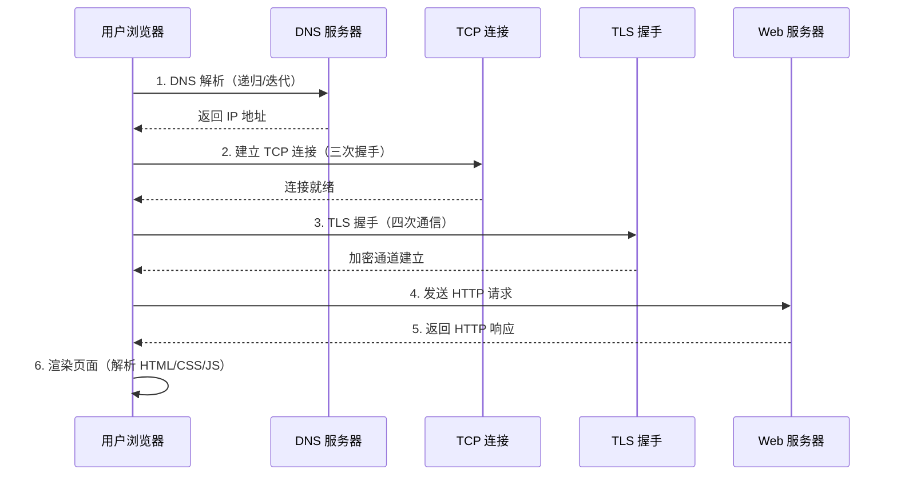
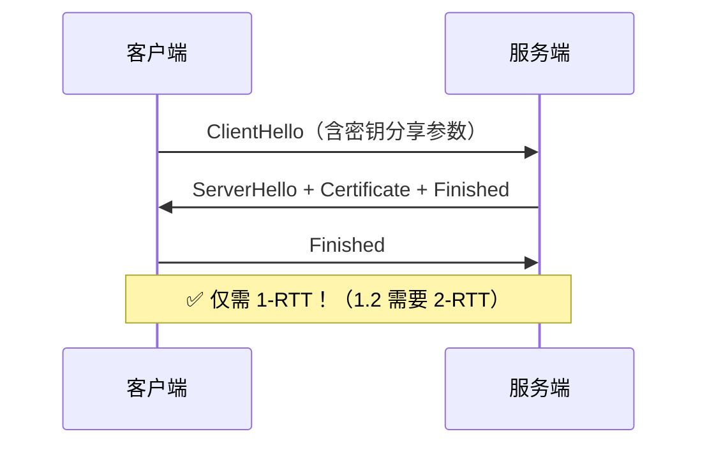
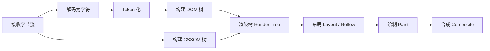

<hr>

<blockquote><p>当你在浏览器地址栏敲下 <code>https://www.example.com</code> 并按下回车，背后发生了什么？这个问题几乎是所有前端/后端面试的必考题，但更重要的是——理解整个过程能帮你快速定位线上故障、优化接口性能、排查网络异常。本文将从 **DNS 解析** 到 **TLS 握手** 到 **HTTP 事务**，一步步拆解完整链路，并附上可复现的实验命令。</p></blockquote>

<!-- more -->

## 一、整体流程全景

先给一张完整的时序图，建立全局认知：



下面我们逐层深挖每个环节。

---

## 二、第一步：DNS 解析 —— 域名怎么变成 IP

### 2.1 DNS 是什么

**DNS（Domain Name System）** 是互联网的电话簿。它把人类好记的域名（如 `www.baidu.com`）翻译成机器能懂的 IP 地址（如 `39.156.66.10`）。

### 2.2 DNS 查询过程

DNS 查询采用**分层架构**：

| 层级 | 服务器类型 | 职责 |
|------|-----------|------|
| 根域名服务器 | Root Name Server | 13 个逻辑集群，返回 TLD 服务器地址 |
| 顶级域服务器 | TLD Server（.com/.cn/.org） | 返回权威 NS 服务器地址 |
| 权威域名服务器 | Authoritative NS | 返回最终的 A/AAAA/CNAME 记录 |
| 本地 DNS 服务器 | Local DNS Resolver（ISP 提供）| 缓存 + 递归查询 |

查询方式有两种：
- **递归查询（Recursive）**：本地 DNS 代劳到底，最终只给客户端一个结果
- **迭代查询（Iterative）**：客户端自己逐级问，每级返回下一级的地址

> **实际场景**：你的电脑 → 本地 DNS（递归）→ 根/TLD/权威（迭代）

### 2.3 动手实验：观察 DNS 解析

用 `dig` 或 `nslookup` 查看 DNS 解析细节：

```bash
# 安装工具（如果没有）
yum install -y bind-utils   # CentOS/RHEL
# apt install -y dnsutils   # Ubuntu/Debian

# 查看完整解析过程
dig +trace www.baidu.com

# 只看最终结果（A 记录）
dig A www.baidu.com +short

# 查看指定 DNS 服务器
dig @8.8.8.8 www.example.com
```

**验证要点**：观察 `ANSWER SECTION` 中的 IP 地址，以及 `Query time`（解析耗时）。

### 2.4 DNS 缓存与 TTL

DNS 结果会被多层缓存：

```
浏览器缓存 → 操作系统缓存 → Hosts 文件 → 本地 DNS 服务器缓存
```

每条 DNS 记录都有 **TTL（Time To Live）**，单位秒。TTL 过期后必须重新查询。

```bash
# 清除系统 DNS 缓存
systemctl restart systemd-resolved   # systemd 系统
# 或
service nscd restart                 # 使用 nscd 的系统

# macOS
sudo dscacheutil -flushcache; sudo killall -HUP mDNSResponder
```

### 2.5 常见坑

- **DNS 污染**：某些运营商会在 DNS 层劫持域名，返回错误 IP。解决：使用可信 DNS（如 `223.5.5.5` 阿里、`119.29.29.29` 腾讯、`8.8.8.8` Google）
- **TTL 设置过短**：高流量域名如果 TTL=1，DNS 服务器会不堪重负。一般建议：静态资源 3600~86400s，动态服务 60~300s
- **CNAME 链过长**：`a.com → b.com → c.com → d.com`，每次 CNAME 都要多查一次，增加延迟

---

## 三、第二步：TCP 连接 —— 三次握手

### 3.1 为什么需要三次握手

TCP 是**面向连接的可靠传输协议**，通信前必须建立连接。三次握手的目的是：

1. **同步初始序列号（ISN）**：双方确认各自的发送起始序号
2. **协商窗口大小**：告知对方自己的接收缓冲区容量
3. **确认双方收发能力正常**

### 3.2 握手过程详解

```
客户端                          服务端
  |                               |
  |-------- SYN (seq=x) -------->|
  |                               |    客户端进入 SYN_SENT
  |<--- SYN+ACK (seq=y,ack=x+1)--|
  |     服务端进入 SYN_RCVD        |
  |-------- ACK (ack=y+1) ------->|
  |                               |    双方进入 ESTABLISHED
```

**为什么不能两次？** 如果客户端的 SYN 因网络延迟重复到达服务端，服务端会误以为新的连接请求并分配资源。三次握手让服务端在最后一步确认客户端确实还在等待。

**为什么不能四次？** 服务端的 SYN 和 ACK 可以合并为一个包发送（效率优化），所以三次是最小必要次数。

### 3.3 动手实验：抓包看三次握手

```bash
# 用 tcpdump 抓取到某目标的 SYN 包
tcpdump -i any -n host www.example.com and 'tcp[tcpflags] & tcp-syn != 0' -c 3

# 或者用 curl 观察时间统计
curl -w "\nDNS: %{time_namelookup}s\nTCP: %{time_connect}s\nTLS: %{time_appconnect}s\nTotal: %{time_total}s\n" -o /dev/null -s https://www.example.com
```

输出示例：
```
DNS: 0.003245s
TCP: 0.067891s      ← 三次握手耗时
TLS: 0.098234s      ← TLS 握手额外耗时
Total: 0.234567s
```

### 3.4 常见坑

- **SYN Flood 攻击**：攻击者大量发 SYN 但不完成第三次握手，耗尽服务端半连接队列。防御：启用 **SYN Cookies**（`net.ipv4.tcp_syncookies = 1`）
- **连接复用（Keep-Alive）**：HTTP/1.1 默认开启 Connection: keep-alive，同一 TCP 连接可以发多个请求，避免重复握手。但服务端通常有超时限制（如 Nginx 默认 75s）
- **TIME_WAIT 过多**：主动关闭方会进入 TIME_WAIT（2~4 MSL，约 60s）。高并发短连接场景可能耗尽端口。调优：`net.ipv4.tw_reuse = 1`

---

## 四、第三步：TLS 握手 —— 加密通道怎么建

### 4.1 HTTPS = HTTP over TLS

**TLS（Transport Layer Security）** 在 TCP 之上、HTTP 之下，提供三个核心能力：

| 能力 | 说明 |
|------|------|
| **机密性（Confidentiality）** | 对称加密传输数据，第三方无法窃听 |
| **完整性（Integrity）** | MAC 校验，数据被篡改可检测 |
| **身份认证（Authentication）** | 数字证书证明服务器身份 |

### 4.2 TLS 1.2 握手流程（经典版）

```
客户端                              服务端
  |                                   |
  |----- ClientHello ---------------->|
  |   （支持的密码套件列表、随机数）     |
  |                                   |
  |<---- ServerHello -----------------|
  |   （选定的密码套件、随机数）         |
  |<---- Certificate -----------------|
  |   （服务器证书链）                  |
  |<---- ServerKeyExchange -----------|
  |   （可选：ECDHE 公钥）             |
  |<---- ServerHelloDone -------------|
  |                                   |
  |----- ClientKeyExchange ---------->|  ← 关键！用服务器公钥加密"预主密钥"
  |----- ChangeCipherSpec ------------|
  |----- Finished --------------------|
  |                                   |
  |<---- ChangeCipherSpec ------------|
  |<---- Finished --------------------|
  |                                   |
  |       🔒 加密通道建立完毕           |
```

**关键点**：
1. **预主密钥（Pre-Master Secret）**：客户端生成，用服务器证书中的公钥加密后发送
2. **主密钥推导**：双方用 ClientRandom + ServerRandom + PreMasterSecret 通过 PRF（伪随机函数）计算出相同的 **Master Secret**
3. **对称加密密钥**：从 Master Secret 衍生出加密密钥和 MAC 密钥

### 4.3 TLS 1.3 的改进

TLS 1.3（RFC 8446）大幅简化了握手：



主要变化：
- 移除了不安全的算法（RC4、DES、CBC 模式等）
- 强制使用 **ECDHE**（前向安全）
- 支持 **0-RTT Resume**（恢复会话时零往返）
- 握手从 **2-RTT 减少到 1-RTT**

### 4.4 动手实验：检查 TLS 配置

```bash
# 查看 TLS 版本和密码套件
openssl s_client -connect www.example.com:443 -tlsextdebug </dev/null 2>/dev/null | grep -E 'Protocol|Cipher'

# 更详细的信息（证书链、SAN 等）
openssl s_client -connect www.baidu.com:443 -showcerts </dev/null 2>/dev/null | openssl x509 -noout -subject -dates -ext subjectAltName

# 用 testssl.sh 做全面扫描（推荐）
# git clone https://github.com/drwetter/testssl.sh.git
# ./testssl.sh --fast https://www.example.com
```

**验证要点**：确认目标站点是否支持 TLS 1.3，以及密码套件是否安全（优先 ECDHE-AES256-GCM-SHA384 或类似）。

### 4.5 常见坑

- **混合内容（Mixed Content）**：HTTPS 页面中引用了 HTTP 资源，浏览器会拦截或报警告。检查 Network 面板的 `(mixed content)` 标记
- **证书过期/配置错误**：Let's Encrypt 证书有效期仅 90 天！必须设置自动续期（certbot renew timer）
- **SNI（Server Name Indication）**：一个 IP 托管多个 HTTPS 站点依赖 SNI 扩展（ClientHello 中携带域名）。极老环境（Android 4.x / IE 6）不支持
- **HSTS（HTTP Strict Transport Security）**：通过响应头 `Strict-Transport-Security: max-age=31536000; includeSubDomains` 强制浏览器后续只用 HTTPS 访问

---

## 五、第四步：HTTP 请求与响应

### 5.1 HTTP 请求的结构

一个典型的 GET 请求：

```http
GET /index.html HTTP/1.1
Host: www.example.com
User-Agent: Mozilla/5.0 ...
Accept: text/html,application/xhtml+xml
Accept-Language: zh-CN,zh;q=0.9
Connection: keep-alive
```

POST 请求多了 Body：

```http
POST /api/login HTTP/1.1
Content-Type: application/json
Content-Length: 42

{"username": "admin", "password": "123456"}
```

### 5.2 HTTP 响应的结构

```http
HTTP/1.1 200 OK
Content-Type: text/html; charset=utf-8
Content-Length: 1254
Date: Tue, 28 Jul 2026 02:00:00 GMT
Server: nginx/1.24.0
Cache-Control: max-age=3600

<!DOCTYPE html>
<html>
<head><title>Example</title></head>
<body>...</body>
</html>
```

### 5.3 关键 Header 速查表

#### 请求头（Request Headers）

| Header | 含义 | 典型值 |
|--------|------|--------|
| `Host` | 目标域名（虚拟主机必需） | `www.example.com` |
| `User-Agent` | 客户端信息 | 浏览器标识字符串 |
| `Accept` | 可接受的响应类型 | `text/html`, `*/*` |
| `Authorization` | 认证信息 | `Bearer xxx` |
| `Cookie` | 搭带 Cookie | `session_id=abc123` |
| `Content-Type` | 请求体格式 | `application/json` |
| `Content-Length` | 请求体长度（字节） | `42` |

#### 响应头（Response Headers）

| Header | 含义 | 典型值 |
|--------|------|--------|
| `Status Code` | 状态码 | `200`, `404`, `500` |
| `Content-Type` | 响应体格式 | `application/json; charset=utf-8` |
| `Content-Length` | 响应体长度 | `1254` |
| `Set-Cookie` | 设置 Cookie | `id=a3fWa; Expires=...` |
| `Cache-Control` | 缓存策略 | `max-age=3600`, `no-cache` |
| `Location` | 重定向目标 | `/new-page` |
| `Server` | 服务器软件 | `nginx/1.24.0` |

### 5.4 状态码分类

| 范围 | 含义 | 常见示例 |
|------|------|---------|
| **1xx** | 信息性 | `101 Switching Protocols`（WebSocket 升级） |
| **2xx** 成功 | `200 OK`, `201 Created`, `204 No Content` | |
| **3xx** 重定向 | `301 Moved Permanently`, `302 Found`, `304 Not Modified` | |
| **4xx** 客户端错误 | `400 Bad Request`, `401 Unauthorized`, `403 Forbidden`, `404 Not Found`, `429 Too Many Requests` | |
| **5xx** 服务端错误 | `500 Internal Server Error`, `502 Bad Gateway`, `503 Service Unavailable`, `504 Gateway Timeout` | |

> **记忆口诀**：2xx 成功 3xx 跳，4xx 你错 5xx 我错。

### 5.5 动手实验：用 curl 模拟各种请求

```bash
# 基本请求（显示响应头）
curl -I https://www.example.com

# 带自定义 Header
curl -H "Authorization: Bearer mytoken" https://api.example.com/user

# POST JSON
curl -X POST -H "Content-Type: application/json" \
  -d '{"name": "test", "value": 42}' \
  https://httpbin.org/post

# 跟随重定向（查看完整链路）
curl -vL https://httpbin.org/redirect-to?url=https://www.example.com 2>&1 | grep -E "< HTTP|Location"

# 只看时间统计（性能基线）
curl -o /dev/null -s -w "DNS: %{time_namelookup}\nConnect: %{time_connect}\nTLS Handshake: %{time_appconnect}\nTTFB: %{time_starttransfer}\nTotal: %{time_total}\n" https://www.baidu.com

# 保存完整请求/响应用于调试
curl -v https://www.example.com 2>&1 > /tmp/http-debug.txt
```

**验证要点**：对比不同站点的 TTFB（Time To First Byte），了解网络延迟差异；观察 `Set-Cookie` 和 `Cache-Control` 头的实际用法。

### 5.6 常见坑

- **GET 与 POST 的本质区别**：GET 应当是幂等的/安全的（语义上），但协议层面并不禁止 GET 带 Body（只是很多代理/服务器会忽略）。POST 用于非幂等操作
- **Content-Length vs Transfer-Encoding: chunked**：大文件或动态生成的内容常用 chunked（分块传输），此时没有 Content-Length
- **429 Too Many Requests**：被限流了！检查响应头的 `Retry-After` 或 `X-RateLimit-Reset`
- **502 vs 504**：502 是上游挂了（Bad Gateway），504 是上游太慢没及时回（Gateway Timeout）。排障方向完全不同！

---

## 六、第五步：页面渲染 —— 浏览器的工作

### 6.1 渲染管线概览



### 6.2 关键概念

- **DOM（Document Object Model）**：HTML 解析后的节点树
- **CSSOM（CSS Object Model）**：样式解析后的规则树
- **渲染树（Render Tree）**：DOM + CSSOM 的可见节点合并结果（不含 `<script>`、`<meta>`、`display:none` 的元素）
- **布局（Layout/Reflow）**：计算每个节点的位置和尺寸
- **绘制（Paint）**：将节点填充像素
- **合成（Composite）**：将各图层合并到屏幕

### 6.3 性能瓶颈与优化

| 阶段 | 性能问题 | 优化手段 |
|------|---------|---------|
| HTML 解析 | 文件过大 | 压缩、按需加载 |
| CSS 解析 | CSS 阻塞渲染 | 关键 CSS 内联、异步加载非关键样式 |
| JavaScript 执行 | JS 阻塞 DOM 解析 | 用 `defer`/`async`、放到 `<body>` 底部 |
| Layout | 频繁回流 | 批量修改 DOM、避免读取 offsetWidth 等触发属性 |
| Paint | 重绘开销大 | 使用 GPU 加速层（transform/opacity）、减少阴影/渐变 |
| Composite | 图层过多 | 控制 `will-change` 和 `z-index` 合成层数量 |

### 6.4 动手实验：用 Chrome DevTools 分析渲染

1. 打开 Chrome DevTools（F12）
2. 切换到 **Performance** 面板
3. 点击 Record 刷新页面
4. 观察：
   - **蓝色区域**：HTML 解析 + DOM 构建
   - **紫色区域**：样式计算 + 布局
   - **绿色区域**：绘制
   - 每个任务的耗时和调用栈

```javascript
// 在控制台强制收集性能数据
const perfData = performance.getEntriesByType('navigation')[0];
console.table({
  'DNS 查询': perfData.domainLookupEnd - perfData.domainLookupStart,
  'TCP 握手': perfData.connectEnd - perfData.connectStart,
  'TLS 握手': perfData.secureConnectionStart ? perfData.connectEnd - perfData.secureConnectionStart : 0,
  '首字节时间(TTFB)': perfData.responseStart - perfData.requestStart,
  '内容下载': perfData.responseEnd - perfData.responseStart,
  'DOM 解析': perfData.domContentLoadedEventEnd - perfData.responseEnd,
  '页面加载完成': perfData.loadEventEnd - perfData.startTime,
});
```

---

## 七、完整链路的性能优化总结

把以上五个环节的优化手段汇总：

| 环节 | 优化目标 | 具体措施 |
|------|---------|---------|
| DNS | 减少解析时间 | DNS 预解析 `<link rel="dns-prefetch">`、合适的 TTL、HTTP/2 连接合并 |
| TCP | 减少握手开销 | Keep-Alive、HTTP/2 多路复用、TCP Fast Open |
| TLS | 减少握手延迟 | TLS 1.3、Session Resumption（会话复用）、OCSP Stapling |
| HTTP | 减少请求数/体积 | 压缩（Gzip/Brotli）、CDN 分发、HTTP/2 头部压缩、缓存策略 |
| 渲染 | 加快首屏渲染 | 关键 CSS 内联、JS 异步、懒加载图片、骨架屏 |

---

## 八、常见面试题速查

> **Q1：HTTP 和 HTTPS 的区别？**
> - HTTPS = HTTP + TLS（加密 + 认证 + 完整性）
> - HTTPS 默认端口 443（HTTP 为 80）
> - HTTPS 需要 CA 证书，有成本
> - HTTPS 比 HTTP 慢约 20~50%（TLS 握手开销），但 HTTP/2 + TLS 1.3 已大幅缩小差距

> **Q2：GET 和 POST 的区别？**
> - 语义：GET 取资源（幂等），POST 提交数据（非幂等）
> - 缓存：GET 可被缓存，POST 默认不缓存
> - 长度：URL 有长度限制（浏览器/服务器），POST 在 Body 中无此限制
> - 安全：两者都不安全（明文），必须用 HTTPS

> **Q3：HTTP/1.1 vs HTTP/2 vs HTTP/3？**
> - HTTP/1.1：Keep-Alive 复用连接，但**队头阻塞**（前一个请求阻塞后面的）
> - HTTP/2：**多路复用**（一个连接并行多个流）、头部压缩（HPACK）、服务端推送
> - HTTP/3（QUIC）：基于 UDP，解决了 TCP 层面的队头阻塞，0-RTT/1-RTT 连接建立

> **Q4：什么是中间人攻击（MITM）？如何防范？**
> - 攻击者拦截通信双方的数据，解密/篡改后再转发
> - TLS 通过**数字证书 + 公钥加密**防范：客户端验证服务器证书链是否受信任
> - 注意：如果用户点了「继续访问（不安全）」，等于主动放弃 MITM 防护！

---

## 九、总结

本文从用户输入 URL 到最终页面渲染，拆解了 **五大环节**：

1. **DNS 解析**：域名 → IP，利用缓存加速，注意 TTL 和污染问题
2. **TCP 连接**：三次握手建立可靠通道，注意 TIME_WAIT 和 SYN Flood
3. **TLS 握手**：协商加密参数建立安全通道，TLS 1.3 已简化为 1-RTT
4. **HTTP 事务**：请求/响应交互，关注状态码、Header、缓存策略
5. **页面渲染**：DOM → CSSOM → 布局 → 绘制 → 合成，关注阻塞和回流

**核心建议**：遇到网络问题时，按这个链路逐层排查——先 `ping` 看 DNS 是否通，再 `telnet` 看 TCP 是否通，再用 `curl -v` 看 HTTP 层的状态码和 Header，最后用 DevTools 看渲染阶段。这套方法论能覆盖 80% 的日常网络故障。

---

## 参考资料

1. [RFC 9110 - HTTP Semantics](https://www.rfc-editor.org/rfc/rfc9110.html) — HTTP 语义最新标准
2. [RFC 8446 - The Transport Layer Security (TLS) Protocol Version 1.3](https://www.rfc-editor.org/rfc/rfc8446.html) — TLS 1.3 完整规范
3. [MDN Web Docs - HTTP](https://developer.mozilla.org/zh-CN/docs/Web/HTTP) — Mozilla 开发者网络的 HTTP 权威指南
4. [How browsers work](https://web.dev/howbrowserswork/) — Tali Garsiel / Paul Irish，浏览器内部原理经典长文
5. [Cloudflare Learning - SSL/TLS](https://www.cloudflare.com/learning/ssl/) — Cloudflare 的 TLS 通俗教程
6. [高性能 PHP 应用开发 - HTTPS 优化](https://book.douban.com/subject/35391462/) — 相关性能优化图书参考
7. [Wireshark 官方文档 - TLS 分析](https://wiki.wireshark.org/TLS) — 用 Wireshark 抓包分析 TLS 握手的实操指南
8. [HTTP/3 explained](https://http3-explained.haxx.se/en) — Daniel Stenberg（curl 作者）写的 HTTP/3/QUIC 详解
