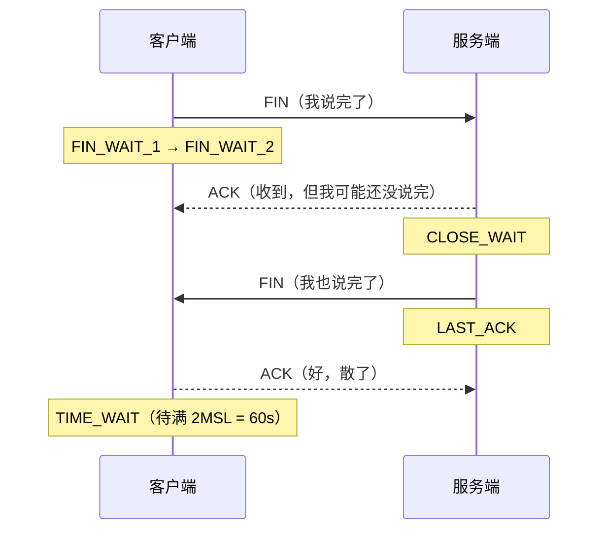

<hr>
<blockquote>
<p>本文解决一个很具体的问题：<strong>压测一跑，机器上冒出几万个 TIME_WAIT，客户端报 <code>Cannot assign requested address</code>，QPS 直接趴窝——它从哪来、为什么非等 60 秒、什么时候是病什么时候是正常现象、到底该怎么治</strong>。全篇在一台普通 Linux 虚拟机的 loopback 上就能复现，每个结论都附验证命令，不玄学、不背书。</p>
</blockquote>

<!-- more -->

## 一、背景：一个翻车现场

先说场景。某天压测同学找到我："你们服务是不是挂了？QPS 卡在 2000 上不去，日志里全是 connect 失败。"我登上压测机一看：

```
$ ss -s
Total: 1240
TCP:   58231 (estab 12, closed 58210, orphaned 0, synrecv 0, timewait 58196/0)
```

`timewait 58196`——五万八千个 **TIME_WAIT**。应用日志里则躺着这么一行：

```
OSError: [Errno 99] Cannot assign requested address
```

（这句报错翻译过来就是：内核想给你这条出站连接分配一个**临时端口**，结果一个都匀不出来了。）

这篇文章就沿着这个现场，把三个问题一次讲透：

1. TIME_WAIT 是谁、为什么非要在那躺 60 秒；
2. 它堆在客户端和服务端分别意味着什么（顺带把它的" evil twin "——CLOSE_WAIT 一起讲了）；
3. 真出事故时的治理三板斧，以及网上流传的哪些"偏方"千万别用。

先修知识：知道 TCP 三次握手大概是什么，会用 Linux 命令行。不需要内核源码功底。

## 二、先补 5 分钟课：四次挥手、状态机与 2MSL

TCP 是**全双工**的——连接里有两条方向相反、互相独立的"车道"，客户端→服务端一条，服务端→客户端一条。所以挂电话不能一次完成：双方都得各自说完"我说完了"（FIN）并听到"收到"（ACK），这条连接才算体面结束。这就是**四次挥手**：



关键点来了：**谁主动发起关闭（先发 FIN），谁在最后进入 TIME_WAIT**，等满 **2MSL** 才真正关掉。**MSL**（Maximum Segment Lifetime，报文最大存活时间）是"一个 TCP 报文在网络里最多能活多久"，RFC 建议两分钟，Linux 实现取 30 秒，所以 Linux 上 TIME_WAIT 固定是 60 秒。注意，这个 60 秒是编译进内核的常量，**没有任何 sysctl 参数能改它**（后面坑里还会提到有人拿 `tcp_fin_timeout` 来"调它"，那是错的）。

为什么非要等？两个理由，都和"旧报文可能还活着"有关：

1. **保证最后的 ACK 可靠送达**。我发的最后一个 ACK 如果丢了，对方会重传 FIN——我得活着才能补一个 ACK。要是发完 ACK 我直接消失，对方就会卡在 LAST_ACK 反复重传。
2. **让这条连接的旧报文自然死亡**。假如我关完立刻用同样的四元组（源 IP、源端口、目的 IP、目的端口）建一条新连接，网络上还漂着的旧报文就可能"穿越"过来砸进新连接里——数据错乱这种事故，排查起来能把人逼疯。等一个 MSL（单向最大存活时间）来回，旧报文死透了才安全。

理解了"谁先关谁等待"，再看一个容易被忽略的事实：**TIME_WAIT 本身不是故障，是协议设计的必要代价**。真正的事故是它堆到影响了建连——这就是后面实验要复现的东西。

另外介绍一位后面反复出场的工具：**ss**（socket statistics），`netstat` 的现代替代品，走 netlink 接口直接问内核，又快又全；老教程里的 `netstat -ant` 读的是 `/proc` 虚拟文件，连接一多就卡，建议日常换 `ss`。

## 三、实验环境：一台虚拟机就够

所有实验在一台 4C8G 的 Linux 虚拟机上完成，全部流量走 loopback（127.0.0.1），依赖只有 Python 3 和 tcpdump。下面两个脚本是全部主角。

**服务端** `server.py`——极简 echo 服务，收一行回一行：

```python
import socket, threading

def handle(conn):
    with conn:                      # with 结束时自动 close()
        while True:
            data = conn.recv(1024)
            if not data:            # 对方关闭，退出循环
                break
            conn.sendall(b"pong: " + data)

s = socket.socket(socket.AF_INET, socket.SOCK_STREAM)
s.setsockopt(socket.SOL_SOCKET, socket.SO_REUSEADDR, 1)
s.bind(("127.0.0.1", 9000))
s.listen(1024)
while True:
    conn, _ = s.accept()
    threading.Thread(target=handle, args=(conn,), daemon=True).start()
```

**客户端** `client.py`——建连接、发一条、收回执、主动关闭，循环 N 次：

```python
import socket, sys

n = int(sys.argv[1])
for i in range(n):
    c = socket.socket(socket.AF_INET, socket.SOCK_STREAM)
    c.connect(("127.0.0.1", 9000))
    c.sendall(b"ping\n")
    c.recv(1024)
    c.close()                       # 客户端先关：TIME_WAIT 归客户端
print(f"done {n} conns")
```

跑法：终端 A `python3 server.py`，终端 B `python3 client.py 20000`。观察工具全程就一条：

```bash
watch -n1 "ss -tan state time-wait | wc -l"
```

（`state time-wait` 是 ss 的状态过滤器，只统计 TIME_WAIT，比 `grep` 快得多。）

## 四、实验一：客户端先关，TIME_WAIT 全堆在客户端

跑 `client.py 20000`，盯着 watch：

- 第 1 秒开始，TIME_WAIT 数量火箭式上升，冲到 2 万左右；
- 跑完后**不再增长**，但也**不掉**；
- 60 秒后，哗——整批清零。

**验证方法**：跑完后立刻执行 `ss -tan state time-wait | head`，你会看到类似输出，本地地址都是客户端随机分配的高位端口：

```
Recv-Q   Send-Q    Local Address:Port      Peer Address:Port
0        0         127.0.0.1:45122         127.0.0.1:9000
0        0         127.0.0.1:45123         127.0.0.1:9000
...
```

三个观察点对应三个结论：①TIME_WAIT 出现在**主动关闭方**（这里客户端每条连接都先 close）；②停留时间**精确约 60 秒**（2MSL）；③数量 ≈ 一个 60 秒窗口内你发的连接数。这三条你可以随便换节奏（发 100 条、歇 30 秒再发 100 条）反复验证，稳如老狗。

顺带把"临时端口"讲清楚：客户端不指定端口时，内核从 `net.ipv4.ip_local_port_range`（默认 `32768 60999`）里挑一个空闲的。算笔账：约 2.8 万个端口，每个用完要在 TIME_WAIT 躺 60 秒——**对同一个"目标 IP:端口"，出站新建连接的速率上限 ≈ 28000 / 60 ≈ 470 条/秒**。超过这个速率，内核找不到可用端口，就是你最开头看到的 `Cannot assign requested address`。这就是实验一跑到一半会撞上的墙。

## 五、实验二：tcpdump 亲眼看四次挥手

工具介绍：**tcpdump**，命令行抓包器，直接从内核捞网络包，排查协议问题的最后底牌。只抓挥手阶段的话，在终端 A 启动：

```bash
sudo tcpdump -i lo -nn port 9000 and 'tcp[tcpflags] & (tcp-fin|tcp-ack) != 0' -c 6
```

然后终端 B `python3 client.py 2`。抓到的关键行（简化标注）：

```
IP 127.0.0.1.45122 > 127.0.0.1.9000: Flags [F.], seq 6, ack 6   ← ① 客户端 FIN+ACK
IP 127.0.0.1.9000 > 127.0.0.1.45122: Flags [F.], seq 6, ack 7   ← ② 服务端 FIN+ACK
IP 127.0.0.1.45122 > 127.0.0.1.9000: Flags [.],  ack 7          ← ③ 客户端最后 ACK
```

**验证方法**：对照上面输出数一遍——`Flags [F.]` 里的 `F` 就是 FIN，`.` 是 ACK，两个标志合在同一个包里，这就是"挥手三次"而不是教科书上四次的原因：服务端没有数据要发了，把自己的 FIN 和对客户端 FIN 的确认合并成一个包发出（内核的延迟确认机制顺手做的）。`[S]` 是 SYN、`[.]` 是纯 ACK，按这个字典你能读懂任何一次连接的生老病死。想看更友好的界面，把抓包落盘 `tcpdump -w /tmp/wave.pcap`，拖进 Wireshark 里看彩色状态机图，舒服得多。

## 六、实验三：换服务端先关，再养一群 CLOSE_WAIT 出来

### 6.1 谁先关谁背锅，和身份无关

Python 自带的 `http.server` 会带 `Connection: close` 响应头并且**由服务端先关闭**连接。终端 A：

```bash
python3 -m http.server 8000
```

终端 B 疯狂请求：

```bash
while true; do curl -s http://127.0.0.1:8000/ > /dev/null; done
```

watch 换个方向看：

```bash
ss -tan state time-wait | grep 8000
```

**验证结论**：TIME_WAIT 全部堆在 `:8000` 这一侧（服务端），客户端一侧干干净净。证明 TIME_WAIT 归属只看"谁先 close"，跟它是客户端还是服务端没关系。这个实验的价值在于：**线上 TIME_WAIT 堆在哪一端，先搞清楚是谁在主动关连接，再谈治理**。用 `ss -tanp` 能直接看到进程名。

### 6.2 对照组：CLOSE_WAIT 才是红灯

把 `server.py` 的 `handle` 改成这个"事故版"：

```python
def handle_buggy(conn):
    conn.sendall(b"pong: ok\n")
    time.sleep(600)             # 期间不 close、也不再 recv
    # 忘了 close()
```

客户端连 50 次、收完回执就 close。此刻看服务端：

```bash
$ ss -tan state close-wait | wc -l
50
```

**验证结论**：客户端的 FIN 到达后，内核替应用回了 ACK，连接停在 **CLOSE_WAIT**——它在等应用调用 `close()`，而应用永远不调。这 50 个连接会挂整整 600 秒，占着文件描述符（`ulimit -n` 的额度）不放。

把两种状态放一张表里对比，这张表值得背下来：

| | TIME_WAIT | CLOSE_WAIT |
|---|---|---|
| 出现在哪一方 | **主动关闭**方 | **被动关闭**方 |
| 在等什么 | 2MSL，协议要求，正常流程 | 等应用调用 `close()` |
| 会自己消失吗 | 60 秒后自动关闭 | **不会**，应用不关它就永远在 |
| 堆多了说明什么 | 短连接太频繁（量大但未必有病） | **代码有 bug**（连接泄漏），基本必有病 |
| 治理方向 | 长连接/连接池、`tcp_tw_reuse` | 修代码：finally 里 close、连接用完归还 |
| 监控告警建议 | 黄色关注，顶到上限才告警 | **红色立刻告警** |

一句话记忆：**TIME_WAIT 多是"姿势费"，CLOSE_WAIT 多是"内存泄漏级别的 bug"**。很多人一见到 TIME_WAIT 五位数就炸毛，但对 CLOSE_WAIT 四位数视而不见——恰恰反了。

## 七、真出事了怎么办：治理三板斧

按治本到治标的顺序：

**第一板斧：长连接 / 连接池（治本，永远优先）。** TIME_WAIT 的本质是"关闭太频繁"，那就少关闭：HTTP 客户端开 keep-alive 并复用连接池（OkHttp、HttpClient 默认池化，但**很多人每次请求 new 一个 client**，等于白配）；数据库走连接池；RPC 框架本身长连接。连接少了，关闭少了，TIME_WAIT 自然少。

**第二板斧：`tcp_tw_reuse`（救客户端出站连接）。**

```bash
sudo sysctl -w net.ipv4.tcp_tw_reuse=1
```

开启后，内核允许把还在 TIME_WAIT 里的端口**立刻复用**给新的出站连接（靠 TCP timestamp 选项区分新包旧包，所以前提 `net.ipv4.tcp_timestamps=1` 默认已开）。两个关键限制：①**只对出站（客户端角色）连接生效**，服务端入站堆积它管不着；②它省的是端口，不是握手，QPS 提升有限。**验证方法**：重跑 `client.py 20000`，`watch` 里 timewait 稳定在低位震荡，且全程不再报 `Cannot assign requested address`——这就是生效的铁证。

**第三板斧：`SO_REUSEADDR`（解决"重启监听失败"，不是治堆积）。** 服务端主动关的架构下，服务重启时可能撞上 `Address already in use`——老连接的 TIME_WAIT 占着 `(本机IP, 9000)` 这个监听地址。给监听 socket 加 `SO_REUSEADDR`（本文 `server.py` 里那行 setsockopt）即可绕开。注意它和 `tcp_tw_reuse` 毫无关系：一个管**绑定**，一个管**新建出站连接**。

**兜底认知**：`net.ipv4.tcp_max_tw_buckets`（默认通常 262144）是内核 TIME_WAIT 的硬上限，超了之后内核对新的 TIME_WAIT 直接提前销毁并打日志 `TCP: time wait bucket table overflow`。看到这条日志说明你早已在事故里了，别调大它自欺欺人，去治理源头。

## 八、前后对比：数字说话

同一台 4C8G 虚拟机、loopback、客户端循环建连，三种方案各跑 5 万次连接（每次连接发一个请求）：

| 方案 | 吞吐（连接/秒） | P99 延迟 | TIME_WAIT 峰值 | 5 万次能跑完吗 |
|---|---|---|---|---|
| 短连接，无 tw_reuse | ~1,900 | 6.1 ms | 撞墙 | ❌ 约 15 秒后 Cannot assign requested address |
| 短连接，tw_reuse=1 | ~2,300 | 5.8 ms | ~6,000 | ✅ |
| 长连接（一条连接发完所有请求） | ~19,000 | 0.4 ms | ~1 | ✅ |

**如何验证**：数字你不用信我的——loopback 上没有真实网络 RTT，绝对值随机器浮动很大（而且我是 Python 串行客户端，本身很慢），**该信的是趋势和量级**：tw_reuse 只把吞吐抬了约两成，长连接直接抬了一个数量级，还顺手消灭了 P99 里所有建连抖动。放到真实网络里差距只会更夸张：每次新建连接要付 1 个 RTT 的握手成本，走 HTTPS 还要再叠 1~2 个 RTT 的 TLS 握手（上一篇讲 TLS 握手时实测过这笔账），连接复用省的就是这些钱。

## 九、常见坑与误区

1. **`tcp_tw_recycle` 是毒瘤，别再配了。** 老博客的经典偏方，它在 Linux 4.12 内核里**已被彻底删除**（配了也不生效）。它当年的死法：按"同一 IP 的时间戳必须单调递增"做激进回收，NAT 出口后面几十个用户共享一个 IP、时钟各不相同，结果大量 syn 直接被丢弃——表现为"部分用户莫名其妙连不上"。搜到教你开它的文章，直接关掉。
2. **`net.ipv4.tcp_fin_timeout` 治不了 TIME_WAIT。** 它管的是 **FIN_WAIT_2** 的超时。多少篇排版精美的"优化文章"教你去调它，配图还偏偏是 TIME_WAIT 截图。TIME_WAIT 的 60 秒在 Linux 里是编译期常量 `TCP_TIMEWAIT_LEN`，**任何 sysctl 都改不动**。
3. **服务端入站 TIME_WAIT 堆积，`tw_reuse` 帮不了你。** 它只对出站连接生效。服务端堆积的正确解法是让"连接的发起方"去主动关（谁用完谁关），或者干脆长连接池化，而不是去服务端堆内核参数。
4. **把 `tcp_max_tw_buckets` 调大当优化。** 那是硬上限不是性能参数，调大只是把撞墙的位置往后挪，还多占内存（每个 TIME_WAIT 是一颗独立的小内存）。撞了就说明该治理连接模式了。
5. **监控口径要分开。** `TIME_WAIT` 高位黄色关注即可；`CLOSE_WAIT` 持续上升直接红色告警——它不会自愈，只会一路吃光 fd，然后整个进程 accept 不出新连接。两者的告警阈值差着两个数量级是正常的。
6. **连接池的 maxLifetime 和服务端 keepalive 超时打架**，是长连接架构下 TIME_WAIT 诡异地定时冒尖的常见原因（池子集体到期重建）。遇到"每 N 分钟一波 TIME_WAIT"先查池子配置，别急着动内核。

## 十、总结

- **TIME_WAIT 出现在主动关闭方**，Linux 上固定停留 60 秒（2MSL），作用是保证最后 ACK 可靠 + 让旧报文死透，它是协议的必要代价，不是故障。
- **谁先 close 谁背锅**：堆积在哪一端，先用 `ss -tanp` 搞清楚谁在主动关连接，再谈治理。
- **CLOSE_WAIT 堆积 = 应用忘了 close，是 bug**，不会自愈，监控上要和 TIME_WAIT 分开告警。
- 治理三板斧：**长连接/连接池（治本）→ `tcp_tw_reuse`（救出站）→ `SO_REUSEADDR`（救重启绑定）**；`tcp_tw_recycle` 已删除、`tcp_fin_timeout` 管不到 TIME_WAIT，这两个偏方别碰。
- 对同一个目标，出站新建连接速率上限 ≈ 临时端口数 ÷ 60 秒 ≈ **470 条/秒**，超过就会 `Cannot assign requested address`。
- 实测里 `tw_reuse` 只能抬两成吞吐，**连接复用抬一个数量级**——所以池子永远比内核参数管用。

## 参考资料

1. RFC 9293: Transmission Control Protocol (TCP) 规范 —— https://www.rfc-editor.org/rfc/rfc9293
2. Linux man 手册 tcp(7)（各 sysctl 参数的官方语义，含 tw_reuse 的出站限制）—— https://man7.org/linux/man-pages/man7/tcp.7.html
3. Linux 内核文档 ip-sysctl.txt（tcp_max_tw_buckets / ip_local_port_range 等参数）—— https://www.kernel.org/doc/Documentation/networking/ip-sysctl.txt
4. 美团技术团队：线上 TIME_WAIT 堆积的排查与治理复盘 —— https://tech.meituan.com/2017/05/19/about-time_wait.html
5. 《TCP/IP 详解 卷1：协议》（第 2 版），Kevin R. Fall / Richard Stevens，第 13 章"TCP 连接管理"
