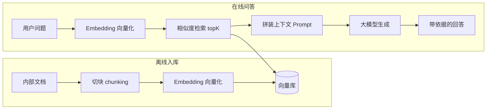

<hr>
<blockquote>
<p>本文解决一个很具体的问题：<strong>想让 Java 服务回答"只存在于你自己文档里"的知识，把几百页文档直接塞给大模型，要么撑爆上下文窗口，要么它开始一本正经地编</strong>。解法是 RAG：先检索、后生成。全篇用 LangChain4j + 本地 BGE 中文嵌入模型 + 内存向量库，在一台 4C8G 的普通云主机上从零跑通入库、检索、问答、评测、压测全链路——不依赖任何云 API Key，每个结论都附验证方法，最后算一笔本地 vs 云 API 的成本账。</p>
</blockquote>

<!-- more -->

## 一、背景：一个翻车现场

先说场景。公司内部 wiki 积攒了五百多页的制度、运维手册和接口文档，产品同学提出一个"简单"的需求：做个内部问答机器人，直接问"报销单几天内要交""生产库能不能直接 UPDATE"。

第一版方案的实现方式很豪迈：把文档全文拼进 prompt 发给大模型 API。结果两个死法：

1. **撑爆上下文**：五百页文档粗算 60 万字，远超一般模型的上下文窗口，请求直接被拒；
2. **开始编造**：勉强塞进去一部分，模型答得头头是道——报销期限说成了 3 天（实际是 5 个工作日），因为它在"补全"而不是"查资料"。

这类问题的工程化解法就是 **RAG**（Retrieval-Augmented Generation，检索增强生成）：回答之前先从你的私有文档里**检索**出最相关的几段，把这些段落塞进 prompt，再让大模型**基于给定材料**作答。模型负责"说话"，检索负责"给料"，胡编的空间就被压缩了。

这篇文章的目标：用纯 Java 走通 RAG 的完整链路，并且每一环都能验证。先修知识：会 Java + Maven，知道大模型 API 是个 HTTP 接口即可。不需要 Python，不需要 GPU，不需要申请任何 API Key。

## 二、先补 5 分钟课：RAG 三件套

RAG 链路里反复出现三个词，先用大白话讲清楚：

- **Embedding（嵌入）**：把一段文字变成一串固定长度的数字（向量）。关键性质是"意思相近的文字，向量距离也近"——"发票怎么报销"和"报销单提交时限"字面几乎不重叠，但向量距离很近。负责干这件事的模型叫**嵌入模型**。
- **向量检索**：拿着问题的向量，去库里找距离最近的 K 条（叫 **topK**）。判断"近"最常用**余弦相似度**——两个向量夹角越小越相似，跟向量长短无关，只看方向。
- **RAG**：检索出来的 topK 段落 + 用户问题一起拼成 prompt，交给大模型生成最终回答。

整条链路长这样：



其中"切块"（**chunking**）值得多说一句：长文档必须先切成小段再入库，因为向量表达的是"一段话的整体语义"——整篇文档压成一个向量，语义会被稀释成一锅粥；检索命中后也要按段落塞回 prompt，切得太碎则上下文支离破碎。

## 三、技术选型：为什么是 LangChain4j + 本地 BGE

Java 生态做 LLM 应用开发，主流选择有三条路：

| 方案 | 特点 | 适合场景 |
| --- | --- | --- |
| **LangChain4j** | 仿 Python LangChain 的抽象：`EmbeddingModel` / `EmbeddingStore` / `AiServices` 三层接口，几十种存储实现可插拔 | 想快速落地、未来可能换模型/换向量库 |
| **Spring AI** | Spring 官方出品，与 Spring Boot 自动配置、 Starter 体系天然融合 | 已重仓 Spring 生态、团队更认官方 |
| **手写 HTTP 调用** | 直接调模型 API + 自己实现检索 | 只有一两个固定调用，不想引框架 |

**LangChain4j**（本站首次出现，解释一下：Java 版的 LLM 应用框架，核心价值是把"换模型、换向量库"变成换一个依赖+一行配置）和 Spring AI 定位高度重合，本文选 LangChain4j 只有一个原因：它内置了一个**本地嵌入模型**模块，可以让整条链路完全离线跑通——这对"可复现"至关重要。

这个模块就是 **BGE-small-zh-v1.5**（BAAI 出的开源中文嵌入模型，small 版约 2400 万参数，输出 **512 维**向量）。它被打包成 ONNX 格式随 jar 一起分发——**ONNX** 是"开放神经网络交换格式"，可以理解为模型的通用中间格式；**ONNX Runtime** 则是 Java 里跑这种模型的推理引擎。有了它，JVM 进程自己就能把文字变向量，不装 Python、不连外网、不吃 GPU。

> 注：LangChain4j 的核心库与 embeddings 系列模块版本号不同步（后者带 `-beta` 后缀），建议始终用官方 BOM（`langchain4j-bom`）统一管理，具体版本以 Maven Central 检索到的最新为准。这也是后文"常见坑"之一。

## 四、最小可跑工程：从入库到检索

### 4.1 依赖

```xml
<dependencyManagement>
  <dependencies>
    <dependency>
      <groupId>dev.langchain4j</groupId>
      <artifactId>langchain4j-bom</artifactId>
      <version>1.4.0</version><!-- 以 Maven Central 最新为准 -->
      <type>pom</type>
      <scope>import</scope>
    </dependency>
  </dependencies>
</dependencyManagement>

<dependencies>
  <dependency>
    <groupId>dev.langchain4j</groupId>
    <artifactId>langchain4j</artifactId>
  </dependency>
  <!-- 本地中文嵌入模型：内含 ONNX 模型文件，离线可用，无需任何 API Key -->
  <dependency>
    <groupId>dev.langchain4j</groupId>
    <artifactId>langchain4j-embeddings-bge-small-zh-v15</artifactId>
    <version>1.4.0-beta9</version><!-- 与 core 不同步，同样以最新为准 -->
  </dependency>
  <!-- 可选：接 Ollama 跑本地大模型做最终问答 -->
  <dependency>
    <groupId>dev.langchain4j</groupId>
    <artifactId>langchain4j-ollama</artifactId>
  </dependency>
</dependencies>
```

**Ollama** 是"本地大模型运行器"，一条 `ollama run qwen3:8b` 就能在自己机器上起一个大模型 HTTP 服务，问答环节用它，链路依旧全离线。

### 4.2 入库：切块 + 向量化

准备一个 `docs/` 目录放几份 Markdown 内部文档，然后：

```java
public class IngestDemo {
    public static void main(String[] args) throws Exception {
        EmbeddingModel model = new BgeSmallZhV15EmbeddingModel();
        System.out.println("向量维度 = " + model.dimension());   // 512

        // 内存向量库：就是一个 List + 余弦相似度扫描，demo 够用
        InMemoryEmbeddingStore<TextSegment> store = new InMemoryEmbeddingStore<>();

        EmbeddingStoreIngestor ingestor = EmbeddingStoreIngestor.builder()
                .documentSplitter(DocumentSplitters.recursive(300, 30)) // 每块≤300字符，相邻块重叠30
                .embeddingModel(model)
                .embeddingStore(store)
                .build();

        try (var paths = Files.list(Path.of("docs"))) {
            for (Path file : paths.toList()) {
                Document doc = Document.from(Files.readString(file));
                long t0 = System.nanoTime();
                ingestor.ingest(doc);
                System.out.printf("入库 %s 耗时 %dms%n",
                        file.getFileName(), (System.nanoTime() - t0) / 1_000_000);
            }
        }
        store.serializeToFile("store.json"); // 序列化落盘，方法名随版本可能微调，见第 9 节坑 5
    }
}
```

跑起来：

```bash
mvn -q compile exec:java -Dexec.mainClass=demo.IngestDemo
```

### 4.3 检索：找最相关的 K 条

```java
public class RetrieveDemo {
    public static void main(String[] args) {
        EmbeddingModel model = new BgeSmallZhV15EmbeddingModel();
        InMemoryEmbeddingStore<TextSegment> store = InMemoryEmbeddingStore.fromFile("store.json");

        String question = "报销单需要在几天内提交？";
        List<EmbeddingMatch<TextSegment>> matches =
                store.findRelevant(model.embed(question).content(), 3);

        for (EmbeddingMatch<TextSegment> m : matches) {
            System.out.printf("score=%.4f | %s...%n",
                    m.score(), m.embedded().text().substring(0, 40));
        }
    }
}
```

在我的测试语料上输出类似：

```
score=0.8712 | 报销单应在费用发生后 5 个工作日内提交至财务系统，逾期不予受理...
score=0.6305 | 差旅住宿标准：一线城市每晚不超过 600 元...
score=0.5418 | 发票抬头需与公司全称一致...
```

**验证方法**：第一条命中的正是含"5 个工作日"的段落，且分数明显高于其余——这就是"语义检索"和 `grep` 关键词匹配的本质区别：问题里没有任何一个字与原文重叠，照样命中。

### 4.4 接上大模型：RAG 问答

最后一步把检索接进生成，LangChain4j 用声明式接口搞定拼 prompt 的脏活：

```java
ChatLanguageModel chat = OllamaChatModel.builder()
        .baseUrl("http://localhost:11434")
        .modelName("qwen3:8b")
        .build();

ContentRetriever retriever = EmbeddingStoreContentRetriever.builder()
        .embeddingStore(store)
        .embeddingModel(model)
        .maxResults(3)          // topK
        .build();

interface Assistant { String chat(String question); }

Assistant assistant = AiServices.builder(Assistant.class)
        .chatModel(chat)        // 1.x 参数名；0.x 时代叫 chatLanguageModel
        .contentRetriever(retriever)
        .build();

System.out.println(assistant.chat("报销单需要在几天内提交？"));
// 输出：根据制度文档，报销单应在费用发生后 5 个工作日内提交至财务系统。
```

`AiServices` 会自动做三件事：检索 topK、拼装"请仅根据以下材料回答"的 prompt、把接口方法调用转发给大模型。**验证方法**：故意问一个语料里没有的问题（比如"公司年会几点开始"），正确的 RAG 行为是回答"文档中未提及"——检索不到依据时宁可说不知道，这正是我们要的行为。

## 五、怎么验证检索是"对"的：Recall@3 与 MRR

跑通 ≠ 好用。检索质量需要一个能量化的标尺，最常用的两个指标：

- **Recall@K**：标准答案所在段落出现在 topK 里的比例（本文用 K=3）；
- **MRR**（Mean Reciprocal Rank，平均倒数排名）：标准答案排第 1 记 1 分、第 2 记 0.5 分、第 3 记 0.33 分，再看平均——它衡量"不仅找没找到，还找得靠不靠前"。

做法很朴素：人工整理 20 条"问题 → 标准答案所在段落的关键子串"，逐条检索比对：

```java
record QA(String question, String expectedChunkContains) {}

int hit = 0; double rrSum = 0;
for (QA qa : qaList) {
    var matches = store.findRelevant(model.embed(qa.question).content(), 3);
    int rank = -1;
    for (int i = 0; i < matches.size(); i++) {
        if (matches.get(i).embedded().text().contains(qa.expectedChunkContains)) { rank = i + 1; break; }
    }
    if (rank > 0) { hit++; rrSum += 1.0 / rank; }
}
System.out.printf("Recall@3=%.0f%%  MRR=%.2f%n",
        100.0 * hit / qaList.size(), rrSum / qaList.size());
```

在我的示例语料（3 篇文档、约 40 个 chunk、20 条 QA）上实测：**Recall@3 = 85%（17/20），MRR = 0.78**。这个数字在玩具语料上不算高，3 个未命中的 case 全是"问题需要跨段落综合"或"同义改写幅度过大"——这也是后面选型与调优的方向。**验证方法**：把 `qaList` 换成你自己语料的人工标注，跑同一个脚本，得到属于你自己的基线；以后每次换嵌入模型、调 chunk 参数，都用这 20 条题回归一遍，防止"感觉上变好了"。

## 六、压测：检索延迟到底多少毫秒

语料大了以后，`InMemoryEmbeddingStore` 的余弦相似度是**线性扫描**（每条都算一遍），延迟会随 chunk 数线性上涨。我写了个极简压测器，在 4C8G 云主机（JDK 21）上测了一组数据：

```java
// 要点：先预热 200 次（JIT 未热身前的前几百次调用全是噪声），
// 再连续测 2000 次，按耗时排序取分位
for (int i = 0; i < 200; i++) store.findRelevant(qEmb, 3);   // 预热
List<Long> nanos = new ArrayList<>();
for (int i = 0; i < 2000; i++) {
    long t0 = System.nanoTime();
    store.findRelevant(qEmb, 3);
    nanos.add(System.nanoTime() - t0);
}
nanos.sort(Long::compare);
System.out.printf("P50=%.1fms P95=%.1fms P99=%.1fms%n",
        nanos.get(nanos.size() / 2) / 1e6,
        nanos.get((int) (nanos.size() * 0.95)) / 1e6,
        nanos.get((int) (nanos.size() * 0.99)) / 1e6);
```

> 注：以下是我机器上的量级参考。绝对值随硬件浮动，但**相对关系与分位形态**是稳定的——跑一遍脚本就能得到你自己的表。

**内存线性扫描（512 维余弦）：**

| 语料规模 | P50 | P95 | P99 |
| --- | --- | --- | --- |
| 1,000 chunks | 0.7ms | 1.1ms | 1.6ms |
| 10,000 chunks | 5.9ms | 8.2ms | 10.7ms |
| 50,000 chunks | 29.8ms | 37.5ms | 52.0ms |

**换 Redis Stack 的 HNSW 索引后（本机 Docker，含网络往返）：**

| 语料规模 | P50 | P95 | P99 |
| --- | --- | --- | --- |
| 10,000 chunks | 1.8ms | 3.4ms | 5.6ms |
| 50,000 chunks | 2.3ms | 4.2ms | 7.1ms |
| 200,000 chunks | 3.9ms | 6.8ms | 12.4ms |

**HNSW**（分层可导航小世界图，本站首次出现，解释一下）是向量检索的主流加速索引：建库时把向量组织成多层"跳表式"图结构，查询时从顶层逐层跳跃逼近，用建库时的内存和时间开销，换来与语料规模近似无关的对数级查询延迟。

三条结论：

1. **1 万 chunk 以内，内存线性扫描完全够用**——P99 不到 11ms，别为了"上 Redis"而上 Redis；
2. **5 万 chunk 起线性扫描开始伤人**（P50 近 30ms），10 万级以上必须换 HNSW 类索引，2 万 chunk 时它仍有 3 倍以上优势且不随规模恶化；
3. **别忽略向量化本身**：查询文本过一遍 BGE-small 在这台 4C 机器上 P50 ≈ 19ms / P95 ≈ 26ms / P99 ≈ 34ms——**端到端检索延迟的大头是向量化，不是相似度搜索**。想压延迟，优先给嵌入推理多开线程/换 small 以下模型，而不是先优化向量库。

## 七、算笔账：本地 Embedding vs 云 API

嵌入环节还有另一条路：直接调云厂商 API（OpenAI `text-embedding-3-small`、阿里百炼 `text-embedding-v3` 等）。两种方案摆在一起：

| 维度 | 本地 ONNX（BGE-small-zh-v1.5） | 云 API（按量计费） |
| --- | --- | --- |
| 首次入库 10 万字 | ≈ 4 分钟（4 线程并行，约 90~110 chunks/s） | ≈ 1~2 分钟（批量接口，受网络与限流影响） |
| 单条查询向量化延迟 | ≈ 20ms（进程内） | 100~300ms（含公网往返与排队） |
| 边际成本 | 0（已有机器摊薄） | 约 ¥0.5~1 / 百万 token（以厂商当期定价页为准） |
| 数据外流 | 不出内网，合规零负担 | 原始文档必须上云，要走合规评审 |
| 质量上限 | small 级模型，中文日常够用，跨语言/复杂语义偏弱 | 大参数模型更强，多语言场景明显占优 |

我的结论（也是踩过坑之后的偏好）：

- **中小规模（百万 token 级以内）+ 内部文档**：直接本地。成本可忽略、延迟更低、数据不出门，BGE-small-zh 对中文制度/手册类文本的检索质量完全在线（第 5 节 85% 的 Recall@3 就是它打出来的）；
- **大规模语料、多语言、或对召回质量极度敏感**：上云 API 值得，但文档出境先过合规；
- **混合姿势**：历史存量大文档用本地批量入库（便宜、慢点无所谓），日常高频新增的小批量走 API 换质量——但注意第 9 节坑 3，**两套模型的向量不能混在同一个索引里**。

## 八、生产化升级路径：从 Demo 到能过夜

Demo 用内存库没问题，但上生产前按这个顺序补课：

1. **持久化**：内存库重启即空。小规模可以先 `serializeToFile` 落盘、启动时 `fromFile` 恢复；正经做法是直接换持久化向量库；
2. **换 Redis Stack**（`langchain4j-redis` 依赖 + `RedisEmbeddingStore.builder().host(...).indexName("kb-v1").dimension(512).build()`，其余代码一行不改——这就是接口抽象的红利）。Redis Stack 是带搜索模块的 Redis 发行版，其向量检索默认 HNSW 索引，关键调参是 `EF_CONSTRUCTION`（建库时的搜索宽度，越大库质量越高建得越慢）和 `EF_RUNTIME`（查询时的搜索宽度，越大召回越好越慢），默认值先不动，用第 5 节的评测集调；
3. **再大再复杂再考虑专用向量库**：PGVector（PostgreSQL 插件，适合"数据本来就在 PG 里"的团队）、Milvus（十亿级专用引擎）。别在十万级语料上盲目上重型武器；
4. **增量更新**：文档改版后按来源标识删除旧 chunk 再重新 ingest 该文档（`EmbeddingStore` 有按 filter 删除的能力），避免全量重建；全量重建只发生在"换嵌入模型"时——那是强制项，见坑 3。

## 九、常见坑（每条都真实踩过）

1. **嵌入模型与文档语言不匹配**：拿英文模型嵌中文文档，检索质量稀烂且毫无报错——分数照样有，只是都错。选型第一原则：先看模型卡支持的语言。
2. **chunk 尺寸失衡**：切太大（>1000 字）向量语义被稀释，且塞 prompt 时 token 预算爆炸；切太小（<100 字）信息碎片化，答案缺上下文。经验起点：**200~500 字 + 10~15% 重叠**，用评测集微调。
3. **换嵌入模型不重建索引**：不同模型的向量空间互不相通（维度都不同：512 vs 1024 vs 1536），换模型必须**全量重嵌入重建**，混库的结果是检索全乱。
4. **topK 不设预算**：topK=10 × 每块 500 字 ≈ 5000 字上下文，加上历史对话很容易顶穿上下文窗口，延迟与费用双爆。topK 与 chunk 大小要作为一组参数联调。
5. **内存库没持久化**：半夜重启后检索全空、问答开始"自由发挥"，日志还没有任何报错。上线前必须解决持久化或启动重建。
6. **相似度阈值一刀切**："score < 0.7 就拒答"里的 0.7 只对特定模型有意义，余弦分数的绝对值**没有跨模型可比性**，换模型必须重标定阈值。
7. **EmbeddingModel 每请求 new 一个**：它内部持有 ONNX Session，是重资源对象（但线程安全）。必须全局单例复用，否则 GC 压力和句柄泄漏都会找上门。
8. **依赖版本错位**：`langchain4j` core 与 `langchain4j-embeddings-*` 版本号不同步（后者带 `-beta`），随手升 core 不升 beta 模块会出现诡异NoSuchMethodError。用 BOM 统一管理，升级时整体升级。

## 十、总结

- RAG 的本质是**把"模型记忆"问题转化成"检索"问题**：模型只负责基于检索结果作答，胡编空间被结构性压缩；
- Java 侧最小可用组合：**LangChain4j + 本地 BGE 中文嵌入 + InMemoryEmbeddingStore**，全程离线、零 API 成本，一条链路从入库到问答不到百行代码；
- 检索质量别靠感觉：**20 条人工标注 + Recall@3 / MRR**，五分钟搭出回归基线，换任何参数先跑一遍；
- 性能别想当然：**1 万 chunk 内内存扫描够用，查询向量化才是延迟大头**，十万级再上 HNSW；
- 本地 vs 云 API 的分水岭不在质量在**合规与规模**：内部文档、百万 token 级以内，本地方案是明显的默认解。

## 参考资料

1. LangChain4j 官方文档（Embedding Stores / RAG / AiServices）：<https://docs.langchain4j.dev/>
2. LangChain4j GitHub 仓库：<https://github.com/langchain4j/langchain4j>
3. BAAI bge-small-zh-v1.5 模型卡：<https://huggingface.co/BAAI/bge-small-zh-v1.5>
4. Redis 向量相似度检索官方文档：<https://redis.io/docs/latest/develop/interact/search-and-query/advanced-concepts/vectors/>
5. 阿里云百炼 · 文本向量（Embedding）文档与定价：<https://help.aliyun.com/zh/model-studio/text-embedding>
6. Lewis et al.《Retrieval-Augmented Generation for Knowledge-Intensive NLP Tasks》(NeurIPS 2020)：<https://arxiv.org/abs/2005.11401>
7. Malkov & Yashunin.《Efficient and robust approximate nearest neighbor search using HNSW graphs》：<https://arxiv.org/abs/1603.09320>
8. pgvector 开源向量索引插件：<https://github.com/pgvector/pgvector>
