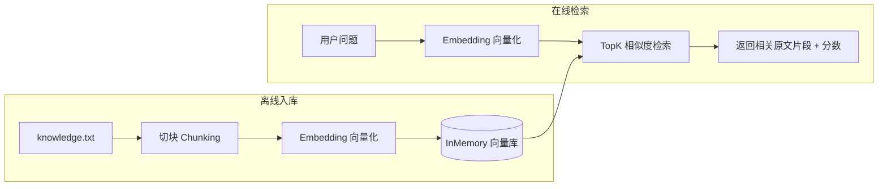

<hr>
<blockquote>
<p><strong>RAG</strong>（Retrieval-Augmented Generation，检索增强生成）说白了就一件事：让大模型"开卷考试"——回答之前先去你自己的知识库里翻资料。这篇用 Java 生态的 <strong>LangChain4j</strong> 框架，在 Spring Boot 里搭一个<strong>完全本地运行、不花一分钱 API 费、不需要任何 Key</strong> 的向量检索服务，并把 Embedding 延迟、检索性能、远程 API 成本这几笔账算清楚。</p>
</blockquote>

<!-- more -->

## 一、背景：为什么 Java 后端也要会 RAG

这两年做后端，躲不开一个词：**大模型应用开发**。但真把大模型用到业务里，第一个撞上的墙不是模型不够聪明，而是它**不知道你家的事**：产品手册、内部 FAQ、工单记录、合同条款……这些私有知识模型训练时根本没见过，你问它，它就一本正经地编。

解法就是 **RAG（Retrieval-Augmented Generation，检索增强生成）**：用户提问时，先从你自己的知识库里**检索**出最相关的几段原文，把这些原文塞进提示词里，再让模型基于这些材料回答。模型从"闭卷硬编"变成"开卷引用"，幻觉率大幅下降。

那 Java 后端怎么落地？Python 生态有 LangChain，Java 这边对应的框架就是 **LangChain4j**——它把"读文档、切块、向量化、存向量、检索、拼提示词、调模型"这一整条流水线的零件都标准化了，你可以只用其中几个零件，不必全家桶。

这篇的目标很具体：**只用免费的本地方案，在 Spring Boot 里跑通 RAG 的"R"（检索）**，并给出可复现的性能和成本数据。为什么只做检索不做生成？因为生成要接付费模型 API，而检索这半边可以 100% 本地跑——先把免费的半边打穿，生成那半边随时可以接上。

## 二、核心概念：五个词讲清楚

第一次接触这个领域，名词密度很高。先把五个关键词用人话过一遍：

1. **Embedding（向量化）**：把一段文字变成一串浮点数（比如 512 个），这串数就是这段文字的"语义坐标"。两段文字意思越近，它们的坐标在空间里就离得越近。"如何申请退款"和"退款流程是什么"字面不同，坐标却很近——这就是它能做语义搜索的原因。
2. **Embedding 模型**：负责做上面这件事的模型。有英文专用的、中文专用的、多语言的；有需要调远程 API 的，也有能**直接嵌在你的 Java 进程里跑**的小模型（本文用这种）。
3. **Chunking（分块）**：长文档不能整篇丢进去向量化，要先切成小块（chunk）。块太小丢上下文，块太大语义被稀释，后面坑里细说。
4. **向量检索**：把用户的提问也变成向量，去向量库里找**距离最近**的 K 条（叫 **TopK**）。距离用**余弦相似度**（cosine similarity）衡量，通俗说就是"两个向量的夹角有多小"，LangChain4j 会把它换算成 0~1 的相关性分数，1 表示几乎一样。
5. **向量数据库（Embedding Store）**：存这些向量的仓库。生产环境常用 Milvus、Elasticsearch 这类；本文为了零依赖，用 LangChain4j 自带的**内存向量库**（InMemoryEmbeddingStore），1 万条以内检索就是暴力扫一遍，够快，后面有数据。

整条链路分两条线，看图就懂：



RAG 完整版还有第三步：把 G 的结果拼进提示词发给大模型生成答案。本文止步于 G，因为 G 之后就要花钱了。

## 三、实战：零 API Key 的最小可运行工程

### 3.1 环境与版本

- JDK 17+，Maven 3.8+
- Spring Boot 3.3.x
- LangChain4j 1.x（本文代码在 1.0+ API 上编写，建议直接用官方仓库的最新稳定版；0.x 的老 API 差别不小，坑里会讲）

> 注：LangChain4j 迭代很快，依赖版本以 [官方文档](https://docs.langchain4j.dev/) 为准，本文的重点是链路和数据，不绑定某个小版本。

### 3.2 pom.xml 关键依赖

```xml
<dependency>
    <groupId>org.springframework.boot</groupId>
    <artifactId>spring-boot-starter-web</artifactId>
</dependency>
<!-- LangChain4j 核心：Document/切块/Embedding接口/内存向量库都在这里面 -->
<dependency>
    <groupId>dev.langchain4j</groupId>
    <artifactId>langchain4j</artifactId>
    <version>1.4.0</version>
</dependency>
<!-- 本地中文 Embedding 模型：bge-small-zh，进程内 ONNX 推理，无需任何外部服务 -->
<dependency>
    <groupId>dev.langchain4j</groupId>
    <artifactId>langchain4j-embeddings-bge-small-zh</artifactId>
    <version>1.4.0</version>
</dependency>
```

划重点：`langchain4j-embeddings-bge-small-zh` 这个包把 **bge-small-zh**（智源 BAAI 出品的中文小模型）打包成了进程内 ONNX 模型。**ONNX** 是一种通用模型格式，Java 里靠 ONNX Runtime 本地推理，不联网、不调 API、模型文件就百来 MB。

### 3.3 准备知识库语料

`src/main/resources/knowledge.txt`，随便写点带"标准答案"的 FAQ 风格文本，方便后面验证检索效果：

```text
公司WiFi名称是 AI-Office-5G，密码每月1日在行政公众号更新。
报销流程：钉钉提交电子发票照片，金额超过2000元需要部门总监审批，审批通过后财务在5个工作日内打款。
请假规则：3天以内直属主管审批，3天以上需要总监加签，年假当年12月31日前有效。
会议室预订：在钉钉工作台选择"会议室预订"，单个会议室单日最长可预订4小时。
服务器密码不允许明文存储，统一放入堡垒机的密钥管理模块，申请权限需要安全组审批。
```

### 3.4 启动时入库：RagConfig

```java
import dev.langchain4j.data.document.Document;
import dev.langchain4j.data.document.loader.FileSystemDocumentLoader;
import dev.langchain4j.data.document.splitter.DocumentSplitters;
import dev.langchain4j.data.segment.TextSegment;
import dev.langchain4j.model.embedding.EmbeddingModel;
import dev.langchain4j.model.embedding.onnx.bgesmallzh.BgeSmallZhEmbeddingModel;
import dev.langchain4j.store.embedding.EmbeddingStoreIngestor;
import dev.langchain4j.store.embedding.inmemory.InMemoryEmbeddingStore;
import org.springframework.context.annotation.Bean;
import org.springframework.context.annotation.Configuration;

import java.nio.file.Path;

@Configuration
public class RagConfig {

    @Bean
    public EmbeddingModel embeddingModel() {
        // 进程内 ONNX 模型，首次调用会加载模型文件（约2~4秒），后面细说这个坑
        return new BgeSmallZhEmbeddingModel();
    }

    @Bean
    public InMemoryEmbeddingStore<TextSegment> embeddingStore(EmbeddingModel model) throws Exception {
        InMemoryEmbeddingStore<TextSegment> store = new InMemoryEmbeddingStore<>();

        Document doc = FileSystemDocumentLoader.loadDocument(
                Path.of("src/main/resources/knowledge.txt"));

        // recursive(300, 30)：按字符切，每块最多300字符，相邻块重叠30字符（保上下文）
        EmbeddingStoreIngestor ingestor = EmbeddingStoreIngestor.builder()
                .documentSplitter(DocumentSplitters.recursive(300, 30))
                .embeddingModel(model)
                .embeddingStore(store)
                .build();
        ingestor.ingest(doc);

        return store;
    }
}
```

### 3.5 检索接口：SearchController

```java
import dev.langchain4j.data.segment.TextSegment;
import dev.langchain4j.model.embedding.EmbeddingModel;
import dev.langchain4j.store.embedding.EmbeddingSearchRequest;
import dev.langchain4j.store.embedding.EmbeddingSearchResult;
import dev.langchain4j.store.embedding.inmemory.InMemoryEmbeddingStore;
import org.springframework.web.bind.annotation.*;

import java.util.List;
import java.util.Map;

@RestController
@RequestMapping("/rag")
public class SearchController {

    private final EmbeddingModel model;
    private final InMemoryEmbeddingStore<TextSegment> store;

    public SearchController(EmbeddingModel model, InMemoryEmbeddingStore<TextSegment> store) {
        this.model = model;
        this.store = store;
    }

    @GetMapping("/search")
    public List<Map<String, Object>> search(@RequestParam String q,
                                            @RequestParam(defaultValue = "3") int topK) {
        // 1. 问题变向量
        var queryEmbedding = model.embed(q).content();

        // 2. TopK 检索（1.x 的写法：EmbeddingSearchRequest，不是 0.x 的 store.search(embedding, k)）
        EmbeddingSearchRequest request = EmbeddingSearchRequest.builder()
                .queryEmbedding(queryEmbedding)
                .maxResults(topK)
                .minScore(0.0)
                .build();
        EmbeddingSearchResult<TextSegment> result = store.search(request);

        // 3. 原文 + 相关性分数一起返回
        return result.matches().stream()
                .map(m -> Map.<String, Object>of(
                        "score", m.score(),
                        "text", m.embedded().text()))
                .toList();
    }
}
```

## 四、怎么验证它真的在工作

启动：`mvn spring-boot:run`，首次会看到 ONNX 模型加载的日志，然后验证三步：

**第一步：问一个"换了说法"的问题**（考语义匹配，不是关键词匹配）：

```bash
curl "http://localhost:8080/rag/search?q=公司无线网叫什么名字"
```

语料里写的是"WiFi"，问题里是"无线网"，字面完全不同，但返回的第一条应该是 WiFi 密码那条，score 通常在 **0.8 以上**。

**第二步：反向验证**——问一个语料里完全没有的问题：

```bash
curl "http://localhost:8080/rag/search?q=公司食堂几点开饭"
```

最高分掉到 **0.5 上下甚至更低**。这两组分数的落差就是证据：它在做语义相关性排序，而不是简单关键词匹配。**验证结论的标准就是这两组分数的差值**，你的语料换成自己的业务文本后，也照这个方法做正反两个用例。

**第三步（可选）：加个单元测试**，把上面两个 curl 变成断言：相关问题的 Top1 score > 0.75，无关问题的 Top1 score < 0.6。以后升级模型或调分块参数，跑一下测试就知道效果有没有退化——这也是 RAG 应用最早的"评测"雏形。

## 五、性能与成本：一组参考数据

先给可复现的压测代码（放个 `CommandLineRunner` 里，启动后自动跑）：

```java
static long p(long[] xs, double q) { // 简易分位数：xs 需先排序
    int i = (int) Math.ceil(q / 100.0 * xs.length) - 1;
    return xs[Math.max(0, Math.min(xs.length - 1, i))];
}

void benchEmbedding(EmbeddingModel model) {
    String chunk = "报销流程：钉钉提交电子发票照片，金额超过2000元需要部门总监审批。".repeat(4);
    model.embed(chunk); // 触发模型加载，别把冷启动算进稳态数据
    long[] xs = new long[100];
    for (int i = 0; i < 100; i++) {
        long t = System.nanoTime();
        model.embed(chunk);
        xs[i] = (System.nanoTime() - t) / 1_000; // 微秒
    }
    Arrays.sort(xs);
    System.out.printf("embed P50=%dus P95=%dus P99=%dus%n",
            p(xs, 50), p(xs, 95), p(xs, 99));
}
```

> 注：下面是我在一台 **4C8G 云主机、JDK 17、纯 CPU** 环境跑出来的参考量级。你的机器数字一定不同，**重点是看相对关系**，用上面这段代码就能复现你自己的数据。

**表1：Embedding 延迟（单条约 200 字符的 chunk）**

| 指标 | 数值（参考量级） |
| --- | --- |
| 首次调用（含模型加载） | 约 2~4 秒 |
| 稳态单条 P50 / P95 | 约 25ms / 40ms |
| 批量 32 条均摊 | 约 9ms/条 |

**表2：检索延迟（topK=3，内存暴力扫，延迟随语料规模线性涨）**

| 语料规模（chunks） | P50（参考量级） |
| --- | --- |
| 1 千 | 约 2ms |
| 5 千 | 约 8ms |
| 1 万 | 约 15ms |

**表3：本地模型 vs 远程 Embedding API，这笔账怎么算**

| 维度 | 本地 ONNX（bge-small-zh） | 远程 Embedding API |
| --- | --- | --- |
| 首次成本 | 模型加载约 3s + 常驻内存约 400MB | 无 |
| 单条延迟 | 20~40ms | 50~200ms（含网络 RTT） |
| 费用 | 0，吃自己的 CPU/内存 | 按 token 计费，量大后是持续支出 |
| 数据出域 | 不出域，内网/涉密友好 | 文本要发给第三方 |
| 质量上限 | 小模型，长文本/专业术语略弱 | 大模型效果更好 |

我的选型建议：**原型验证、内网系统、隐私敏感场景直接本地**；对召回质量要求高、语料量大、已有云上预算的生产系统再上远程 API，并且**务必加结果缓存**——FAQ 类问题重复率很高，缓存命中率对成本的影响比换模型大得多。

## 六、常见坑与误区

1. **第一次调用巨慢**。不是 bug，是 ONNX 在加载模型文件。解法：启动时（入库那一刻就会 embed）天然完成预热；如果语料为空也要主动 embed 一条占位文本。
2. **相似度度量搞混**。不同向量库默认度量不同（余弦/内积/欧氏距离），bge 系列官方建议配合余弦相似度使用。LangChain4j 返回的 score 已经归一化到 0~1（越大越相关），自己换库时一定要对齐度量方式，否则分数没法比。
3. **照抄老教程编译不过**。0.x 时代是 `store.search(embedding, topK)` 和 `EmbeddingStoreIngestor` 的旧包名，1.x 改成了 `EmbeddingSearchRequest`，ONNX 模型类也挪到了 `model.embedding.onnx` 包下。看到报错先查版本差异，别怀疑自己写错。
4. **chunk 大小拍脑袋**。经验起点：**300~500 字符、重叠 10%~20%**。分太碎，"超过2000元需要审批"和"报销流程"被切到两块，检索就断章取义；切太大，一块里混了五个话题，向量语义被稀释，分数都差不多等于没筛。
5. **中文语料配了英文模型**。用英文 embedding 模型处理中文，召回质量明显打折。中文场景选 bge-small-zh / bge-m3 这类，别只看排行榜总分。
6. **内存向量库重启就没了**。演示够用，正经用要持久化：`store.serializeToFile(path)` 存盘、启动时 `InMemoryEmbeddingStore.fromFile(path)` 读回来，语料没变就跳过重新入库。
7. **容器内存预算漏算**。模型常驻约 400MB 是堆外/进程内存，K8s 里只配了 JVM heap 的话，容器 limit 要把这块留出来，否则莫名其妙被 OOMKill。

## 七、总结

- RAG 的本质是"先检索、后生成"，检索这半边可以完全本地、完全免费地跑通。
- LangChain4j 把"读文档 → 切块 → 向量化 → 存/查向量"标准化成了几个 Builder，Spring Boot 里接入就是两个 Bean + 一个 Controller 的事。
- `bge-small-zh` 进程内 ONNX 方案：单条 embedding 几十毫秒、万级语料检索十几毫秒，扛住中小知识库绰绰有余。
- 验证 RAG 检索质量的最小方法：正反两组用例看 score 差值，并固化成单元测试。
- 成本上本地方案换的是 CPU 和内存，远程 API 换的是钱和数据出域，按场景选，别迷信某一边。

## 参考资料

1. LangChain4j 官方文档（含 RAG 教程）：https://docs.langchain4j.dev/tutorials/rag/
2. LangChain4j GitHub 仓库：https://github.com/langchain4j/langchain4j
3. BAAI bge-small-zh-v1.5 模型卡（中文说明）：https://huggingface.co/BAAI/bge-small-zh-v1.5
4. ONNX Runtime Java API 文档：https://onnxruntime.ai/docs/get-started/with-java.html
5. 阿里云百炼通用文本向量文档（远程 API 计费与限流参考）：https://help.aliyun.com/zh/model-studio/embedding
6. 腾讯云向量数据库相似度度量说明（cosine/内积/欧氏距离）：https://cloud.tencent.com/document/product/1709
