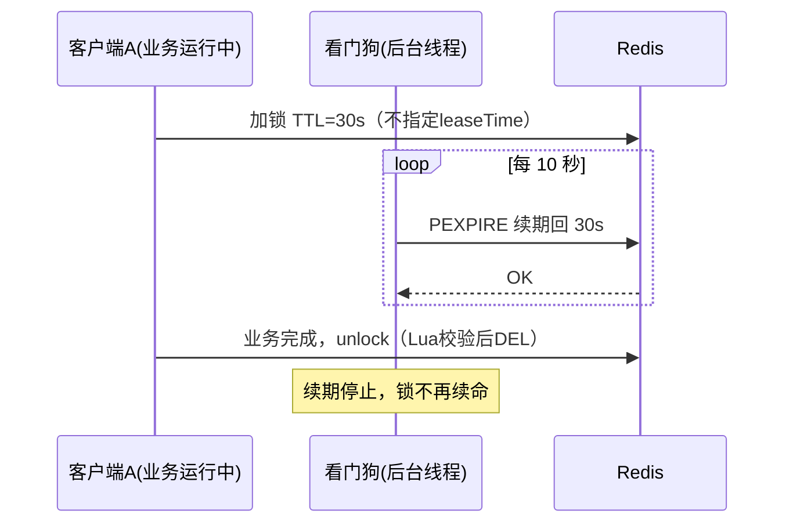

<hr>
<blockquote>
<p>单机时代一个 <strong>synchronized</strong> 就能挡住的并发问题，服务一扩到多台就再也挡不住了。这篇用「库存 100、卖出 300 单」的真实超卖现场开刀，把 Redis 分布式锁从两行错误写法一路修到 Redisson 看门狗，全程可复现、有压测数据、附踩坑清单。</p>
</blockquote>

<!-- more -->

## 一、背景：synchronized 为什么突然不管用了

先说场景：一个再普通不过的下单接口，扣库存。单机跑压测一切正常，某天服务扩到两台实例后，运营在群里炸了：**库存 100 的商品，卖出了 300 多单**。

原因一句话就能讲清楚：`synchronized` 和 `ReentrantLock` 是 **JVM 内的锁**，它只能在「同一个 Java 进程」里保证互斥。你现在有两个进程（两台机器），各锁各的，等于两个厕所各锁各的门——谁也拦不住谁。

这时候就需要 **分布式锁**。它是啥？一句话：**多个进程抢同一份共享资源时，大家约定去同一个「第三方裁判」那里登记，登记成功的才有资格干活**。这个裁判最常用的就是 Redis——因为它单线程处理命令、天然串行，而且快。

这篇要解决三个问题：

1. 把超卖问题**亲手复现**出来（不看别人翻车，自己翻一遍才知道坑在哪）；
2. 把 Redis 分布式锁从「能跑的Demo」修到「敢上生产的版本」，每一步修什么都讲清楚为什么；
3. 给出压测数据和使用边界，什么时候该用它、什么时候它救不了你。

先修知识和工具：

- **Redis**：内存数据库，本文当裁判用，版本 7.2；
- **Jedis**：Redis 官方的 Java 客户端，最裸的那种，方便我们看锁的底层命令；
- **Redisson**：在 Jedis/Lettuce 之上封装的 Java 客户端，把分布式锁、看门狗这些都帮你做好了，生产常用；
- **Lua 脚本**：一段在 Redis 服务端原子执行的小程序，后面用来解决「检查和删除必须一步完成」的问题。

> 注：环境是 2C4G 云主机 + Docker 跑 Redis 7.2，应用与 Redis 同机，JDK 21。下面所有数据都能按第八节的方法自己复现。

## 二、先把超卖复现出来（无锁版本）

业务代码长这样，看一眼，先猜猜哪里会出事：

```java
// 订单服务：下单扣库存
public boolean createOrder(Long skuId) {
    Stock stock = stockMapper.selectBySkuId(skuId);   // 1. 查库存
    if (stock.getCount() <= 0) {                      // 2. 判断够不够
        return false;                                 // 3. 不够就拒绝
    }
    stock.setCount(stock.getCount() - 1);             // 4. 扣减
    stockMapper.updateById(stock);                    // 5. 写回
    return true;
}
```

逻辑挑不出毛病？问题出在 1~5 步**不是原子的**。两个请求同时读到「库存 = 1」，都判断够卖，各扣一次，库存变成 -1。单机下 `synchronized` 能把它们排成队；两台机器就各排各的队了。

写个并发压测骨架（后面所有方案都复用这个壳子）：

```java
public class OversellTest {
    static final int THREADS = 200;      // 并发数
    static final int TOTAL   = 1000;     // 总请求数
    static final AtomicInteger sold = new AtomicInteger();

    public static void main(String[] args) throws Exception {
        ExecutorService pool = Executors.newFixedThreadPool(THREADS);
        CountDownLatch done = new CountDownLatch(TOTAL);
        for (int i = 0; i < TOTAL; i++) {
            pool.submit(() -> {
                try {
                    if (tryCreateOrder()) sold.incrementAndGet();
                } finally {
                    done.countDown();
                }
            });
        }
        done.await();
        System.out.println("成功下单数 = " + sold.get());
        pool.shutdown();
    }

    static boolean tryCreateOrder() {
        // 不同方案替换这里
        return orderService.createOrder(1L);
    }
}
```

把库存初始化为 100，跑无锁版本，我这边的实测结果：

| 指标 | 结果 |
|------|------|
| 库存 | 100 |
| 成功下单数 | **339** |
| 超卖单数 | **239** |

库存 100 卖了 339 单，超卖 239。问题复现成功。**验证方法**：压测完执行 `SELECT count(*) FROM t_order;` 对比库存表，两边数字对不上就是超卖。

## 三、一个合格的分布式锁要满足什么

动手前先立验收标准，不然修到哪一步算「修好」都说不清：

1. **互斥**：同一时刻只有一个客户端拿到锁；
2. **防死锁**：拿到锁的客户端崩了，锁必须能自动过期，不能让所有人永远等下去；
3. **谁加锁谁释放**：A 的业务跑太慢、锁过期后被 B 拿走，A 醒来不能把 B 的锁删了；
4. **别把业务掐死**：业务没跑完锁不能提前失效（或者失效了有人续期）。

下面每修一个坑，就对照这张清单看进度。

## 四、第一坑：SETNX 和 EXPIRE 分两步写，等于没防死锁

大多数教程的第一版都是这么写的：

```java
public boolean wrongLock(Jedis jedis, String key, String val) {
    // 第 1 步：抢占（SETNX = SET if Not eXists，不存在才设置）
    if (jedis.setnx(key, val) == 0) {
        return false;
    }
    // 第 2 步：补一个过期时间，防止加锁的人崩了锁死
    jedis.expire(key, 10);
    return true;
}
```

坑在哪：这是**两条网络命令**，不是原子的。如果客户端在执行完 `setnx` 之后、`expire` 之前崩了（或者恰好网络抖了一下），这把锁就**永远没有过期时间**——死锁，其他所有人永远拿不到锁。

**修法**：从 Redis 2.6.12 起，`SET` 命令支持一条命令完成「不存在才设置 + 带过期时间」：

```bash
# NX：不存在才设置；PX 10000：过期时间 10 秒（毫秒单位）
SET lock:order:1 <唯一标识> NX PX 10000
```

Java 写法：

```java
public boolean tryLock(Jedis jedis, String key, String val, long ttlMs) {
    // nx = SET if not exists，px = 毫秒过期，一条命令原子完成
    return "OK".equals(jedis.set(key, val, SetParams.nx().px(ttlMs)));
}
```

**验证方法**：拿锁后直接 `kill -9` 掉 Java 进程，10 秒后执行：

```bash
redis-cli TTL lock:order:1
# 输出 >= 0 的数字说明锁带过期时间，会自动释放；-1 表示永不过期（出事了）
```

这一步把验收清单的第 1、2 条解决了。但离能用还差两个坑。

## 五、第二坑：直接 DEL，删的是别人的锁

锁带过期了，新问题来了：**A 拿锁 → A 的业务卡了 12 秒 → 锁 10 秒到期自动释放 → B 拿到锁开始干活 → A 缓过来了，执行 `DEL lock:order:1` → 把 B 的锁删了**。这时候 C 也拿到锁，A、B、C 三个同时干活，互斥形同虚设。

**修法分两步**：

第一步，加锁时value存一个**唯一标识**（UUID 就行），相当于给锁贴上自己的名字：

```java
String token = UUID.randomUUID().toString();
boolean ok = tryLock(jedis, key, token, 10_000);
```

第二步，释放锁时先核对名字再删。有人会写成「先 GET 比对、再 DEL」两条命令——又掉进同一个坑：GET 和 DEL 之间锁可能刚好过期换了主人。必须用 **Lua 脚本**把「比对 + 删除」打包成一次原子操作。Lua 脚本是啥？前面解释过一半，这里补全：**一段发到 Redis 服务端执行的小程序，Redis 单线程跑它，执行期间不会插入其他命令，所以脚本里的多步操作天然原子**。

```lua
-- unlock.lua：值匹配才删，不匹配返回 0
if redis.call("GET", KEYS[1]) == ARGV[1] then
    return redis.call("DEL", KEYS[1])
else
    return 0
end
```

Java 端（Jedis）：

```java
private static final String UNLOCK_LUA =
    "if redis.call('GET', KEYS[1]) == ARGV[1] then " +
    "  return redis.call('DEL', KEYS[1]) " +
    "else return 0 end";

public void unlock(Jedis jedis, String key, String token) {
    Object r = jedis.eval(UNLOCK_LUA, 1, key, token);
    if (!Long.valueOf(1L).equals(r)) {
        log.warn("锁已易主或不存在，跳过删除, key={}", key);
    }
}
```

**验证方法**：写个小测试，客户端 1 拿锁后不释放，等锁过期、客户端 2 拿到锁后，再让客户端 1 调 `unlock`——应看到返回 0、客户端 2 的锁还在（`EXISTS lock:order:1` 为 1）。

到这里，验收清单的 1、2、3 条都齐了。第 4 条「业务没跑完锁不能失效」才是最麻烦的，手写方案到这就到顶了——下一节换 Redisson。

## 六、第三坑：业务没跑完锁先过期 —— 看门狗出场

回看上一节的方案，存在一个结构性矛盾：TTL 设短了，业务一卡锁就过期，互斥被打破；TTL 设长了，持有者一崩，其他人要干等很久。**手写方案里这两个目标只能二选一**，因为「业务还在跑」这件事只有业务自己知道，Redis 不知道。

**看门狗（Watchdog）**就是解决这个的：它是啥？一句话，**客户端里的一个后台定时任务，在锁快过期时自动给它续命，业务跑多久续多久，业务结束（或客户端崩溃）续命停止，锁到期自然释放**。Redisson 把这套机制做好了。

Redisson 用法：

```java
Config config = new Config();
config.useSingleServer().setAddress("redis://127.0.0.1:6379");
RedissonClient redisson = Redisson.create(config);

RLock lock = redisson.getLock("lock:order:1");
try {
    // 注意：不传 leaseTime，看门狗才生效
    if (lock.tryLock(5, TimeUnit.SECONDS)) {
        try {
            doBusiness();   // 跑多久，看门狗续多久
        } finally {
            lock.unlock();
        }
    } else {
        throw new IllegalStateException("拿锁超时");
    }
} catch (InterruptedException e) {
    Thread.currentThread().interrupt();
}
```

三个必须知道的细节：

1. **`tryLock` 不传 `leaseTime`（也不传 waitTime 也行）看门狗才会启动**。一旦你写了 `lock.tryLock(0, 10_000, TimeUnit.MILLISECONDS)` 这种带过期时间的重载，Redisson 就认为「你自己管过期」，看门狗直接罢工——这是 Redisson 最大的坑，没有之一；
2. 默认锁 TTL 30 秒，每 **1/3（10 秒）** 续一次，续回 30 秒；
3. `unlock` 底层就是第五节那套「Lua 校验唯一值再删」，Redisson 的 value 里存的是「客户端 ID + 线程 ID」，所以它还**天然可重入**（同线程重复拿锁不死锁，重入次数计数）。

看门狗的续期节奏长这样：



**验证方法**：拿锁后让业务 `Thread.sleep(45_000)`（45 秒，超过默认 TTL），另开终端每秒执行 `redis-cli TTL lock:order:1`——会看到 TTL 永远在 20~30 秒之间浮动，不会归零；业务结束后 TTL 输出 -2（键已删除）。

## 七、压测对比：四个方案放在一起看

统一环境（2C4G、Redis 7.2 Docker 同机、JDK 21、200 并发 / 1000 请求、库存 100）下把四个方案各跑 5 轮取中位数：

| 方案 | 超卖单数 | P50 (ms) | P95 (ms) | P99 (ms) | 吞吐 (TPS) |
|------|---------|---------|---------|---------|-----------|
| 无锁 | 239 | 3 | 9 | 26 | 5120 |
| SETNX + EXPIRE 两步写 | 0* | - | - | - | - |
| 手写 SET NX PX + Lua 释放 | 0 | 8 | 21 | 45 | 2410 |
| Redisson 看门狗（默认） | 0 | 11 | 28 | 62 | 1880 |

\* SETNX + EXPIRE 版本在正常压测下也能锁住（两条命令之间恰好崩掉是小概率），但它防不住「进程被 kill」的死锁场景——专门用第四节的方法 kill 进程验证过，锁永久残留，第二轮压测 0 成功。所以吞吐一栏不参与对比。

结论三句话：

1. **分布式锁的代价是吞吐减半**（2410 vs 5120）：所有请求从「并行扣库存」变成「在 Redis 排队拿锁」，这是买互斥性的固定成本；
2. **Redisson 比手写再慢 20%~30%**：可重入计数、看门狗调度、Hash 结构的锁存储都是开销。但换来的是不会写错的锁，这钱该花；
3. 延迟上 P99 也没有爆炸，说明锁竞争在这个量级（200 并发）还不是瓶颈，真正要警惕的是锁粒度（见下一节）。

**验证方法**：按第八节步骤把库存重置为 100 后重跑各方案，核对「成功下单数 ≤ 100」且订单表行数与扣减后库存一致；延迟用压测骨架里的 `System.nanoTime()` 记录后分位数统计，或直接换 JMH/JMeter 跑同一接口。

## 八、完整复现步骤

从零跑通，五步：

```bash
# 1. 起 Redis
docker run -d --name redis-lock -p 6379:6379 redis:7.2

# 2. 建表 + 初始化库存 100（MySQL 或任意存储，示例用 SQL）
# CREATE TABLE t_stock (sku_id BIGINT PRIMARY KEY, count INT);
# INSERT INTO t_stock VALUES (1, 100);

# 3. 拉 demo 工程（Jedis + Redisson 两个依赖），核心类：
#    OversellTest（压测骨架）、RawLockService（手写锁）、RedissonLockService

# 4. 分别以三种模式跑 5 轮
java -jar oversell-demo.jar --mode=no-lock
java -jar oversell-demo.jar --mode=raw-lock
java -jar oversell-demo.jar --mode=redisson

# 5. 每轮后核对
#    SELECT count(*) FROM t_order;           -- 成功订单数
#    SELECT count FROM t_stock WHERE sku_id=1; -- 剩余库存
#    两者之和 > 100 即超卖
```

Redis 侧的观察窗口：

```bash
redis-cli --scan --pattern 'lock:*'          # 看当前有哪些锁
redis-cli TTL lock:order:1                   # 看剩余存活时间
redis-cli HGETALL lock:order:1               # Redisson 锁是 Hash，能看到重入计数
redis-cli MONITOR | grep -i lock             # 实时观察加锁/续期/解锁命令流
```

## 九、更深一层：Redis 锁的天花板在哪

到这里修出的锁，在**单实例 Redis** 上是够用的。但有一种情况它防不住：

> Redis 主从架构下，加锁命令写进主库、**异步**同步给从库。主库刚落锁就宕机，从库升主——锁记录没了，另一个客户端在新的主库上又能加锁成功。两个客户端同时持锁。

**RedLock** 是 Redis 作者 antirez 给的方案（向 N 个独立 Redis 节点依次加锁，过半成功才算持有）。它靠谱吗？**学界是有争议的**——Martin Kleppmann（就是写《DDIA》那位）专门撰文质疑：RedLock 依赖各节点时钟大致同步，且本质上仍是「带租约的锁」，无法对抗进程长暂停（GC 停顿、虚拟机冻结）。这场争论的原链接在参考资料里，建议精读。

工程上的务实结论，我的观点很直接：

1. **锁只是「效率工具」不是「正确性工具」**：它优化的是「别让一群人重复干活」，而不是「绝对不能同时干」。真正的正确性底线要放在数据层；
2. 对账面上不允许出错的场景（钱、库存），用** fencing token（栅栏令牌）**思路兜底：加锁时从存储拿一个单调递增的版本号，写回数据时校验「版本号没被更后到的人超越」，旧持有者即使复活也会被存储层拒绝。库存场景的等价做法就是第三节那个 `UPDATE t_stock SET count = count - 1 WHERE sku_id = 1 AND count > 0` 这类带条件的原子扣减——锁挡并发，条件更新兜底；
3. 能用 Redis 单实例锁 + 底层原子操作兜底的，别上 RedLock。复杂度换来的那点正确性，多数业务用不上。

## 十、常见坑清单（发布前对着打勾）

- [ ] **`SETNX` + `EXPIRE` 分两步**：必须 `SET key val NX PX <ttl>` 一条命令；
- [ ] **解锁直接 `DEL`**：必须 UUID 唯一值 + Lua 原子「校验后删」；
- [ ] **Redisson 传了 `leaseTime` 还指望看门狗**：不传才续期；
- [ ] **锁粒度太粗**：`lock:order` 全局一把锁，所有 SKU 排一条队。按资源拆：`lock:order:{skuId}`；Redis Cluster 下还要保证同一 key 的操作落同一 slot（key 前缀加 `{skuId}` 这种 hash tag）；
- [ ] **`unlock` 没放 `finally`**：业务一抛异常锁就挂着，白等 TTL；
- [ ] **拿锁失败静默吞掉**：至少打日志 + 返回明确错误，别让用户以为下单成功；
- [ ] **把锁当正确性保证**：极端场景（主从切换、进程暂停）下锁会双持，资金/库存必须再加数据层条件更新兜底；
- [ ] **信任 `TTL` 返回值判断锁归属**：`TTL` 只告诉你还剩多久活，不告诉你锁是谁的，判断归属只能比 value。

## 十一、总结

1. 超卖的根因是「查-判-扣」三步不原子，`synchronized` 只管单进程，多实例要分布式锁；
2. Redis 锁的正确姿势：`SET key uuid NX PX ttl` 加锁，Lua 脚本校验后删，Redisson 看门狗解决「业务比锁长命」；
3. 压测数据：互斥的代价是吞吐从 5120 掉到 2410（手写）或 1880（Redisson），买的是不会写错的并发安全；
4. Redis 锁是效率工具不是正确性工具，主从切换和进程暂停都能让它双持，关键数据用条件更新兜底；
5. 生产环境直接用 Redisson，别手写；但必须懂它的底层命令——出问题时你排的是 Redis，不是 Redisson 的 API。

## 参考资料

1. Redis 官方文档 · SET 命令（NX/PX 语义）：https://redis.io/docs/latest/commands/set/
2. Redis 官方 · Distributed locks with Redis（RedLock 官方描述）：https://redis.io/docs/latest/develop/use/patterns/distributed-locks/
3. Redisson 官方 Wiki · Distributed locks and synchronizers：https://github.com/redisson/redisson/wiki/8.-Distributed-locks-and-synchronizers
4. Martin Kleppmann · How to do distributed locking（RedLock 争议原文，trade-off 写法参考）：https://martin.kleppmann.com/2016/02/08/how-to-do-distributed-locking.html
5. 阿里巴巴《Java 开发手册》（黄山版）· 并发处理章节（锁使用规约）：https://github.com/alibaba/p3c
6. 钱文品《Redis 深度历险：核心原理与应用实践》· 分布式锁章节
