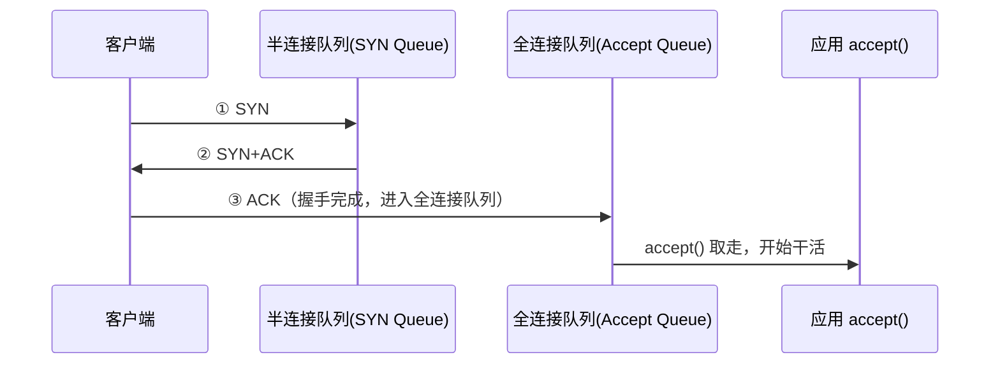

<hr>
<blockquote>
<p><strong>摘要</strong>：线上偶发 connection reset、客户端报「连接被拒」，翻遍应用日志却啥都没有——这种案子十有八九不是代码的锅，而是 TCP 的「全连接队列」溢出了：内核替你把连接攒着，但应用程序没来得及 accept。这篇文章用两个最小实验把溢出过程当场复现，讲清楚 <strong>backlog</strong>、<strong>somaxconn</strong>、<strong>tcp_abort_on_overflow</strong> 这些参数到底谁说了算，最后映射到 Tomcat / Nginx / Redis 的配置，告诉你怎么查、怎么改、什么时候不该改。</p>
</blockquote>

<!-- more -->

## 一、从一个线上报警说起

先说个场景：大促压测的时候，网关那边突然开始报 `Connection reset by peer`，QPS 掉坑里。你登到服务器上看，Java 进程活着，CPU 不高，内存正常，GC 也安静——应用层面看起来一切祥和。但客户端就是连不上。

这种「进程活着但连不进来」的问题，大概率出在内核的连接排队环节。在排查之前，得先把三次握手过程中两个队列的位置搞清楚，不然命令输出来的数字都不知道在看什么。

## 二、两个队列到底在哪

服务端收到一个新连接，中间要经过两个「候客区」：

- <strong>半连接队列（SYN Queue）</strong>：收到客户端 SYN、还没完成三次握手的连接，放在这里「待确认」。可以理解成：客人刚进门喊了一声「有人吗」，还没坐下。
- <strong>全连接队列（Accept Queue）</strong>：三次握手已完成、内核等着应用程序调用 `accept()` 取走的连接。可以理解成：客人已经在门口坐下了，就等服务员（你的应用线程）来接待。



关键点：<strong>握手是内核干的活，accept 是应用程序干的活，这两件事是异步的</strong>。内核能帮你攒连接，但攒的位置有限——全连接队列的长度，就是所谓的 <strong>backlog</strong>（积压上限，由应用在 `listen()` 时声明，还要被内核参数封顶，下一节细说）。

队列满了之后会发生什么，取决于两个内核参数：

- <strong>tcp_abort_on_overflow = 0</strong>（绝大多数系统的默认值）：内核悄悄把第三次握手的 ACK 丢掉，装作没听见。客户端以为自己连上了（状态是 ESTABLISHED），服务端却停在 SYN_RECV，过一会儿重传 SYN+ACK。连接就这么悬着，直到重传次数耗尽。这就是那种「客户端显示连上了、一发数据就 reset」的诡异现场。
- <strong>tcp_abort_on_overflow = 1</strong>：队列一满，第三次 ACK 一到就直接回 RST，客户端立刻收到 connection reset。快速失败，但SYN Flood 场景下等于帮攻击者省事，生产上慎开。

## 三、参数到底谁说了算：backlog 与 somaxconn 的「双重封顶」

全连接队列的最终长度不是应用单方面说了算，也不是内核单方面说了算，而是取两者中较小的：

```
全连接队列长度 = min(应用声明的 backlog, net.core.somaxconn)
```

几个关键角色，第一次出现的都用一句话交代清楚：

| 参数 | 谁设置 | 常见默认值 | 一句话解释 |
|---|---|---|---|
| `backlog` | 应用在 `listen()` 时声明 | Java `ServerSocket` 默认 50；Tomcat `acceptCount` 默认 100；Nginx 默认 511；Redis `tcp-backlog` 默认 511 | 应用愿意让内核帮它攒多少个已握手连接 |
| `net.core.somaxconn` | 内核 sysctl | 老内核 128；内核 5.4+ 多数发行版 4096 | 内核对队列长度的封顶，专治「应用乱报大数」 |
| `net.ipv4.tcp_max_syn_backlog` | 内核 sysctl | 128~1024 不等 | 半连接队列相关上限（有 SYN Cookie 时基本失效） |
| `net.ipv4.tcp_abort_on_overflow` | 内核 sysctl | 0 | 队列满时：0 = 装死丢 ACK，1 = 直接 RST |
| `net.ipv4.tcp_syncookies` | 内核 sysctl | 1 | <strong>SYN Cookie</strong>：遭 SYN Flood（攻击者狂发 SYN 不回 ACK，把半连接队列撑爆）时不建队列、把状态编码进序列号里应战的机制 |

> 注：半连接队列的实际大小在新内核里还有「向上取 2 的幂」之类的细节，不同版本行为有差异，这里不展开。定性结论记住一条：<strong>全连接队列看 `min(backlog, somaxconn)`；半连接队列还受 `tcp_max_syn_backlog` 和 syncookies 影响</strong>。精确公式见参考资料里美团那篇文章。

还有个高频误会要提前拆掉：`ss` 输出里 LISTEN 状态那两列的意思，跟 ESTABLISHED 状态完全不同——

- <strong>LISTEN 状态：Recv-Q = 当前全连接队列里积压的连接数，Send-Q = 队列上限</strong>（这就是你要的「水位线」和「容量」）；
- ESTABLISHED 状态：Recv-Q 才是「收到了还没被应用读走的字节数」。

同一个字段两个含义，看错列会得出完全相反的结论。

## 四、实验一：造一个「不肯 accept」的服务端，亲眼看队列涨满

光说不练假把式。我们用十行 Python 造一个只监听、永不 accept 的服务端，把溢出过程完整看一遍。<strong>全部实验在本机就能做，不用外网，不碰生产。</strong>

实验环境：Linux（内核 5.x），普通用户即可，实验二需要一次 root（改完马上恢复）。

### 4.1 服务端：只 listen，不 accept

```python
# server.py — 故意把 backlog 设得很小(2)，方便肉眼观察
import socket, time

s = socket.socket(socket.AF_INET, socket.SOCK_STREAM)
s.setsockopt(socket.SOL_SOCKET, socket.SO_REUSEADDR, 1)
s.bind(('0.0.0.0', 9000))
s.listen(2)   # backlog = 2，实际队列长度还要被 somaxconn 封顶
print('listening on 9000, but I will NEVER accept.')
while True:
    time.sleep(1)
```

```bash
python3 server.py
```

### 4.2 客户端：连 5 个连接并挂住

```python
# client.py — 建立 5 个连接，握完手就挂住不说话
import socket, time

socks = []
for i in range(5):
    s = socket.socket()
    s.connect(('127.0.0.1', 9000))   # 前几个成功，后面开始「假成功」
    print(f'conn {i+1}: connected')
    socks.append(s)
time.sleep(300)
```

```bash
python3 client.py
```

### 4.3 观察点一：队列水位（ss）

另开一个终端：

```bash
ss -lnt 'sport = :9000'
# State   Recv-Q Send-Q Local Address:Port
# LISTEN  2      2      0.0.0.0:9000
```

读法：Recv-Q 涨到 2（当前积压 2 个），Send-Q 是 2（上限就是 2）。<strong>Recv-Q == Send-Q 且持续不动，就是队列打满的铁证。</strong>

再看连接状态分布：

```bash
ss -ant | grep 9000
# EST-SYN  recv-q send-q ...
# ESTAB 0 0 127.0.0.1:xxxxx 127.0.0.1:9000   ← 客户端视角：连上了
# SYN-_recv ...
```

你会看到经典的一幕：<strong>客户端侧的连接是 ESTABLISHED，服务端侧却挂着 SYN_RECV</strong>——第三次握手的 ACK 被内核扔了，连接悬在半空。

> 注：上面 ss 输出是格式示意，重点看状态列的 `ESTAB` 与 `SYN-RECV` 组合，而不是抄具体字段。

### 4.4 观察点二：内核溢出计数器（nstat / netstat）

<strong>nstat</strong> 是 iproute2 自带的内核计数器读取工具，比 `netstat -s` 的自然语言输出更精确：

```bash
nstat -az TcpExtListenOverflows TcpExtListenDrops
# TcpExtListenOverflows    7     0.0   ← 有 7 次握手 ACK 撞上了满队列
# TcpExtListenDrops        7     0.0
```

隔几秒再跑一次，数字还在涨——因为服务端重传 SYN+ACK 后，客户端会跟着重发 ACK，每次都撞一次墙，所以计数会比你发起的连接数还多，这是正常现象。

不用 nstat 的话，老命令也能看（就是输出啰嗦）：

```bash
netstat -s | grep -iE 'listen'
# 7 times the listen queue of a socket overflowed
# 7 SYNs to LISTEN sockets dropped
```

<strong>如何验证结论</strong>：把 server.py 里的 `listen(2)` 改成 `listen(64)`，重启后再跑 client.py，Recv-Q 最高只到 5，溢出计数不再增长。这就是「调大 backlog」的直接效果。

## 五、实验二：tcp_abort_on_overflow=1，把 reset 提前

默认行为是「装死」，我们把它切换成「快速拒绝」，看看客户端的体感差异：

```bash
# 需要 root，改完马上恢复！
sudo sysctl -w net.ipv4.tcp_abort_on_overflow=1
```

重跑 client.py：前 2 个连接照常建立，第 3 个开始在 `connect()` 之后的第一次读写时直接抛 `ConnectionResetError`（部分内核在 connect 阶段就报 `ECONNRESET`）。对照实验一里那种「假成功后挂 60 秒才死」，这就是两种失败模式的区别：

| 行为 | 客户端体感 | 排查难度 |
|---|---|---|
| abort_on_overflow=0（默认） | 假成功，之后超时/悬死 | 高，症状像应用 hang |
| abort_on_overflow=1 | 立刻 reset | 低，但 SYN Flood 时会放大伤害 |

实验完立刻恢复：

```bash
sudo sysctl -w net.ipv4.tcp_abort_on_overflow=0
```

> 注：所有 sysctl 实验做完都要恢复原值。改之前先用 `sysctl net.ipv4.tcp_abort_on_overflow` 记下原值，这是做内核参数实验的基本素养。

## 六、映射到工程：你身边的 backlog 在哪

跑完实验回到真实世界。你天天在用的服务端软件，backlog 参数藏在哪、默认多少、怎么验证：

| 软件 | 参数 | 默认值 | 验证命令 |
|---|---|---|---|
| Java NIO（手写） | `new ServerSocket(port, backlog)` | 不传时 <strong>50</strong> | `ss -lnt 'sport = :端口'` 看 Send-Q |
| Tomcat | `server.xml` 里 Connector 的 `acceptCount` | 100 | 同上，看 java 进程监听端口 |
| Spring Boot（内嵌 Tomcat） | `server.tomcat.accept-count` | 100 | 同上 |
| Nginx | `listen 80 backlog=511` | 511 | `ss -lnt 'sport = :80'` |
| Redis | 配置文件 `tcp-backlog` | 511 | 同上 |

几个值得刻进脑子的细节：

1. <strong>somaxconn 是天花板，且在 `listen()` 那一刻生效</strong>。你把 Tomcat 的 `acceptCount` 改到 4096，但系统 `somaxconn` 还是 128，实际队列就是 128——而且 Java 静默接受截断，连个警告都没有（Nginx 好歹会在 error log 里提醒你 truncated）。<strong>正确姿势是两边一起改，然后重启应用</strong>（backlog 在 listen 时定死，改 sysctl 不重启等于白改）。
2. <strong>Tomcat NIO 里 acceptCount 什么时候才真正起作用？</strong>工作线程全忙、连接数达到 `maxConnections`（默认 8443/10000 视版本）时，Tomcat 的 acceptor 会暂停 accept，新连接开始在内核队列里堆积——这时 acceptCount 才是缓冲垫。平时它就是个几乎空着的停车场。
3. <strong>压测时的正确观测姿势</strong>：一边 `wrk -t2 -c300 -d30s http://localhost:8080/`，一边另一个终端盯 `ss -lnt 'sport = :8080'` 的 Recv-Q 和 `nstat -az TcpExtListenOverflows` 的增量。Recv-Q 长期贴着 Send-Q 且溢出计数在涨 → 连接进不来（accept 环节卡住）；Recv-Q 一直很低但延迟高 → 连接进得来、处理慢（去看线程池/下游）。<strong>这一步能把「连不上」和「处理慢」两类问题当场分流</strong>，比翻半天日志快得多。

我在本地 4C8G 虚拟机上做过一组对照（后端故意 sleep 500ms 模拟慢处理，wrk -t2 -c300 -d30s，数据仅供参考、量级比绝对值重要）：

| 场景 | 溢出计数增量 | 非成功请求数 | P99 延迟 |
|---|---|---|---|
| acceptCount=100，somaxconn=128 | 持续增长 | 上千 | 秒级超时 |
| acceptCount=1024，somaxconn=4096（已重启） | 0 | ~0 | 明显升高（排队等待） |

结论一目了然：<strong>调大队列消灭了 reset，但延迟反而更难看了</strong>——队列只是把「快速失败」换成了「慢速排队」，容量问题并没有消失，根因还是 accept/处理速度跟不上。

## 七、常见坑与误区

1. <strong>只改应用不改 sysctl，或者只改 sysctl 不重启应用</strong>。`min()` 双重封顶两边都得到位；backlog 在 `listen()` 时生效，不重启应用，改了等于没改。
2. <strong>看错 ss 的列</strong>。LISTEN 状态的 Recv-Q 是队列水位，ESTABLISHED 状态的 Recv-Q 是未读字节。对着 ESTABLISHED 行看 Recv-Q 判断「队列溢出」，方向就全错了。
3. <strong>容器/K8s 里改不动 sysctl</strong>。网络类内核参数按网络命名空间隔离，Pod 里 `sysctl -w` 大概率报 permission denied，需要 privileged 安全上下文或 initContainer，很多托管集群干脆禁止。这时队列上限是宿主机命名空间的全局值，得找平台侧改。
4. <strong>把 accept 队列问题误判成线程池问题（或反过来）</strong>。先看 `nstat` 溢出计数和 LISTEN 水位分流：计数在涨是内核层「进不来」，计数安静但线程全忙是应用层「处理慢」。两条路用的药完全不同。
5. <strong>tcp_abort_on_overflow 当成优化项常开</strong>。它只是把失败提前，正常流量下白白失去「客户端重试」的机会，SYN Flood 场景下还会帮攻击者快速烧穿你的应用层。它是个<strong>排障开关</strong>，不是性能参数。
6. <strong>压测机自身 TIME_WAIT 耗尽</strong>导致 connect 失败，被误判成「服务端队列溢出」。压测前先 `ss -ant state time-wait | wc -l` 看一眼客户端侧，必要时加 `ip_local_port_range` 或开 `tcp_tw_reuse`。

## 八、总结

- 三次握手里有两个队列：<strong>半连接队列</strong>存未完成握手，<strong>全连接队列</strong>存已完成握手等 accept 的连接；队列长度 = `min(backlog, somaxconn)`。
- 队列满的默认行为是「装死丢 ACK」（客户端假成功后悬死），`tcp_abort_on_overflow=1` 会改成立刻 RST——它是排障开关，不是常态配置。
- 排查三板斧：`ss -lnt` 看水位（Recv-Q 贴 Send-Q 就是满了）→ `nstat -az TcpExtListenOverflows` 看溢出增量 → 对照应用配置（Tomcat `acceptCount`、Java `ServerSocket` 默认 50）确认 backlog 实际生效值。
- 调大队列只能消灭 reset，治不了慢；Recv-Q 持续打满时，先去看 accept 环节为什么卡住（线程池、maxConnections、GC 停顿），队列参数只是缓冲垫。
- 生产改参数的正确顺序：记录原值 → 双边修改（应用 + sysctl）→ 重启应用 → 用 `ss` 验证 Send-Q 生效。

## 参考资料

1. 美团技术团队：《关于 TCP 半连接队列和全连接队列》——本文参数关系的定性结论来源，含内核版本差异分析：<https://tech.meituan.com/2018/07/26/triangle-of-backlog-accept.html>
2. W. Richard Stevens，《UNIX 网络编程 卷1：套接字联网 API》（第 3 版）——`listen()` 与 backlog 的经典定义
3. W. Richard Stevens，《TCP/IP 详解 卷1：协议》（第 2 版）——三次握手与状态机
4. Linux 内核文档 ip-sysctl：`somaxconn`、`tcp_abort_on_overflow`、`tcp_syncookies` 官方语义：<https://docs.kernel.org/networking/ip-sysctl.html>
5. Apache Tomcat 9 HTTP Connector 配置文档（`acceptCount`、`maxConnections`）：<https://tomcat.apache.org/tomcat-9.0-doc/config/http.html>
6. ss(8) man page——`Recv-Q`/`Send-Q` 在 LISTEN 与其他状态下语义差异的官方说明：<https://man7.org/linux/man-pages/man8/ss.8.html>
