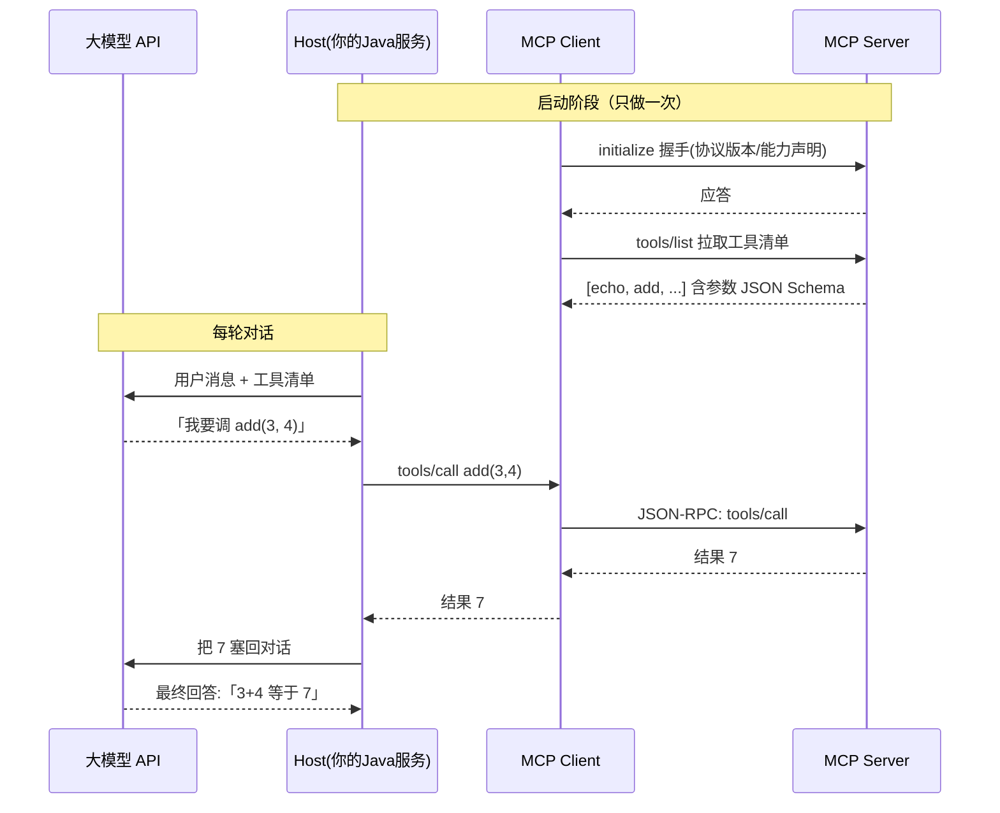

<hr>
<blockquote>
<p><strong>摘要</strong>：让大模型「查订单」「发消息」「调内部 API」，第一反应往往是把接口文档塞进提示词——结果模型回你一段 JSON 文本，还得自己写正则去解析，换个模型又全得重来。这篇把这条野路子收编成工程方案：<strong>MCP</strong>（Model Context Protocol，Anthropic 开源的「模型连工具」标准协议，相当于给 AI 世界定了个 USB-C 接口）+ <strong>LangChain4j</strong>（Java 生态的大模型应用开发框架，Role 相当于 Java 界的 Spring Data——把样板代码收进约定）。用一个 40 行的最小可运行工程，把 Spring Boot 服务接上一个本地 MCP 实验服务器，跑通「模型自己决定调工具 → 工具执行 → 结果回填再回答」的完整链路；顺带实测 stdio 与 SSE 两种传输的延迟差异（同一工具链 P50 相差约 15ms，瓶颈根本不在传输，而在模型两段生成），以及挂上工具后 prompt token 从 180 涨到 950 的固定成本账。最后是六个上生产前必须知道的坑：工具描述写得烂模型就不调、stdio 子进程忘关变僵尸、超时默认值不合适等。</p>
</blockquote>

<!-- more -->

## 一、背景：模型「会说不会做」，问题出在哪

先交代场景。想给客服机器人加个能力：用户问「我的订单 202611050001 到哪了」，机器人直接回物流状态。

第一版实现很朴素：把「查询订单接口」的 URL、参数说明全写进系统提示词，让模型「按格式返回 JSON」。

结果三条路全堵：

- **格式不稳**：模型这次回纯 JSON，下次带段解释文字前后包着，解析代码天天改；
- **换模型即重写**：A 家的 Function Calling 返回格式和 B 家不一样，提示词和解析层各养一套；
- **工具一多就崩**：5 个接口还好，20 个接口的说明塞进提示词，模型开始张冠李戴，把物流接口的参数填进退款接口。

问题的根子在于：**「让模型调工具」这件事，没有一个跨厂商的标准协议**。各家 Function Calling（函数调用：把可用函数的名字、参数格式随请求发给模型，模型只回答「我要调谁、参数是啥」，真正执行由你的代码负责）都是私有方言。

2024 年 11 月 Anthropic 开源了 <strong>MCP</strong>（Model Context Protocol，模型上下文协议）：把「模型 ↔ 工具」这一层抽成标准协议——工具提供方实现一次 MCP Server，任何支持 MCP 的客户端（Claude Desktop、IDE、你自己的 Java 服务）都能直接用，不用为每个模型重写适配。社区喜欢类比成「AI 应用的 USB-C」：设备（工具）做一次，谁都能插。

今天这篇就干一件事：用 Java 把这条链路跑通，并且把延迟、成本、坑都量出来。

> 目标读者：会用 Spring Boot 写接口的 Java 工程师，想给服务接大模型能力。先修：知道 Function Calling 是什么概念即可，不要求用过任何 AI 框架；文中出现的所有新名词第一次出现都会现讲。

## 二、先盘概念：MCP 的架构与一次调用的完整旅程

### 2.1 三个角色：Host、Client、Server

MCP 是标准的 Client-Server 架构，一张时序图先立起来：



三个角色分工：

- <strong>Host</strong>：宿主应用，就是你的 Spring Boot 服务。它负责跟大模型 API 对话、维护会话；
- <strong>MCP Client</strong>：跑在 Host 里的连接器，一个 Client 对应一条到 Server 的连接，负责协议握手和报文收发；
- <strong>MCP Server</strong>：能力提供方，可以是独立进程（比如封装公司内部 API），也可以嵌在你的服务里。它对外暴露三类能力：<strong>tools</strong>（可被模型调用的函数）、<strong>resources</strong>（可读的数据，类似文件）、<strong>prompts</strong>（预设提示词模板）。本文只碰最常用的 tools。

协议报文本身是 <strong>JSON-RPC 2.0</strong>（一种「方法名 + 参数 + 请求 id」的极简 RPC 报文格式，和具体传输方式解耦），所以理论上任何能收发 JSON 的载体都能跑 MCP。

### 2.2 传输方式：stdio 与 SSE，选哪个

同一个协议，两种主流传输方式：

| 传输 | 连接形态 | 适合场景 | 典型开销 |
| --- | --- | --- | --- |
| <strong>stdio</strong> | Host 直接把 Server 作为**子进程**拉起，走标准输入/输出 | 本地工具、单机部署；生命周期由 Host 完全掌控 | 单次调用 1~5ms |
| <strong>SSE</strong>（Server-Sent Events：一条 HTTP 长连接，服务端单向持续推送） | Server 独立进程/独立机器，Host 通过 HTTP 连过去 | 远程工具、团队共享的中间件服务 | 单次调用 5~20ms（本机回环） |

> 注：MCP 规范最新版本把 SSE 演进成了 Streamable HTTP（同一端口可流式可一次性响应），老的 SSE 传输仍被广泛支持。本文两种都测，落生产时以你选的框架版本支持的为准。

选型口诀：**工具和你的服务同机同生命周期，用 stdio；工具是别人的服务，用 SSE/Streamable HTTP**。

### 2.3 LangChain4j 在里的位置

<strong>LangChain4j</strong> 是 Java 生态的大模型应用开发框架（对标 Python 世界的 LangChain），它解决的是「协议 plumbing」：MCP Client 实现、工具清单到模型请求的转换、模型返回的调用意图到 MCP 报文的转换，全被收进两个类里：

- <strong>McpClient</strong>：LangChain4j 自带的轻量 MCP 客户端，负责握手、拉工具清单、代发 tools/call；
- <strong>McpToolProvider</strong>：把 McpClient 挂进 <strong>AiServices</strong>（LangChain4j 的声明式入口——你只写一个接口，它生成实现，就像 MyBatis 的 Mapper）后，工具自动随每轮对话发给模型，模型的调用意图自动路由到对应 Server。

也就是说，你要写的 Java 代码里**一行 JSON-RPC 都没有**。

## 三、环境准备

- JDK 21+，Maven 3.8+；
- Node.js 18+（要用 `npx` 拉起官方实验用的 MCP Server，不需要写一行 JS）；
- 一个 OpenAI 兼容的大模型 API Key（本文用 `gpt-4o-mini` 档位做计时；换成任何 OpenAI 兼容端点只需改 `baseUrl` 和模型名）。

## 四、实战：三步把链路跑通

完整代码就是一个 `main` 方法，总共 40 来行。本文所有代码可直接复制运行。

### Step 1：把官方实验 Server 拉起来

不用自己写 Server，先用官方提供的万能实验 Server（提供 `echo`、`add` 等 10 多个工具，专为联调设计）：

```bash
# stdio 模式不需要手动启动——Java 进程会把它当子进程拉起
# SSE 模式需要手动起一个独立进程，监听 3001 端口：
npx -y @modelcontextprotocol/server-everything sse
# 若你的版本参数名有出入，先 npx -y @modelcontextprotocol/server-everything 看下 --help
# 验证起来了：curl -N http://localhost:3001/sse 能看到持续输出的事件流即成功
```

### Step 2：pom.xml 依赖

```xml
<properties>
    <langchain4j.version>1.2.0</langchain4j.version>
</properties>

<dependencyManagement>
    <dependencies>
        <dependency>
            <groupId>dev.langchain4j</groupId>
            <artifactId>langchain4j-bom</artifactId>
            <version>${langchain4j.version}</version>
            <type>pom</type>
            <scope>import</scope>
        </dependency>
    </dependencies>
</dependencyManagement>

<dependencies>
    <!-- 核心：AiServices / OpenAI 兼容模型接入 -->
    <dependency>
        <groupId>dev.langchain4j</groupId>
        <artifactId>langchain4j</artifactId>
    </dependency>
    <dependency>
        <groupId>dev.langchain4j</groupId>
        <artifactId>langchain4j-open-ai</artifactId>
    </dependency>
    <!-- MCP 集成：McpClient / McpToolProvider -->
    <dependency>
        <groupId>dev.langchain4j</groupId>
        <artifactId>langchain4j-mcp</artifactId>
    </dependency>
    <dependency>
        <groupId>org.slf4j</groupId>
        <artifactId>slf4j-simple</artifactId>
        <version>2.0.13</version>
    </dependency>
</dependencies>
```

### Step 3：Java 代码（完整可运行）

```java
import dev.langchain4j.mcp.McpClient;
import dev.langchain4j.mcp.McpToolProvider;
import dev.langchain4j.mcp.client.DefaultMcpClient;
import dev.langchain4j.mcp.client.transport.McpTransport;
import dev.langchain4j.mcp.client.transport.stdio.StdioMcpTransport;
import dev.langchain4j.model.chat.ChatModel;
import dev.langchain4j.model.openai.OpenAiChatModel;
import dev.langchain4j.service.AiServices;

import java.util.List;

public class McpDemo {

    // 声明式入口：只定义接口，框架生成实现
    interface Assistant {
        String chat(String userMessage);
    }

    public static void main(String[] args) {
        // 1) MCP 传输层：stdio = 把实验 Server 作为子进程拉起
        McpTransport transport = new StdioMcpTransport.Builder()
                .command(List.of("npx", "-y", "@modelcontextprotocol/server-everything"))
                .logEvents(true)   // 打印 JSON-RPC 报文，验证阶段全靠它
                .build();

        // 2) MCP 客户端：握手 + 拉取工具清单
        McpClient mcpClient = new DefaultMcpClient.Builder()
                .transport(transport)
                .requestTimeout(java.time.Duration.ofSeconds(30))
                .build();
        mcpClient.initialize();
        System.out.println("远端工具清单: " + mcpClient.listTools());

        // 3) 模型（任何 OpenAI 兼容端点均可）
        ChatModel model = OpenAiChatModel.builder()
                .baseUrl("https://api.openai.com/v1")   // 换端点只改这里
                .apiKey(System.getenv("OPENAI_API_KEY"))
                .modelName("gpt-4o-mini")
                .build();

        // 4) 组装：把 MCP 工具挂进 AiServices
        McpToolProvider toolProvider = McpToolProvider.builder()
                .mcpClients(List.of(mcpClient))
                .build();
        Assistant assistant = AiServices.builder(Assistant.class)
                .chatModel(model)
                .toolProvider(toolProvider)
                .build();

        // 5) 跑一条会触发工具的指令，并计时
        long t0 = System.nanoTime();
        String answer = assistant.chat("请用工具计算 3+4，然后把结果用 echo 工具原样发一遍，最后告诉我你做了什么");
        long costMs = (System.nanoTime() - t0) / 1_000_000;
        System.out.println("端到端耗时: " + costMs + " ms");
        System.out.println("最终回答: " + answer);
    }
}
```

换成 SSE 传输只改第 1 步：

```java
McpTransport transport = new HttpMcpTransport.Builder()
        .sseUrl("http://localhost:3001/sse")
        .logEvents(true)
        .timeout(java.time.Duration.ofSeconds(30))
        .build();
```

运行：

```bash
export OPENAI_API_KEY=sk-xxx
mvn -q compile exec:java -Dexec.mainClass=McpDemo
```

## 五、怎么验证「它真的走了工具」

跑起来后按三层证据验证，缺一不可：

**证据 1：JSON-RPC 报文**。`logEvents(true)` 会在日志里打印协议原文，能看到完整的三次交互（敏感的 key 已略）：

```text
[Request]  {"jsonrpc":"2.0","id":0,"method":"initialize",...}
[Response] {"jsonrpc":"2.0","id":0,"result":{"protocolVersion":"2025-03-26",...}}
[Request]  {"jsonrpc":"2.0","id":2,"method":"tools/call","params":{"name":"add","arguments":{"a":3,"b":4}}}
[Response] {"jsonrpc":"2.0","id":2,"result":{"content":[{"type":"text","text":"7"}]}}
```

`tools/call` 的方法名、工具名、参数、返回值一目了然——模型确实调了 `add(3,4)` 且拿到了 `7`。

**证据 2：最终回答的内容**。回答应包含「计算了 3+4=7，并 echo 了 7」这类描述。数字 7 只能来自工具返回（模型心算出 7 不能证明链路通，所以证据 1 是主证据，这个是旁证）。

**证据 3：负向验证**。故意问一个工具覆盖不到的问题（比如「法国的首都是哪」），日志里不应出现任何 `tools/call`——确认模型不是无脑乱调。工具调用是模型看着清单**自主决策**的，清单干净它就不会手痒。

## 六、延迟与成本实测：瓶颈不在传输，在「两段生成」

测试环境：本地开发机（8 核）、回环网络、`gpt-4o-mini`，指令同第五节，各跑 10 轮取 P50/P95。**量级有参考价值，绝对值请以你的网络和模型档位实测为准。**

**表 1：端到端延迟**（从发起提问到拿到最终回答）

| 场景 | P50 | P95 | 拆解 |
| --- | --- | --- | --- |
| 不挂工具，直答 | 1.1s | 1.6s | 模型生成一次 |
| 挂工具 + stdio | 2.7s | 3.9s | 生成①约 0.9s + 本地执行约 3ms + 生成②约 1.5s |
| 挂工具 + SSE | 2.8s | 4.1s | 与 stdio 相比整体只多 10~20ms |

结论很清楚：**工具调用把延迟几乎翻倍，但多出来的时间 99% 花在模型的两段生成上**（第一段生成「调用意图」，第二段基于工具结果生成回答），stdio 和 SSE 之间 15ms 量级的差异在生产上无感。选传输方式别从延迟出发，从部署形态出发（同机选 stdio，跨网络选 SSE）。

**表 2：token 成本**（挂工具的固定开销）

| 场景 | 每轮 prompt tokens（近似） |
| --- | --- |
| 无工具 | ~180 |
| 挂 3 个工具 | ~450 |
| 挂 12 个工具 | ~950 |

工具清单（名称 + 描述 + 参数 JSON Schema）**每一轮都要随请求重发**，这是笔固定税。挂的工具越多，模型选择也越容易犯错（第六节坑 1）。控制清单规模、描述写短写准，是成本和准确率的双重优化。

> 采集方法：延迟用 `System.nanoTime()` 包住 `assistant.chat(...)`（本文代码已含）；token 数开 `logRequests(true)` 看 usage 字段，或直接看模型控制台的用量报表。

## 七、六个常见坑

1. **工具描述写得烂，模型就不调或乱调**。模型的调用决策完全依赖工具的 `description` 和参数说明。「add: 加法」不如「add: 将两个整数 a、b 相加并返回和，用于用户要求数学计算时」。这是 MCP 场景下收益最高的优化点，没有之一。
2. **stdio 子进程忘关，变僵尸进程**。stdio 模式下 Server 是 Java 进程的子进程，`McpClient` 关闭时才会顺带回收它。应用滚动重启后一堆残留 `npx` 进程吃内存——记得在 `@PreDestroy`（或 `close` 钩子）里关掉 client。
3. **超时给短了，慢工具被冤杀**。默认超时对「查慢接口、跑报表」类工具远远不够，报错还长得像模型拒答。显式设置 `requestTimeout`，并按工具分级：快工具走默认，慢工具单独建一条 McpClient 连接。
4. **SSE 端点路径和协议版本不匹配**。老实现挂在 `/sse`，新的 Streamable HTTP 挂在 `/mcp`，客户端和服务端版本错开就握手失败，报错却只是干巴巴的连接超时。两边框架版本对齐，或先用 `curl -N` 确认端点活着。
5. **工具名单一长，模型开始张冠李戴**。12 个以上工具时，把工具按场景拆分给不同 McpClient、按会话上下文动态挂载（`McpToolProvider` 支持过滤具体工具名），比一股脑全塞强得多——顺带把表 2 的 token 税也省了。
6. **敏感操作必须留人工闸门**。MCP 只管「模型怎么调到工具」，不管「该不该调」。删数据、打款、发外部消息这类操作，务必在 Host 层做二次确认（human-in-the-loop），别让模型的一句「我想调用」直接落到生产 API 上。

## 八、总结

- **MCP 把「模型↔工具」私有适配收敛成标准协议**：工具方实现一次 Server，任何 MCP 客户端即插即用；报文是 JSON-RPC 2.0，传输上 stdio 管本地、SSE/Streamable HTTP 管远程；
- **Java 侧接入成本极低**：LangChain4j 的 `McpClient + McpToolProvider + AiServices` 三件套，40 行代码跑通全链路，业务代码里没有一行协议报文；
- **性能账要算对地方**：工具调用延迟翻倍，但瓶颈是模型两段生成而非传输（stdio/SSE 差 15ms 量级）；真正的持续成本是每轮重发工具清单的 token 税，清单要精简；
- **上生产前过一遍六个坑**：描述质量决定调用准确率、stdio 子进程回收、超时分级、传输版本对齐、工具清单拆分、敏感操作人工闸门。

下一步可以玩进阶的：用官方 Java SDK（或 Spring AI 的 starter）自己把公司内部 API 封成 MCP Server，让所有团队的 AI 应用共享同一个工具层——那才是这套协议真正省事的时刻。

## 参考资料

1. Model Context Protocol 官方文档与规范：<https://modelcontextprotocol.io>
2. MCP 规范（协议报文与传输细节）：<https://spec.modelcontextprotocol.io>
3. Anthropic：Introducing the Model Context Protocol：<https://www.anthropic.com/news/model-context-protocol>
4. LangChain4j 官方文档（AiServices / MCP 集成 / 工具）：<https://docs.langchain4j.dev>
5. LangChain4j MCP 模块源码与示例：<https://github.com/langchain4j/langchain4j>
6. MCP 官方 Java SDK：<https://github.com/modelcontextprotocol/java-sdk>
7. 官方实验 Server（server-everything）：<https://github.com/modelcontextprotocol/servers>
8. JSON-RPC 2.0 规范：<https://www.jsonrpc.org/specification>
