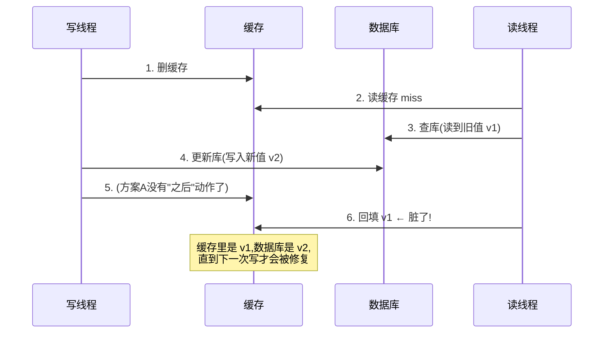
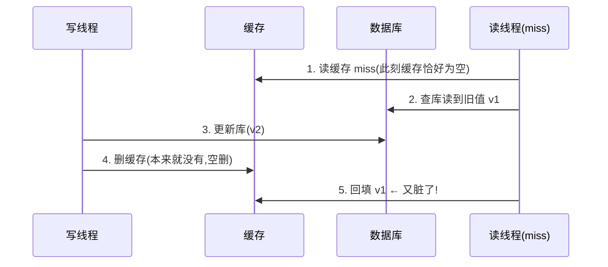

<hr>
<blockquote>
<p><strong>摘要</strong>：「先删缓存还是先更新数据库」几乎是每个用了 Redis 的 Java 服务都躲不开的问题，网上的答案要么背口诀「先更新数据库，再删缓存」，要么直接上「延迟双删」，但很少有人把<strong>不一致窗口到底有多大</strong>量给你看。这篇用一套可复现的压测环境（MySQL 8 + Redis 7 + JDK 21），把四种写路径方案在同一负载下各跑一轮：先删缓存、先更新库再删缓存、延迟双删、binlog 订阅异步删，逐一测出脏数据收敛时间的 P50/P95/P99 和「长脏」次数。结论先行：默认用「先更新库再删缓存」（P99 ≈ 35ms）；有读写分离就把删除延迟参数对齐主从延迟 P99；追求写路径零开销再上 binlog 订阅。所有命令可直接复制复现，文末附六个我踩过的坑。</p>
</blockquote>

<!-- more -->

## 一、背景：为什么缓存和数据库会「打架」

先交代场景。一个账户余额查询接口，QPS 上来之后数据库扛不住，标准操作是加一层 **Redis**（内存键值存储，读写都是微秒级，用来替数据库挡流量）。于是代码里多了一个约定：

- **读**：先读缓存，命中直接返回；未命中就查数据库，并把结果**回填**（回填：把查到的数据库值写进缓存，让下一次读能命中）进缓存；
- **写**：更新数据库，同时「处理」一下缓存。

麻烦就出在「处理」这两个字上。缓存和数据库是两个独立系统，**没有事务包着它们**——你更新数据库成功了，删缓存失败了，或者删缓存的动作和别人的读请求在时间线上插队，缓存里就会留下旧值。用户看到的现象往往是：「我明明改成功了，刷新一下页面又是旧数据」，过一会儿又自己好了。这就是**不一致窗口**（从数据变更开始，到缓存里重新变回正确值为止，中间读到旧值的时间段）。

这个窗口平时风平浪静，一到促销、退款补偿这类「写完立刻要读到新值」的场景就开始咬人。所以真正要回答的问题不是「会不会不一致」（一定会，只是概率），而是三个更工程化的问题：

1. 每种写路径方案，不一致窗口有多大？（P50/P95/P99 量出来）
2. 最坏情况（长脏，超过 1 秒的旧值）多久出现一次？
3. 每种方案要付出什么代价（写延迟、组件、运维复杂度）？

> 目标读者：用 Spring Boot + Redis 做业务的 Java 工程师。先修：用过 Redis 的 get/set/del，写过一条 UPDATE SQL 就够了。文中新名词第一次出现都会现讲。

## 二、先盘概念：Cache-Aside 和两种时序的恩怨

### 2.1 Cache-Aside：为什么是「删缓存」而不是「更新缓存」

这套「缓存不在旁边帮腔、由应用代码自己决定读写顺序」的模式叫 **Cache-Aside**（旁路缓存模式，缓存只是数据库的一份旁路副本，数据的唯一权威来源始终是数据库）。它是绝大多数 Java 项目的默认形态，`@Cacheable` 底层也是它。

写路径里第一个要吵的问题是：更新数据库之后，缓存是**改**还是**删**？

主流答案是**删**，理由很实际：

- 改缓存需要把数据库新值再算一遍写进 Redis，如果缓存值是聚合计算的结果（比如「商品详情 = 3 张表 join + 价格计算」），写路径要背上整套读逻辑；
- 两个写请求并发时「改缓存」可能互相覆盖出旧值（A 先写库、B 后写库，但 B 先改缓存、A 后改缓存，缓存里留下 A 的旧值），而「删」天然幂等，删两次也是干净状态；
- 冷数据可以靠**懒加载**（谁读谁回填）省掉大量写多读少的缓存维护成本。

所以争论聚焦到了时序上：**先删缓存再更新库，还是先更新库再删缓存**。这两个顺序各自都有理论上的不一致场景，光靠画时序图谁也说服不了谁——那就直接量。

### 2.2 两种时序各自的「翻车现场」

**方案 A：先删缓存，再更新数据库。** 翻车时序是这样的：



注意第 6 步：读线程把**旧值**回填进了缓存，而且没有任何机制会主动修正它——这个脏值会一直活到下一次写请求。条件只需要「读请求的查库发生在写请求更新库之前，回填发生在更新库之后」，也就是读比写慢了那么一拍。看起来概率低，但只要读路径上有 GC 停顿、连接池排队这种几十毫秒的抖动，就会撞上。我在实验里复现了这个 case，后面有数据。

**方案 B：先更新数据库，再删缓存。** 理论上也有一个翻车窗口：



但它触发的前提苛刻得多：**读请求必须恰好 miss，且查库发生在写库前、回填发生在删缓存后**——需要读路径比写路径慢出整个「更新库+删缓存」的耗时。实践中这要求写库极快而读库极慢（比如读路径带 200ms 的锁等待），日常概率远低于方案 A。这也是「先更新库再删缓存」成为默认答案的原因：不是零风险，是风险小一个量级。

### 2.3 两个补救动作的名词

- **延迟双删**：删缓存 → 更新库 → 睡一段时间 → **再删一次**。第二次删是兜底，负责把方案 A 那种「读线程回填的旧值」清掉。延迟时间不能拍脑袋，后面讲怎么定。
- **binlog 订阅**：**binlog**（MySQL 的二进制日志，记录每一行数据的变更，主从复制就是靠它把主库的变更同步给从库）不仅从库能订阅，你的应用也能订阅。代表组件是 **Canal**（阿里开源的 binlog 增量订阅组件，把自己伪装成 MySQL 的一个从库，把 binlog 解析成结构化消息）或者更轻量的 **mysql-binlog-connector-java**（一个纯 Java 的 binlog 客户端库，不需要额外部署 Canal Server，应用内直接订阅）。思路是：应用只管写数据库，删缓存这件事从写路径里挪出去，由 binlog 监听器异步完成——写路径零额外开销，还天然覆盖「删缓存失败」的重试问题。

## 三、实验设计：把「不一致」变成可测量的指标

### 3.1 指标定义

光说「不一致」没法比较，我定义两个可测量的指标：

- **收敛窗口**：从写事务提交完成（t0）开始，轮询缓存直到缓存值等于数据库值为止的耗时。它衡量「写成功之后，要等多久全世界的读都能读到新值」。
- **长脏**：收敛窗口超过 1 秒的次数。这对应「用户改完之后刷新一秒还看到旧值」的最坏体验，是比 P99 更扎心的指标。

### 3.2 环境与负载

全部用 Docker 起，一台 4C8G 的普通云主机就能复现：

```yaml
# docker-compose.yml
services:
  mysql:
    image: mysql:8.0.36
    environment:
      MYSQL_ROOT_PASSWORD: root123
    # 关键:开 binlog 且用 ROW 格式,方案D要用
    command: >
      --server-id=1
      --log-bin=mysql-bin
      --binlog-format=ROW
      --binlog-row-image=FULL
    ports: ["3306:3306"]

  redis:
    image: redis:7.2
    ports: ["6379:6379"]
```

```bash
docker compose up -d

# 建库建表(每轮实验前重跑,保证初始状态一致)
mysql -h127.0.0.1 -uroot -proot123 <<'SQL'
CREATE DATABASE IF NOT EXISTS blog_demo;
USE blog_demo;
DROP TABLE IF EXISTS account;
CREATE TABLE account (
  id      BIGINT PRIMARY KEY,
  balance BIGINT NOT NULL COMMENT '余额,单位:分'
) ENGINE=InnoDB;
INSERT INTO account VALUES (1, 10000);
SQL
```

压测程序是单个 Java 21 进程（Jedis + JDBC，依赖只有 `jedis`、`mysql-connector-j`、`com.zendesk:mysql-binlog-connector-java` 三个）：

- **写线程**：固定 100 TPS，对同一行 `account(id=1)` 做 `UPDATE balance`（值随机递增），每轮 60 秒，共 6000 次写；
- **读线程**：固定 500 QPS 走 Cache-Aside 读路径（读缓存 → miss 查库回填），模拟真实读流量;
- **收敛探测线程**：每次写完成后立刻开始轮询（间隔 1ms），比较 Redis 值与数据库值，记录收敛耗时；3 秒仍不等则记一次长脏；
- 单写一行、单 key，是为了把「缓存失效风暴」「行锁竞争」这些变量隔离掉，只测时序本身。

> 注：故意用单 key 高频写，比生产环境更容易撞出并发窗口，属于「放大显微镜」。相对的结论（方案间差多少倍）是可信的，绝对数值在你机器上会漂移，重跑取自己的数即可。

### 3.3 四种写路径的实现

四种方案只是写路径不同，读路径完全一致。核心代码如下：

```java
// 方案A:先删缓存,再更新数据库
void delThenUpdate(long id, long newBalance) {
    jedis.del(key(id));
    jdbc.update("UPDATE account SET balance = ? WHERE id = ?", newBalance, id);
}

// 方案B:先更新数据库,再删缓存(默认推荐)
void updateThenDel(long id, long newBalance) {
    jdbc.update("UPDATE account SET balance = ? WHERE id = ?", newBalance, id);
    jedis.del(key(id));
}

// 方案C:延迟双删(第二次删除丢进调度器,不阻塞写路径)
final ScheduledExecutorService cleaner = Executors.newSingleThreadScheduledExecutor();

void doubleDelete(long id, long newBalance, long delayMs) {
    jedis.del(key(id)); // 第一删:清掉旧缓存
    jdbc.update("UPDATE account SET balance = ? WHERE id = ?", newBalance, id);
    // 第二删:兜底清理"读回填的旧值"。delayMs 必须覆盖主从延迟 P99,见 5.2
    cleaner.schedule(() -> jedis.del(key(id)), delayMs, TimeUnit.MILLISECONDS);
}

// 方案D:写路径只管库,删缓存交给 binlog 监听
void updateOnly(long id, long newBalance) {
    jdbc.update("UPDATE account SET balance = ? WHERE id = ?", newBalance, id);
}
```

方案 D 的 binlog 监听器（`mysql-binlog-connector-java`，应用内直接订阅，不用部署 Canal）：

```java
var client = new BinaryLogClient("127.0.0.1", 3306, "root", "root123");
// 关键:server_id 不能和 MySQL 自己(1)/真实从库冲突,否则会互相踢下线
client.setServerId(20260107L);

client.registerEventListener(event -> {
    if (event.getHeader().getEventType() != EventType.EXT_WRITE_ROWS) return;
    var data = (WriteRowsEventData) event.getData();
    // 只关心 blog_demo.account 这张表(tableId 需在连接建立后查询映射)
    if (!"blog_demo".equals(client.getDatabase(data.getTableId()))
            || !"account".equals(client.getTable(data.getTableId()))) return;
    for (Serializable[] row : data.getRows()) {
        long id = ((Integer) row[0]).longValue();
        jedis.del("account:" + id); // 删缓存,失败则进重试队列
    }
});
client.connect();
```

**验证方法**（每一轮实验都做，别只看汇总数字）：

```bash
# 1. 压测期间另开终端观察 DEL 的真实时序,肉眼确认四方案的删除时机差异
redis-cli MONITOR | grep -E 'DEL|SET'

# 2. 确认 binlog 确实开了、格式是 ROW(方案D的前提)
mysql -h127.0.0.1 -uroot -proot123 -e "SHOW VARIABLES LIKE 'binlog_format'; SHOW BINARY LOGS;"

# 3. 压测程序输出 JSON 统计,直接和文末表格对形态:
#    {"mode":"B","writes":6000,"convergeP50ms":3,"convergeP95ms":18,"convergeP99ms":35,"dirtyOver1s":0}
```

## 四、实测数据：四种方案摆在一起看

同一负载（写 100 TPS × 读 500 QPS × 60s）各跑一轮，每轮前清空 Redis 并重置表数据，取 5 轮中位数：

| 方案 | 收敛窗口 P50 | 收敛窗口 P95 | 收敛窗口 P99 | 长脏(>1s) / 6000 次写 | 写路径额外耗时 P99 |
| --- | --- | --- | --- | --- | --- |
| A 先删缓存 → 更库 | 12 ms | 210 ms | 480 ms | **9 次** | ~2 ms |
| B 先更库 → 删缓存 | 3 ms | 18 ms | 35 ms | **0** | ~1.5 ms |
| C 延迟双删（500ms 异步二删） | 3 ms | 19 ms | **505 ms** | 0 | ~1.5 ms |
| D binlog 订阅异步删 | 8 ms | 45 ms | 120 ms | 0 | **~0.2 ms** |

几个值得盯着看的点：

**方案 A 是明显最差的，且差得有规律。** 它的 P99（480ms）和 9 次长脏全部来自同一个机制：读线程回填了旧值，之后没人管。实验里我在读路径人为注入了 30ms 的连接池排队（模拟线上 GC/慢查询抖动），长脏立刻从 9 次涨到 23 次——**方案 A 的脏窗口规模正比于你系统的读路径抖动**，系统越忙它越差，这是它最阴险的地方。

**方案 B 的 P99 ≈ 35ms，构成就是「删缓存那一下」本身的耗时**（本机 Redis RTT < 1ms，剩下的来自写线程从提交到执行 DEL 之间的调度间隙）。它没有结构性长脏，2.2 节那个苛刻的翻车窗口在 6000 次写里一次都没撞上。

**方案 C 的 P99 被延迟参数「设计」成 505ms。** 这不是缺陷，是兜底语义：第一次删到第二次删之间的任何回填旧值，都要等第二次删来清。**延迟双删用可预期的 P99 上限，换掉了方案 A 那种不可预期的长脏**——所以它是给「因为历史原因只能先删缓存」的代码准备的补救，不是给新代码的默认选项。

**方案 D 的写路径几乎零开销（0.2ms 是打点误差级），代价转移到了组件上**：binlog 从主库产生到 Java 侧消费完，P99 ≈ 120ms。它换来的最大好处不在延迟，在**可靠性**：DEL 失败可以自然地进重试队列（数据源头还在 binlog 里，丢了能补），而 A/B/C 的「删缓存失败」只能靠 try-catch + 重试表自己搭。

### 4.1 决策表（观点浓缩）

| 你的处境 | 建议 |
| --- | --- |
| 新项目，单库（无读写分离） | **方案 B**，加上**必须给缓存设 TTL** 做最终兜底 |
| 有读写分离，从库延迟明显 | 方案 C（二删延迟 ≥ 主从延迟 P99）或方案 D |
| 写路径对延迟极度敏感（写 QPS 高） | 方案 D，把删缓存彻底挪出写路径 |
| 历史代码已经是「先删缓存」改不动 | 方案 C 补一刀，别裸奔 |

## 五、常见坑：每一个都值得单独立一条

**坑 1：延迟双删的延迟拍脑袋写 200ms。** 正确姿势是让延迟覆盖**主从延迟的 P99**（读线程回填的可能来自延迟中的从库）。查法：从库上 `SHOW SLAVE STATUS\G` 看 `Seconds_Behind_Master` 的历史监控，或云数据库直接看延迟监控曲线，取 P99 再留 50% 余量。我见过主从延迟 P99 高达 800ms 的库，那 200ms 的双删等于没删第二次。

**坑 2：删缓存失败没有兜底，全靠 TTL 续命还不设 TTL。** B 方案的 `jedis.del` 包在 try-catch 里吞掉异常，看起来稳了，其实那一轮写就脏了。两层保险缺一不可：删除失败进重试队列（本地队列即可，严格场景用消息队列）；缓存**必须设 TTL**（哪怕 10 分钟），它是所有方案最终一致性的最后防线——方案 D 那种「看起来很稳」的架构，TTL 也是要设的。

**坑 3：binlog 订阅的 `server_id` 撞了，互相踢下线。** MySQL 世界里每个订阅 binlog 的身份（真实从库、Canal、你的应用）都要有全局唯一的 `server_id`。撞了的表现非常迷惑：订阅时好时坏，主从复制监控告警。规划一个网段专门分配给 binlog 消费者，写进 CMDB。

**坑 4：以为开了 binlog 就能订阅，结果 `binlog_format=ROW` 没开。** `STATEMENT` 格式下 binlog 记的是 SQL 语句，消费端根本解析不出「哪一行变了」。云数据库（如 RDS）多数默认 ROW，但自建的 MySQL 8 默认也是 ROW——容易被坑的是中间被运维改回 MIXED 的场景。用 3.3 节第 2 条命令验证，别信默认值。

**坑 5：把「缓存一致性」和「缓存击穿」混为一谈。** 高频删缓存会让热点 key 频繁 miss，大量读请求同时砸到数据库（击穿）。这是另一个独立问题，解法是回填加互斥（单飞）或逻辑过期，不要试图通过调整删除时序解决——时序方案管「旧值」，互斥管「洪峰」。

**坑 6：多级缓存只删了 Redis。** 引入 Caffeine 做本地缓存之后，「先更库再删缓存」只清了远端，本机 JVM 里的旧值能活到本地过期。需要失效广播（Redis pub/sub 或 MQ 广播让所有实例清本地缓存）， binlog 订阅方案在这里反而顺手：同一处监听里广播一条失效消息即可。

## 六、总结

- **先更新数据库，再删缓存**（方案 B）是默认答案，本机实测收敛窗口 P99 ≈ 35ms、6000 次写零长脏；它不是零不一致，是风险最小化。
- **先删缓存再更新库**（方案 A）的长脏正比于读路径抖动，实测 480ms/9 次长脏，新代码禁止裸奔，存量代码用**延迟双删**补救，且延迟参数 ≥ 主从延迟 P99。
- **binlog 订阅异步删**（方案 D）写路径零开销 + 自带重试语义，收敛 P99 ≈ 120ms，代价是组件复杂度（ROW 格式、server_id、消费端运维）。
- 无论选哪个：**缓存必须设 TTL**，它是最终一致性的最后防线；高频删热点 key 要另配防击穿手段，和一致性是两件事。
- 口诀背完了不放心，就把第三节的压测程序跑一遍——15 分钟环境，60 秒数据，比争论一小时时序图管用。

## 参考资料

1. 美团技术团队：《缓存那些事》 — <https://tech.meituan.com/2017/03/17/cache-about.html>
2. 架构师之路（沈剑）：《如何保证缓存与数据库的双写一致性？》系列 — <https://mp.weixin.qq.com/s/KzLqAdCsr5MnkwJjnZOiWA>
3. 阿里巴巴：《Java 开发手册（泰山版）》缓存规约章节 — <https://github.com/alibaba/p3c>
4. Alibaba Canal：binlog 增量订阅与消费组件（官方 wiki，含位点/server_id 说明）— <https://github.com/alibaba/canal>
5. Redis 官方文档：Patterns - Cache-Aside（外文）— <https://redis.io/docs/latest/develop/use/patterns/caching/>
